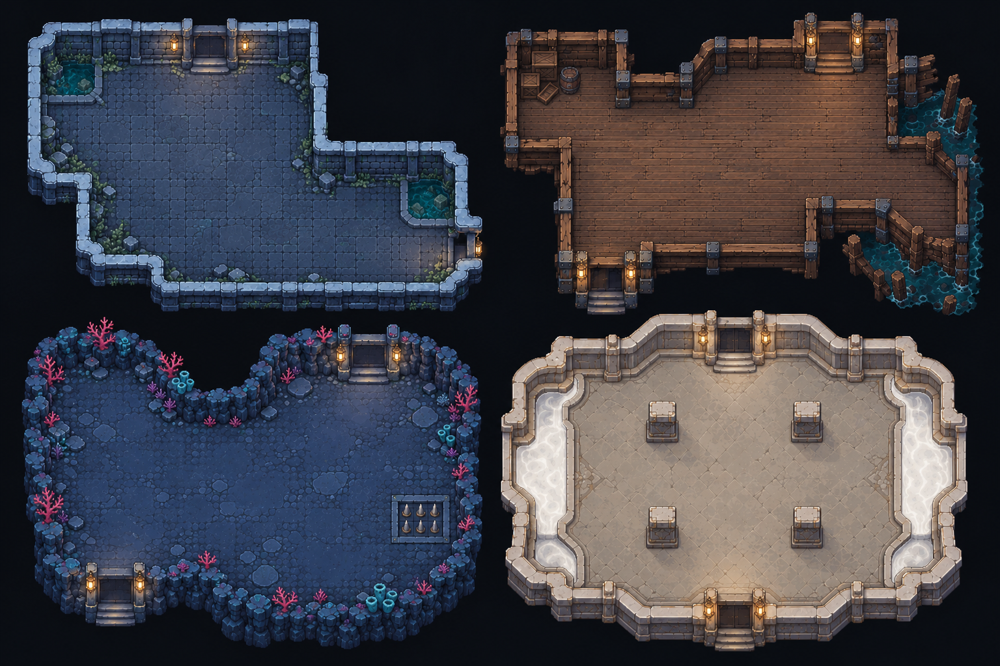

# #114 地图美术源文件

当前资源的带图风格基准、完整类别索引及新增主题提示词见 [地图美术风格手册](../../docs/MAP_ART_STYLE.md)。下文早期版本均为来源历史；实际采用 v18 同色边框墙体、已确认的十款方砖 ground-v7 和其余 v3 图集。

负责人于 2026-10-27 指定 GPT 负责地图画面、资源生成与工程实现；Claude 主责仅怪物 AI 和武器设计，同时继续复审 GPT 完成的工作。

## 已确认的四主题 v2 概念图

负责人已确认：“这次生成的概念图没啥问题了”。该确认针对概念图方向，不代表生产素材、游戏内走位、碰撞、真机或性能已验收。

- 文件：`art-src/maps/map-themes-v2.png`。
- 来源：2026-10-27 使用内置 imagegen 生成 v1，再按负责人反馈用 imagegen 编辑为 v2；未用 CLI/API fallback。v2 原始 PNG 原样复制，没有二次缩放、压缩或像素编辑。
- 提示词：[v1 原始生成](prompts/map-themes-v1.md)、[v2 修改](prompts/map-themes-v2.md)。v1 已被 v2 替代，不作为生产视觉依据。
- 尺寸：1536×1024；2,538,003 字节；不透明 PNG。
- SHA-256：`03ec2b1e00aa7a7f1aed0024cd7966028286a64e9268e48d6d12e677ffc6bdf4`。
- Git blob：`5d7878d9c574ccae270cd9095d859948c17e1ad7`。
- 来源为本项目 AI 生成设计素材，未使用外部下载的美术或品牌素材。

## 已确认方向与生产约束

四格为海底石殿、沉船货舱、珊瑚深渊和奶池神殿。移除贝壳标记，保留一致的材质精度与清楚的地形收口；水体收在边缘、主战斗区连续宽敞，机关有嵌入地板的底座。

- GPT 采用房间内部至少 80% 可通行的设计目标，最终按几何/碰撞数据核算。还要验证身体半径净空、连通性和主战斗区宽度，不能只有面积数字。
- 奶池地板及液体仍须与奶白 Boss 提示、角色和弹体同屏检验。无角色概念图不等于攻击可读性已经达标。
- 图中轮廓、门朝向、池岸、柱体足迹尚未绑定物理数据；水体示意不构成新增玩法规则。
- 生产素材按地板、直墙、内外角、四向门洞、岸沿/地面过渡、障碍与机关全状态模块制作；统一实际尺寸、像素密度、锚点、透明边界和遮挡。禁止依靠每间房单画背景才能扩容。
- **每层 100–200 间指可供生成器选择的候选房间模板库，绝不是单局一层生成 100–200 个房间。** 单局只抽取少量模板；当前普通层 8 房的数量不因此改变，Boss 层仍按既有规则。#115 实现同一次冒险的同层不重复选择。
- 同层候选库扩到 100–200 间时只增加布局数据，不新增美术资源。当前概念图不是可平铺图集，也不是游戏运行截图；资源组合覆盖和正式房间库均尚未实现。
- 本图仅存于 `art-src/`，不进运行时包或 Workbox 预缓存；大于 2 MiB 的概念源图不能直接当作生产 PNG。

下一步由 GPT 完成地图几何/旧档兼容 ADR、模块资产与接入，按[接入审计](../../docs/design/map-redesign-audit.md)验证后交 Claude 复审；负责人做游戏内与真机验收并合并。#114 仍进行中，#115–#119 按顺序排队。

## 生产模块 v1（历史，已被 v3 替代）

以下为概念图方向的生产接入，前述“尚未实现”描述保留作概念阶段历史。由内置 imagegen 为本项目生成，没有下载外部素材；不把概念图认可写成新素材已经获负责人确认。

| 原图 | 内容 | 运行时 | 字节数 |
| --- | --- | --- | ---: |
| `sources/terrain-v1.png` | 四主题地板、墙顶、墙面、障碍材质共 16 帧 | `map-terrain-v1.webp` | 2,061,738 |
| `sources/doors-v1.png` | 四主题 × 四方向 × 开/锁，共 32 帧 | `map-doors-v1.webp` | 1,660,546 |
| `sources/objects-v1.png` | 地刺三态、水流、海草、桶三态、地雷两态、宝箱两态、水晶及装饰 | `map-objects-v1.webp` | 940,436 |

原图原样保存，完整提示词在 [modular-v1.json](prompts/modular-v1.json)。`python art-src/maps/export_modules.py` 仅导出无损 WebP 和帧矩形元数据，不重画、不缩放源图；每张重解码后比较 RGBA 字节。尺寸、摘要与逐像素相同结果见 [export-report.json](export-report.json)。帧数据生成后按仓库 Prettier 格式化。

实际组合无需逐房新图：地板平铺，墙带/内外角沿物理 polygon 裁剪，四向门按 port 定位，水流/海草/地刺足迹带主题底座，障碍复用 16 个槽。灯具、苔藓及珊瑚已包含在门体的边缘装饰，单独装饰帧保留在图集中，当前未另放场景摆件。宝箱按现有入房即开箱流程显示开态；闭态为素材储备，不新增开箱机制。

三张运行时图共 4,662,720 字节，全部进入 Workbox 清单；原图不进运行时。旧地图图片本批不删除。实际面积、渲染、离线与性能证据见 [模块接入记录](../../docs/testing/modular-map-art.md) 与 [ADR 0041](../../docs/adr/0041-modular-map-art.md)。

## v2 生产修订（历史）：独立墙体、侧门、地板与障碍

负责人否决初版墙体错向、接缝与参考图差距，授权一批完成画面复修。最终采用独立完整墙体模型，上下门保留，左右门接入新侧门；门位留空，45° 墙不设门。已有 19 房型不扩充，更多布局留 #115。前述 v1 截图为问题证据，不是最终画面。

| 新原图 | 用途 | 无损运行时文件 | 字节数 |
| --- | --- | --- | ---: |
| `sources/ground-v2.png` | 四主题地板，镜像重复匹配边缘 | `map-ground-v2.webp` | 1,901,304 |
| `sources/blocks-v2.png` | 独立障碍，完整块排列 | `map-blocks-v2.webp` | 814,706 |
| `sources/wall-model-v17.png` | 最终接受的亮顶/暗身像素墙体 | `map-wall-model-v17.webp` | 833,946 |
| `sources/side-doors-v2.png` | 四主题左右侧门，各有开/锁状态 | `map-side-doors-v2.webp` | 781,852 |

均由内置 imagegen 制作，无 CLI/API fallback 或其他游戏素材下载。地板、障碍、侧门提示词分别在 `prompts/ground-v2.txt`、`blocks-v2.txt`、`side-doors-v2.txt`；墙体最终以负责人上传的 `sources/wall-owner-selected.png` 为输入，经内置 imagegen 去黑框/平直外缘得到 `wall-edges-v16.png`，再大幅压暗墙身并转像素风得到 `wall-model-v17.png`，负责人明确接受并要求提交四向门实景。完整两步提示词见 `prompts/wall-model-v17.txt`；此前 v12 原图与提示词仅保留为历史来源，不再预加载旧 v12 WebP。早期拆分部件、亮色粗描边等被否决草稿不作为最终素材。

源 PNG 原样保存，导出器只无损编码和帧矩形测量，不重画源像素。七张 WebP 共 8,994,528 字节，较初版三张增加 4,331,808 字节，均逐像素 RGBA 相同且各 <2 MiB。

原图已经是完整相连模型，不拼接旧素材；源图的视觉比例不能当作精确几何。渲染器读取同一模型的顶/身区域，校准为 80×80 正方形顶部 +80×96 墙身，严格保证下部高宽比 1.2，顶部另算；世界尺寸为 8×8 与 8×9.6。最近邻采样保留像素感，材质色实心底色填满整块平直长方形，确保连接处同宽、四角完整。此校准不会改写原 PNG。同一个直立模型按 y/x 叠放，不旋转正面；墙体与障碍分别用图。门位留出完整跨度，不用墙块垫底。上下门仍用原 doors-v1，下侧门上移 3.6 世界单位，使顶部与墙带成直线；新左右门用 side-doors-v2。

导出临时文件位于 public 外，避免半写资源进入 PWA。生成帧数据后运行 Prettier；最终整房、侧门开/锁、转角与密集场景截图见 [画面验证](../../docs/testing/wall-art-v2.md)。原始生成图不能替代游戏内像素尺寸和画面验收。

## 当前 v3：以 v17 为基准重绘其余全部地图资源

负责人暂停 Claude 复审并要求所有地图美术统一。墙体原图不变；下面八组均由内置 imagegen 以 v17 作风格参考独立新绘，原始 PNG 原样保存，没有拼接旧图或脚本绘画。完整提示词逐组见 [unified-v3](prompts/unified-v3/)。本轮没有新依赖、外部下载美术或 CLI/API 图像生成 fallback。新素材尚待负责人实景确认。

| 原图 | 内容与帧数 | 运行时文件 |
| --- | --- | --- |
| `ground-v3.png` | 石殿/沉船/深渊/奶池地板，4 | `map-ground-v3.webp` |
| `blocks-v3.png` | 四主题独立矮障碍，4 | `map-blocks-v3.webp` |
| `horizontal-v3.png` | 四主题 × 上/下 × 开/锁，16 | `map-horizontal-v3.webp` |
| `vertical-v3.png` | 四主题 × 左/右 × 开/锁，16 | `map-vertical-v3.webp` |
| `mechanisms-v3.png` | 地刺闲置/预警/激活，水流，海草，桶正常/受击/破碎，地雷正常/点亮，宝箱闭/开，出口水晶，灯具、苔藓、珊瑚，16 | `map-mechanisms-v3.webp` |
| `rims-v3.png` | 四主题嵌地边框，4 | `map-rims-v3.webp` |
| `hub-v3.png` | 主城祭台，金币/生命/能量补给，4 | `map-hub-v3.webp` |
| `effects-v3.png` | 落石、奶池、毒雾、碎屑，4 | `map-effects-v3.webp` |

八组共 68 个新帧，加保留墙体的 8 个顶/身采样帧，共 76 帧。横门宽、竖门高都是六个 8 单位墙块；启动时统一几何与实心矩形，原图文件不改写。墙层挖空和门图定位共享函数。边框按九宫格绘制八个边角，中心透明且下面保留地板，适配现有长条机关。地板镜像平铺；障碍透明边缘下始终是同主题地板。

宝箱沿用进入房间即开箱，闭态只是素材储备；灯具/苔藓/珊瑚/碎屑也已重绘但当前不额外放置。角色、怪物、武器、UI 不是地图资源，本轮不重画；其攻击危险区中的落石/奶池/毒雾已统一。攻击提示标记保留负责人既定形式。

九张运行时 WebP 合计 **8,569,012 字节**，较 v17 七图的 8,994,528 减少 **425,516 字节**；各 <2 MiB、源 PNG/WebP 解码 RGBA 全相同，详见 [导出报告](export-report.json)。六张被替代模块 WebP 已移除；旧 PNG 保留历史，旧 LegacyRoomArt 素材仅停止预加载而未清除 Git 历史。实际预缓存与内存见 [本轮验证](../../docs/testing/unified-map-art.md)。

## 地板 ground-v4（历史，已被 v5 替代）

2026-10-28 最新：负责人接受除地板外的 v3 资源和 ground-v4 地板，随后明确恢复相邻贴图块以共同边为轴的镜像铺设；此要求取代此前不镜像的方案。保持已确认素材、去暗边/黑框和略提亮的方向，完整保留原图砖缝，取消 12 块程序地砖重排。地板更新仍按负责人要求免跑验证和实机截图；旧测试、性能及截图只能作为历史。恢复 Claude 复审，等待新 head 评审时保持 Draft，通过后交负责人合并；不改 main、不触发远端 CI。

原稿 `sources/ground-v4.png` 使用内置 imagegen 编辑仓库 ground-v3，原样保存；完整提示词见 [ground-v4.txt](prompts/ground-v4.txt)。运行图为 `map-ground-v4.webp`，旧运行 ground-v3 移除，其余八张运行图不变。导出只无损编码；按负责人最新要求，运行时对完整主题帧进行 2×2 镜像铺设，让相邻贴图块沿共同边轴对称，保留原图砖缝。此前 12 块程序地砖重排已移除，额外整层压暗与内缘描边仍关闭。提示词记录当时素材生成要求，最终运行铺法以本节最新要求为准。中间规则方砖/连续颗粒试稿未采用、未提交。

见 [地板增量与验证豁免](../../docs/testing/ground-v4.md)。上文素材表和体积属于此前 v3，最新地板记录以 export-report.json 为准。

## 地板 ground-v5（历史）

负责人最新要求为参考图式大小方砖/长方砖交错，清晰砖缝，木地板无圆形木结；上下/左右砖缝对应，整体材质和像素细节匹配 v17 墙体与 v3 门。先绘制可周期平移的几何参考 `sources/ground-v5-layout-guide.png`，再使用内置 imagegen 参考该布局与 v17 墙体生成完整图集；未使用 CLI/API fallback。完整提示词见 [ground-v5.txt](prompts/ground-v5.txt)。截图仅作砖块结构参考，未复制其中图片像素或水印。

最终原图为 `sources/ground-v5.png`（1254×1254），四主题帧均 627×627；原样保存，没有代码重绘、缩放或像素修补。运行图 `map-ground-v5.webp` 仅无损编码，RGBA 逐像素相同，旧运行 v4 删除，v4 原稿保留历史。布局参考只是生成输入，不在运行时加载；其余八张图集不变。

每个完整帧按最近邻绘制到 256×256 pattern，对应 32×32 世界单位，直接平移重复，不旋转、不镜像，不以局部纹理重建砖缝。风格一致性不代表已获负责人对最终游戏画面的确认。地板更新继续免跑游戏验证/截图，文件完整性核对见 [地板 v5](../../docs/testing/ground-v5.md)。体积与摘要以 export-report.json 为准。

负责人最后确认当前砖块结构，仅要求整体调淡、略提亮并降低饱和度/纹理对比，以便看清人物和怪物；最终 ground-v5 已由 imagegen 按此调整，源 PNG 原样保留。

## 历史地板 ground-v6（#135，已由 v7 取代）

负责人要求改为无砖缝的纯像素材质，保留冷蓝灰/暖棕/靛蓝/暖砂四主题配色。使用内置 imagegen 重绘并迭代去掉长纹与醒目斑点，最终原稿原样保存为 [ground-v6.png](sources/ground-v6.png)，提示词见 [ground-v6.txt](prompts/ground-v6.txt)。没有程序补边、模糊、旋转或镜像；完整帧仍直接平铺。

原稿 1,537,333 字节，运行 WebP 1,136,944 字节，解码 RGBA 相同。旧运行 v5 删除，原始 v5 配色参考保留；其余八张图集不变。九图合计 8,485,908 字节，较 v5 减少 144,248 字节；此为当前文件体积，未缩减 Git 历史。更新后的规范与实际图片见 [风格手册](../../docs/MAP_ART_STYLE.md)，游戏验证见 [#135](../../docs/testing/floor-actor-layers.md)。

## 当前地板 ground-v7（#137）

负责人已确认四主题各十款方砖并授权上传，取代 #136 的纯纹理地板。内置 imagegen 生成，未用 CLI fallback；原始 PNG 原样保留。源图为 `sources/ground-temple-v7.png`、`ground-wreck-v7.png`、`ground-abyss-v7.png`、`ground-milk-v7.png`，均 1983×793。完整提示词（含最终细边修正）见 [ground-v7.json](prompts/ground-v7.json)。

运行对应四张 `map-ground-<theme>-v7.webp`，无损编码、RGBA 与原稿一致。每图 5×2 切出十款，运行时以最近邻缩到墙宽 8×8，并统一 1 缓存像素外边；不旋转/镜像。具体边色、采样、固定随机、未来生成规则见 [风格手册](../../docs/MAP_ART_STYLE.md#5-地板墙宽方砖同色细边十款随机铺设)。旧运行 v6 移除，历史源图保留；尺寸/摘要见 [导出记录](export-report.json)。

## #137 墙体边框 v18

负责人要求将 v17 的黑色边框改成对应材质色；通过 imagegen 编辑为 `sources/wall-model-v18.png`，原稿原样保留，1774×887。提示词见 [wall-model-v18.txt](prompts/wall-model-v18.txt)，运行图为 `map-wall-model-v18.webp`，RGBA 与原稿一致。沿用原来的顶/身采样、80×80 + 80×96 归一化、8 单位模块和门洞；旧运行 v17 删除，原稿保留历史。原稿颜色与局内门墙连接效果仍待负责人验收。
