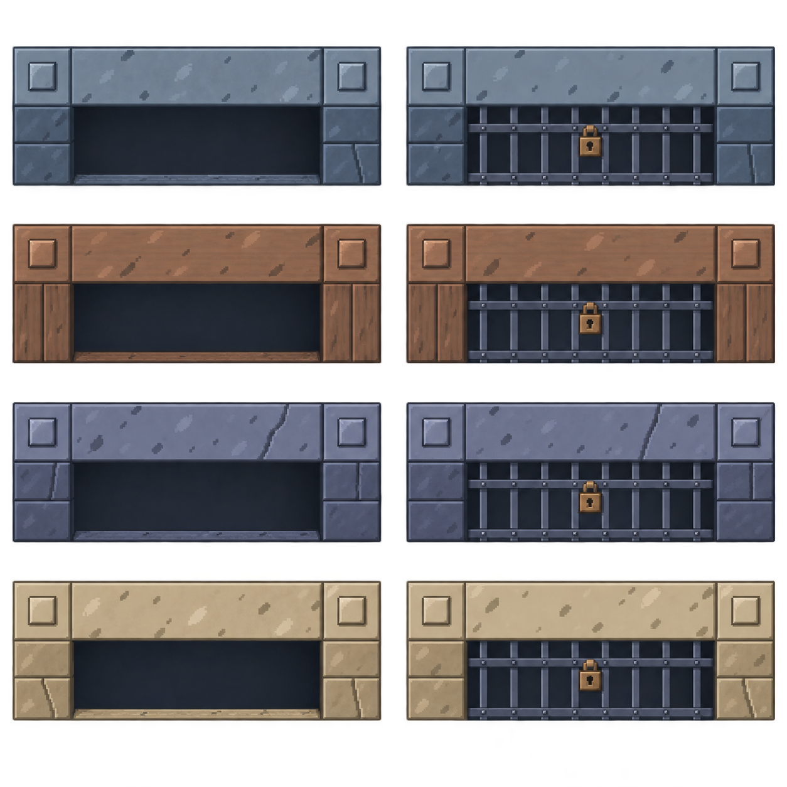
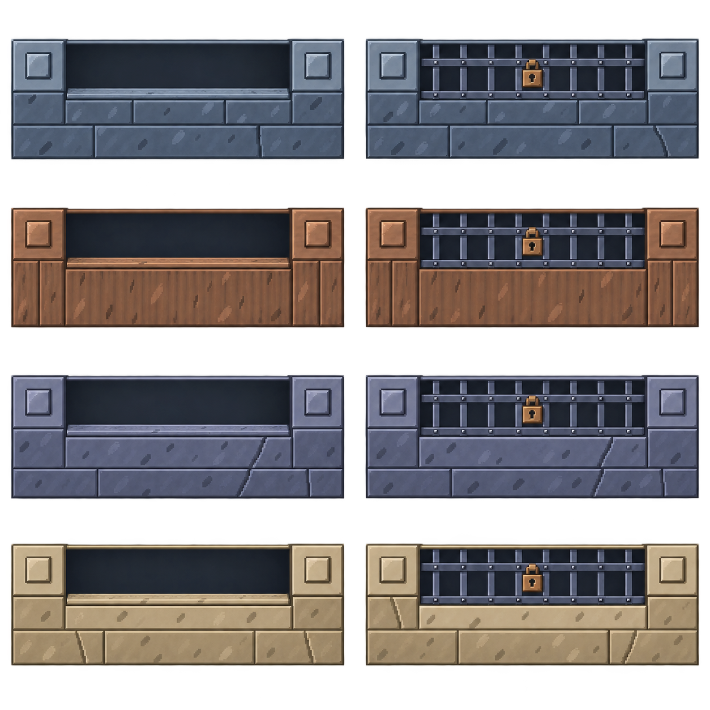

# 地板风格地图重绘：整批应用

生产基线为 #138 合并后的 main `a400fbabaa171bfb1ce7dc5a0ce75fdad0d9f641`。本批在 `gpt/114-floor-style-redraw` 准备，负责人已授权一次性完成剩余绘制并整批应用；本分支已接入运行时，main 与远端 CI 不操作。验证见 [工程记录](../../../docs/testing/floor-style-redraw.md)。

## 最新要求

- 以已确认 ground-v7 地板为风格模板重绘全部地图资源，负责人随后改为一次性完成剩余绘制并应用，不再逐项停下。
- 必须依据局内实际比例绘制；整块和内部构件均检查，只允许等比缩放，不能将旧源图压扁或拉长。
- 墙体为四主题各三款，同主题随机铺设；顶面/墙身成对抽选，独立表现随机，不影响地板或玩法随机，重进与同版本恢复稳定。

| 项目 | 设计尺寸（像素，10 px/世界单位） | 世界尺寸 | 审核状态 |
| --- | --- | --- | --- |
| 完整墙体 | 80×176，顶部80×80，墙身80×96 | 8×17.6 | 上传原件外观已选定，生产切帧与接入待完成 |
| 北侧横门 | 480×176，上段80高，下段96高 | 48×17.6 | 四主题开/锁外观已确认，生产切帧待验收 |
| 南侧横门 | 480×176 | 48×17.6 | 四主题开/锁外观已确认，生产切帧待验收 |
| 东/西侧门 | 80×480，两端各80×80，中段80×320 | 8×48 | 四主题、两方向、开/锁共16帧已选定并接入 |

## 墙体定稿

负责人上传的 [wall-variants-v19-approved.png](../sources/wall-variants-v19-approved.png) 为唯一选定原件，不再改造型，也不用后续生成稿替代。原件1086×1448，1,418,900字节，SHA-256 `e9cbf46c6b37fd01a26805ef2a62b2bc0d0e9e5e55db710b43839915fc24905f`。左到右：石殿、沉船、深渊、奶池；上到下：各主题三款。来源和提示词见 [wall-variants-v19.json](../prompts/wall-variants-v19.json)。

原稿尚未通过逐帧几何与透明边缘验收，不能把提示词的目标尺寸当作实际测量结果，也不能沿用当前 `wallModule` 分别拉伸顶部和墙身的做法。外观确认不代表随机功能已实现或已通过局内验收。

负责人再次上传《四主题十二款像素墙体(2).png》并强调“不要忘了我认可的是这一版的墙体”。已与保存原件做字节及RGBA核对，完全一致；原件不作任何替换或重绘。后续门、障碍等使用此原件为材质参考，不使用其他墙体试稿。

## 北侧横门：外观已确认

每行依次为石殿、沉船、深渊、奶池。负责人回复“可以”，本稿外观通过，定稿副本为 [north-gates-v4-approved.png](../sources/north-gates-v4-approved.png)。尚未接入，也未标记精确切帧/透明边缘验收通过。提示词见 [north-gates-v4.json](../prompts/north-gates-v4.json)。以上为此前逐项审核记录；当前整体应用状态见下方。

## 南侧横门：外观已确认

独立绘制南侧方向，使用北门和墙体定稿为材质参考。负责人回复“确认，可以继续”，外观通过，定稿副本为 [south-gates-v4-approved.png](../sources/south-gates-v4-approved.png)。保持统一左上光照；目标完整帧480×176。原稿尚未接入，提示词和目标尺寸不代替实际几何验收。提示词见 [south-gates-v4.json](../prompts/south-gates-v4.json)。以上为此前逐项审核记录。

## 左右侧门：v4d已确认

四组按左上石殿、右上沉船、左下深渊、右下奶池排列。每组四帧从左到右为东门开、东门锁、西门开、西门锁。目标单帧80×480，两端帽各80×80，中段80×320；独立绘制两个方向，保持左上光照。

初稿1217×1293，已检查16帧数量和方向；不透明主体约98–100×573–574，尚未通过生产切帧、端帽对齐与透明边缘验收。接入必须保持等比，不能把原稿分别拉伸到目标尺寸。初稿提示词见 [side-gates-v4.json](../prompts/side-gates-v4.json)。

负责人补充：开启状态的底色应与主色调一致；随后明确“黑色阴影不要变，大幅度调暗”。v4b偏亮，v4c压暗了主题底色，但仍有错误的上暗下亮纵向光照。

最新要求为靠近开口亮、洞内深处暗。当前送审v4d（1216×1294）沿侧门横向进深着色：东门左亮右暗，西门右亮左暗，去掉底部亮地板和纵向渐变，深处保留近黑阴影。八个开启门左右采样亮度方向8/8正确，具体数值和提示词见 [side-gates-v4d.json](../prompts/side-gates-v4d.json)。这仅是源图验证，未接入游戏。负责人已回复“没问题”，v4d正式选定。南北门原确认稿保留，本批v4b统一洞内明暗并接入。

## 整批应用：当前状态

负责人明确“将这些图片全部投入应用”，并要求四主题水晶与地刺的底座匹配地板。当前15图集/128帧已注册；地板40款保持，墙体12款完整模型独立随机，四向门32态采用单倍率，其他44项含主题扩展。本页前面“未接入/未验收”为各阶段当时状态，当前工程证据以最新记录为准。

| 类别 | 当前原件 | 数量 |
| --- | --- | --- |
| 北/南门洞阴影统一 | [北门](../sources/north-gates-v4b.png)、[南门](../sources/south-gates-v4b.png) | 16态 |
| 四主题障碍 | [blocks-v4.png](../sources/blocks-v4.png) | 4 |
| 四主题边框 | [rims-v4.png](../sources/rims-v4.png) | 4 |
| 四主题水晶 | [crystals-themes-v4.png](../sources/crystals-themes-v4.png) | 4 |
| 四主题地刺 | [spikes-themes-v4.png](../sources/spikes-themes-v4.png) | 12态 |
| 共享机关与物件 | [mechanisms-v4.png](../sources/mechanisms-v4.png) | 12有效帧（旧水晶/地刺格不重复注册） |
| 大厅与补给 | [hub-v4.png](../sources/hub-v4.png) | 4 |
| 危险区与碎屑 | [effects-v4c.png](../sources/effects-v4c.png) | 4 |

完整图片、比例、状态和引用统一在 [风格手册](../../../docs/MAP_ART_STYLE.md)。实际调用提示词已归档，新主题必配一水晶和地刺三态，不能再只用通用石殿底座。素材注册不意味着新增装饰或玩法；已有储备帧继续保留，不擅自加入房间生成。
