# 地图美术风格手册：固定参考、比例与生成规范

版本：2026-10-29，#114 地板风格整批重绘与应用。固定基准为 **ground-v7 地板 + 负责人上传的十二款 v19 墙体 + 本批 v4 系列**。负责人已从逐项审核改为一次完成剩余素材，并授权整批投入应用；水晶和地刺必须按主题使用对应底座。工程验证见 [本批记录](testing/floor-style-redraw.md)。合并部署由负责人完成，不把本地接入写成线上已经更新。

本页保留可复用提示词入口，并直接展示实际原稿；v18、其余 v3 以及旧草稿只作为历史，不再作为新主题风格模板。精确调用记录与可复制模板见 [同系列生成 prompt](../art-src/maps/prompts/series-v4.md)。

## 1. 必须一起继承的视觉语言

| 项目       | 固定要求                                                                                                                                                                |
| ---------- | ----------------------------------------------------------------------------------------------------------------------------------------------------------------------- |
| 视角       | 横屏、俯视角的 2D 游戏；用可见顶面和正面表达体积。墙顶在画面中是正方形，不改成菱形等距视角，不加透视消失点。                                                            |
| 像素       | 中等偏细的像素风：轮廓、倒角、明暗由清楚的像素色块表达。不能是写实材质覆一层像素滤镜，也不能粗到明显比地牢门简陋。以同一游戏显示尺寸比较，不以 PNG 分辨率大小判断精度。 |
| 光照       | 以左上/上方受光为基准，顶部与上沿亮，正面和下沿暗；所有方向共享这一世界光照。墙顶与墙身对比明显，地板仅保留较弱的材质对比。不能旋转整张门/墙图导致光照方向乱转。        |
| 形体       | 厚实、紧凑、清楚的大轮廓；直线、矩形、方形凸台和少量倒角为主。装饰服从模块边界，不增加伸出拼接边的花纹。                                                                |
| 线条       | 接合边平直、材质色收边，不给每个墙块叠一圈浓黑外框。内部凹槽、门洞可以深暗，但不能把暗边变成整块贴图的外框。                                                            |
| 纹理       | 先能读懂砖块、木板、金属边，再添加少量斑点/磨损。重复单元不要出现大裂纹、密集噪点、醒目的破损、密集苔藓或贝壳符号。                                                     |
| 主次       | 地板低饱和、整体较淡，方砖纹理与细边不抢眼；墙顶/障碍靠体积区分，交互物与危险信号可局部鲜明。不要把背景整体提到近白，导致奶白攻击和亮色角色看不清。                     |
| 透明与阴影 | 独立物件保留透明外部和自身接触阴影；地面贴图不透明。透明角下必须铺地板，不画矩形黑垫。参考图集周围的预览底色/软光不等于应铺满地面的背景。                               |

## 2. 四主题配色关系

颜色以本页实际图片为准，以下是用途关系，不是要求新图逐像素采用某一固定色表。

| 主题              | 墙/门主体                         | 地板                         | 辅助材质与装饰                            |
| ----------------- | --------------------------------- | ---------------------------- | ----------------------------------------- |
| 海底石殿 `temple` | 冷蓝灰石材，浅灰顶沿，深蓝灰墙身  | 淡蓝灰石材，纹理对比低       | 暗铁、少量浅苔色；小面积青色水晶          |
| 沉船货舱 `wreck`  | 暖棕木材，亮木质顶面，深棕正面    | 较淡棕色木材；简短低对比木纹 | 铁包角/铆钉用于门和构件；地板不画圆形木结 |
| 珊瑚深渊 `abyss`  | 靛蓝/蓝紫石材，灰蓝亮边，深色墙身 | 较淡靛蓝石材                 | 少量浅色磨损；珊瑚可作小面积紫色点缀      |
| 奶池神殿 `milk`   | 暖浅砂岩/金黄顶面，土褐墙身       | 淡暖砂色石材                 | 少量苔色、暗铁；奶白危险区仍需单独可读    |

新增冰窟、火山等主题时，可以更换材质色和少量表面特征；保留上述“浅地面—亮墙顶—暗墙身”的层次、相同倒角尺度与像素细节。不要为每个新主题重新发明一种卡通/写实程度。

## 3. 墙体：唯一选定原件、每主题三款

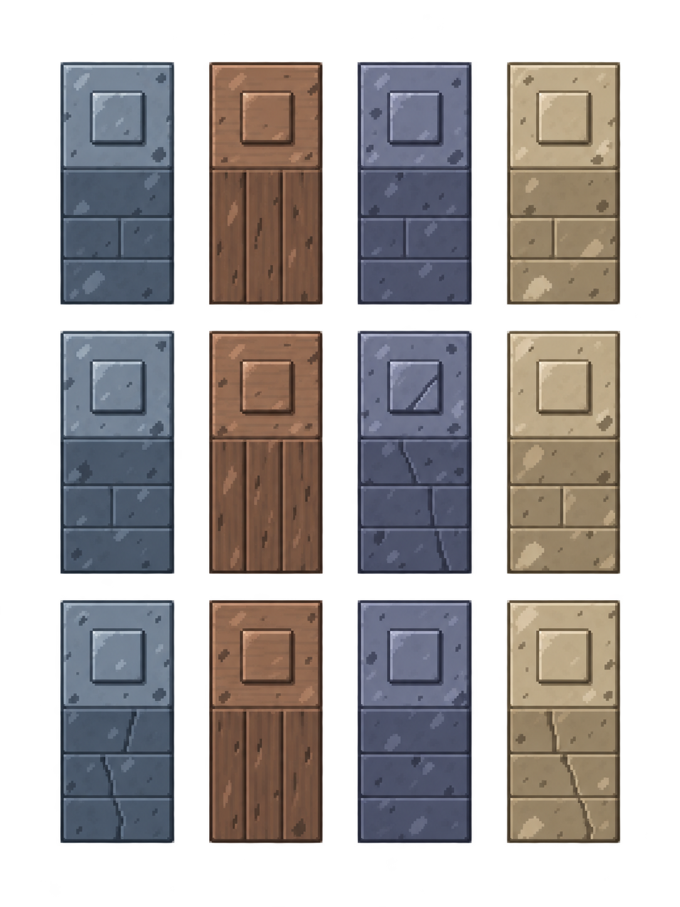

左到右石殿、沉船、深渊、奶池；上到下各主题三款。负责人两次上传的原件逐字节、RGBA一致，SHA-256为 `e9cbf46c6b37fd01a26805ef2a62b2bc0d0e9e5e55db710b43839915fc24905f`。**不重绘、不替换、不移除原件已有裂痕。** 前阶段的去裂痕要求已被最终选图取代；新主题仍控制磨损密度。

设计模块完整80×176、顶部80×80、下部80×96；世界8×17.6。实际生成稿并非逐像素完全符合此比例：运行时对完整模型使用同一个缩放倍率，并在固定模块边界裁掉少量外缘，保留中央凸台和顶/身连接，不再单独拉伸两段。原稿不修改。绘制画布保持同色底层补齐透明边角，避免重复墙块间漏黑。

每主题三款按房间视觉seed和墙块坐标派生 `wall-variants:theme:x:y` 独立随机，重进与同版本恢复稳定；选中的是完整模型，顶/身不会错配。地板流和玩法流不被推进；不新增存档字段，不旋转或镜像模型。纵向按y/x叠放，后一块顶面覆盖前一块墙身。可见墙顶与墙身均受现有物理边界阻挡，造型更换不改变碰撞、门洞或可行动面积。

## 4. 地牢门：完整模型等比接入

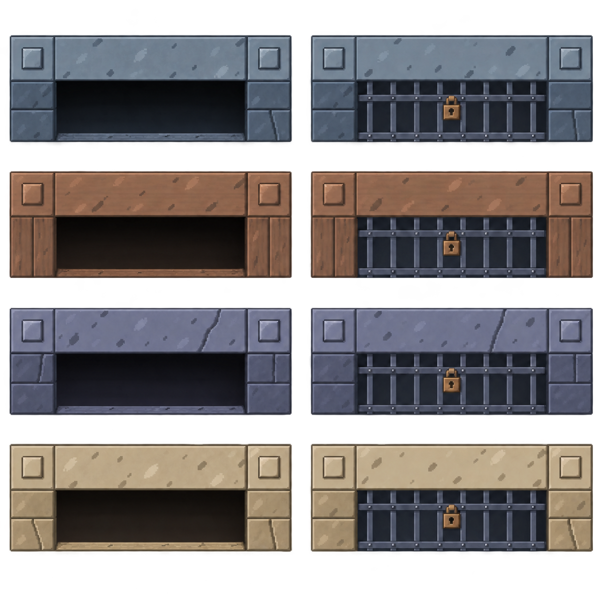

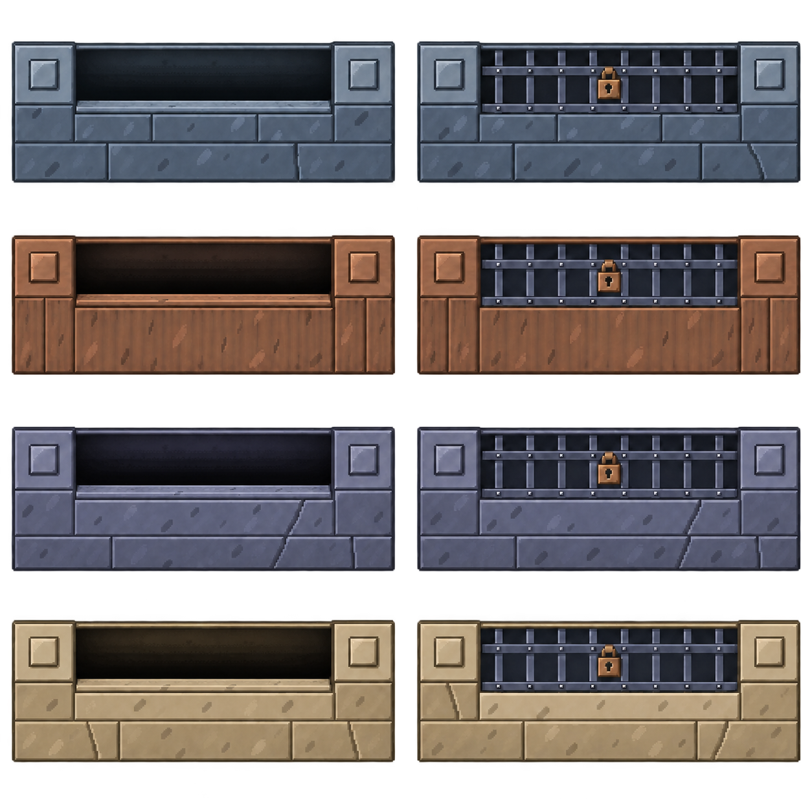

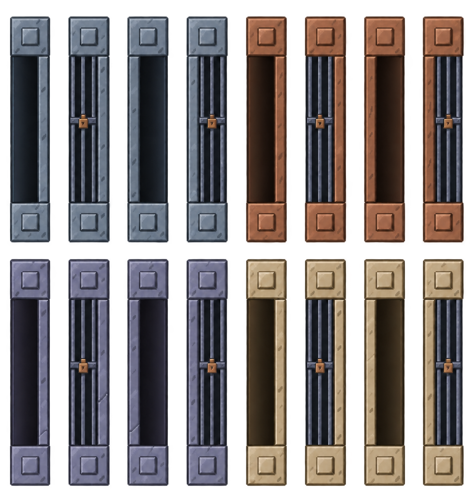

南北门每行一主题；侧门左上石殿、右上沉船、左下深渊、右下奶池，每组依次东开、东锁、西开、西锁。32个方向/状态独立绘制，不能旋转横门当侧门。

横门设计480×176，竖门80×480；跨度都是六个8单位墙块。侧门两端帽80×80、中段80×320。源图保留，缓存以10px/世界单位绘制，使17.6高恰好为176px；同一个完整模型只用一个倍率，裁剪超出模块的少量外缘，不分别拉伸端帽或中段。切空与显示继续共用 `mapDoorRect`，门位不垫墙，不修改物理中心。

开门凹槽的主题底色大幅压暗，保留深处黑影；**开口亮、深处暗**。东门左亮右暗、西门右亮左暗；北门靠下开口略亮、上方深处暗；南门靠上开口略亮、下方深处暗。内部黑影允许存在，不等于给外缘增加黑框。侧门v4d已获负责人“没问题”确认；本批南北门按同规则补齐内阴影，已获整批应用授权。

## 5. 地板：墙宽方砖、同色细边、十款随机铺设

负责人已确认下面四组原稿并要求上传。每个主题各 10 款，按 5 列×2 行排布；顺序从左到右、从上到下编号 0–9。

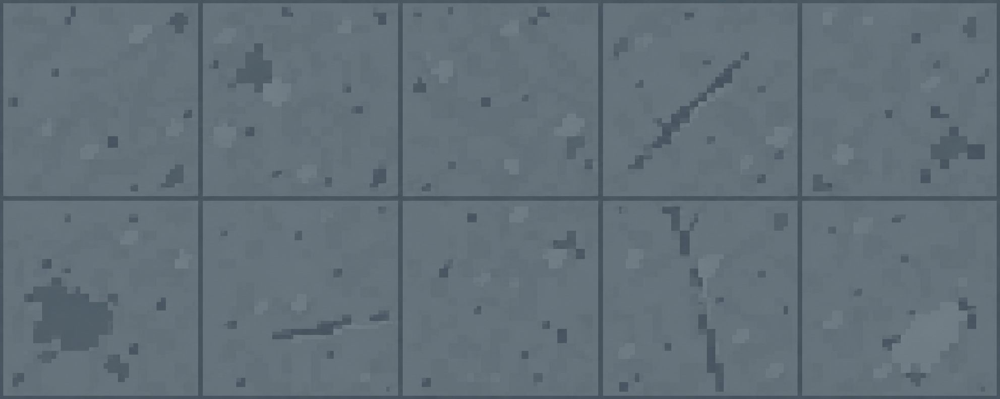

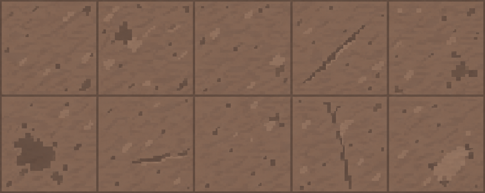

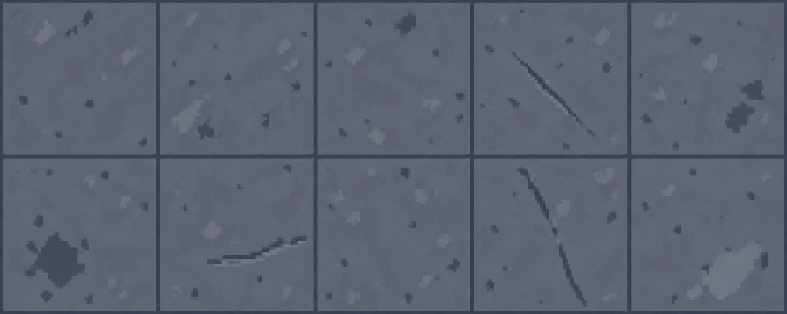

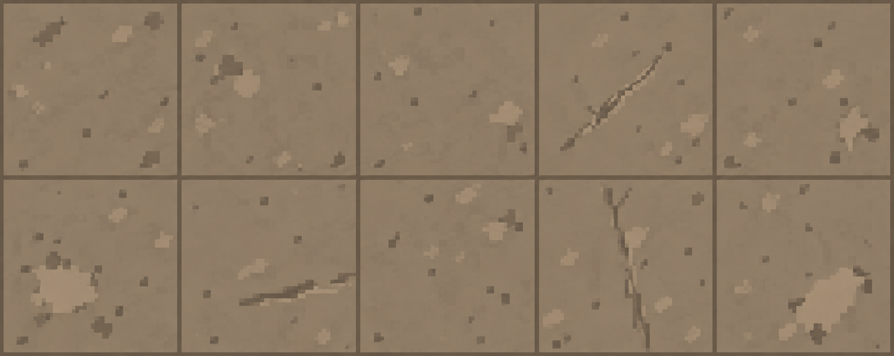

- **每块严格为 8×8 世界单位，与墙体模块同宽。** 同主题每格等概率选择一款，保持正向，不旋转、不镜像，不重复整张 5×2 拼图。以模块房外包框左上角 `(96,39)` 为网格原点，房间轮廓只负责裁剪。
- 地板主色从对应墙体下部长方形取样并调浅。十款允许轻微深浅区别，但每款主体都要浅于墙身；地面低饱和、均匀受光，不使用墙顶强浮雕光影。保留清楚像素色块、少量非对称局部磨损；沉船无圆形木结，避免密集噪点、醒目长纹或各种大符号。
- **同主题全部款式的四边必须是同一个固定颜色。** 细边属于该材质色系，不能用黑色、亮色双框、暗角渐变或凸起边框。当前取确认稿外边中位色：石殿 `#4a5761`、沉船 `#624c40`、深渊 `#3c4154`、奶池 `#685947`。新主题应重新从其确认稿取样，不能套用无关主题的边色。
- 每主题原稿 1983×793，切成约 396/397 像素方形帧（除法取整带来最多 1 像素差）。运行时排除原稿分隔线：各边内缩 8 原图像素，最近邻绘入 64×64 缓存的 62×62 内部，外圈 1 像素统一为主题边色。相邻砖的共同边共 2 缓存像素，即 0.25 世界单位。原稿文件不修改，WebP 无损；这项边缘归一化只发生在表现层缓存。
- 每房从冒险原始 seed、floor 和 roomId 派生独立表现随机流；重进/同版本恢复重建同一地板，不消耗战斗、AI、掉落或地牢生成随机，也不新增存档字段。仅换房时烘焙，无每帧地面重画、无逐砖游戏对象。主城/调试未传 seed 时采用固定 seed 0。
- 地板连续铺在障碍、桶、机关和透明边角下，不按障碍碰撞矩形挖空。移动时需检查细边是否闪烁；不能以原稿确认替代真机验收。

四个原稿均在 `art-src/maps/sources/ground-<theme>-v7.png`。完整生成过程提示词见 [ground-v7.json](../art-src/maps/prompts/ground-v7.json)，可复用提示词见下方类别规范。v6 无砖缝纯纹理及更早的整帧/镜像平铺仅保留历史；最新十款随机方砖要求取代它们。实现与验证见 [#137 记录](testing/floor-variants.md)。

## 6. 障碍与嵌地边框

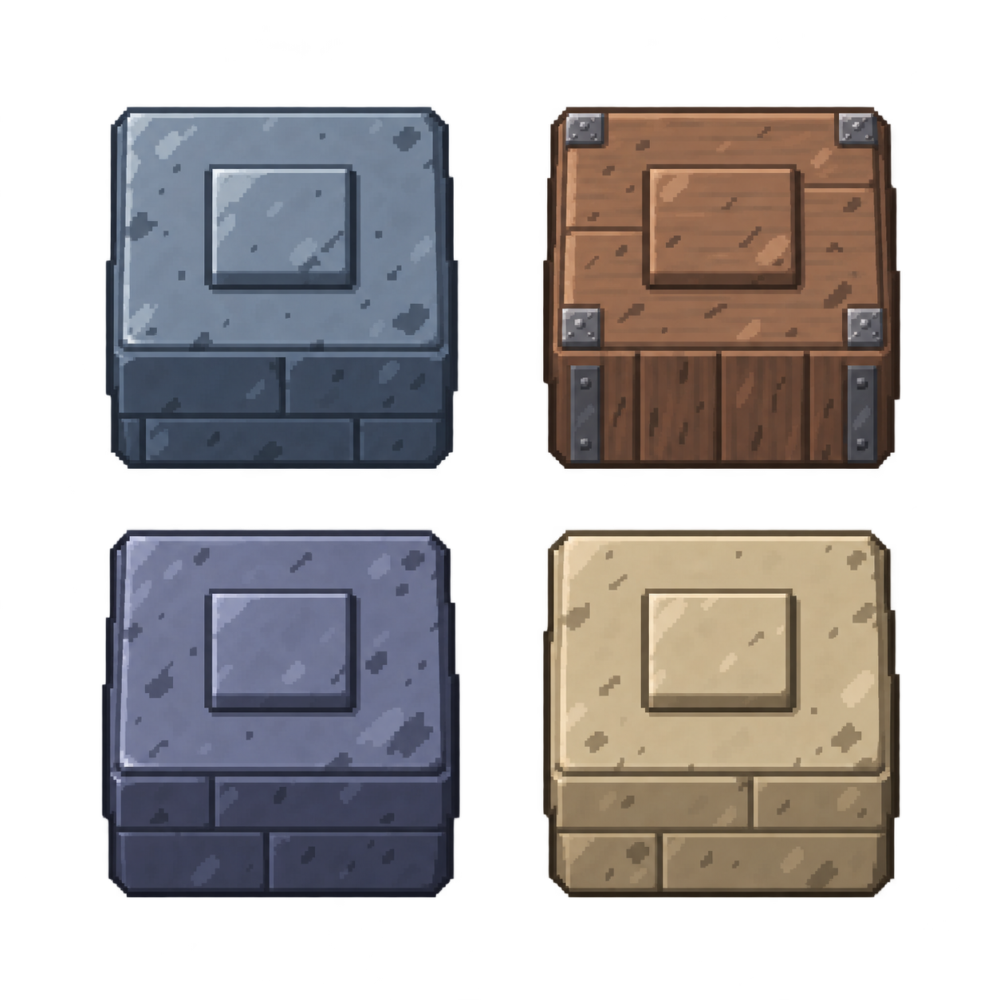

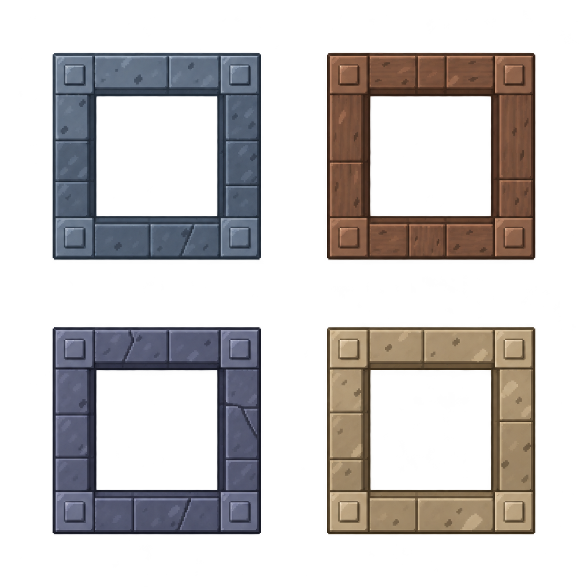

障碍为完整1:1帧的矮方块，保留亮顶、暗面、中央方形凸台。当前分隔带直接将实际布局尺寸设为方块边长的整数倍；两处长条统一60×12，正向重复五个完整12×12模型，显示与碰撞一致，不裁末块、不按宽高分别压伸。下方地板连续，透明角不盖黑底；障碍/完整桶仍处于人物怪物之下；这项图层排序本身不改变碰撞。布局尺寸调整会同步改变实际碰撞和地刺伤害覆盖。

边框为正方形九宫格，边宽采样比例0.18、世界厚度3。四角保持同一倍率，直边按同倍率重复，末段裁剪；中心透明保留地板，不能把整个方框压成长条。

地刺的实际宽高必须为16的整数倍，画面与伤害范围共用该尺寸；不得用半个刺格填满末端。当前16×56改16×64、40×16改48×16、40×14改48×16。深渊 combat_2 北侧地刺向室内移8，保持入场净空。

## 7. 主题水晶、主题地刺与共享机关

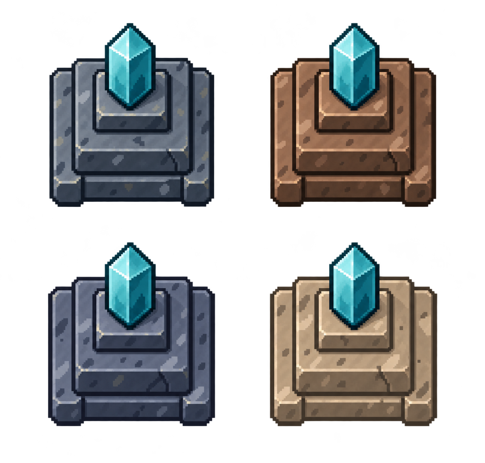

左上石殿、右上沉船、左下深渊、右下奶池。四款使用相同青色晶体和阶梯底座造型，底座主色匹配主题地板；不将晶体本身随主题改色。完整帧世界28×30，保留透明留白，不把窄晶体撑成方块。

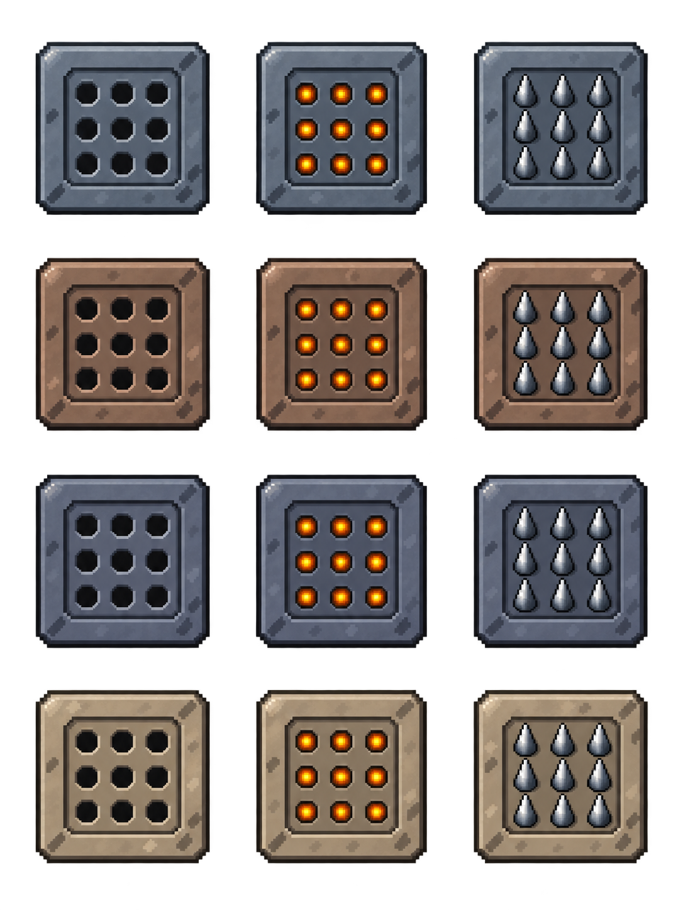

行依次石殿、沉船、深渊、奶池；列为收起、预警、触发。每态16×16世界方帧，统一3×3九孔、锚点和底座；预警为孔内小面积橙光，触发为钢灰刺体，底座主色随主题匹配地板。12态全部独立注册，预警闪烁时只在本主题帧间切换。

水晶与地刺都从当前编译房间的 `RoomArena.artTheme` 取主题，换房/换层/恢复自动使用对应主题；不依赖写死的楼层判断，不改机关判定、时序、伤害或出口交互。

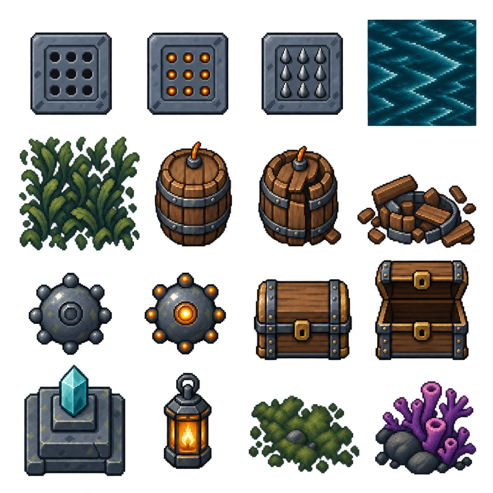

共享图集第一行原地刺三态、第四行第一格原水晶已由上方主题图集替代，不重复注册旧帧。其余12项：水流、海草、完整桶/受击桶/破碎桶、地雷/点亮地雷、闭箱/开箱、灯、苔藓、珊瑚。

| 物件        | 实际世界完整帧 | 状态与锚点                         |
| ----------- | -------------- | ---------------------------------- |
| 水流/海草   | 32×32          | 正方形平铺；水流保留现有方向与滚动 |
| 完整/受击桶 | 18×23          | 共用完整帧、底部和原点(0.5,0.65)   |
| 破碎桶      | 21×13          | 低矮残骸，既有状态语义             |
| 地雷两态    | 15×15          | 相同帧和中心，不更改重设过程       |
| 宝箱两态    | 24×25          | 闭箱上方留透明空间，底部与开箱对齐 |
| 水晶        | 28×30          | 四主题共用14:15画幅                |

灯具10:17、苔藓3:2、珊瑚1:1是储备帧。闭宝箱也仅是已有储备状态；“全部投入应用”包含注册/可用，但不擅自新增房间装饰生成或开箱玩法。桶显示与碰撞差异仍留 #119。

## 8. 大厅、补给与危险区

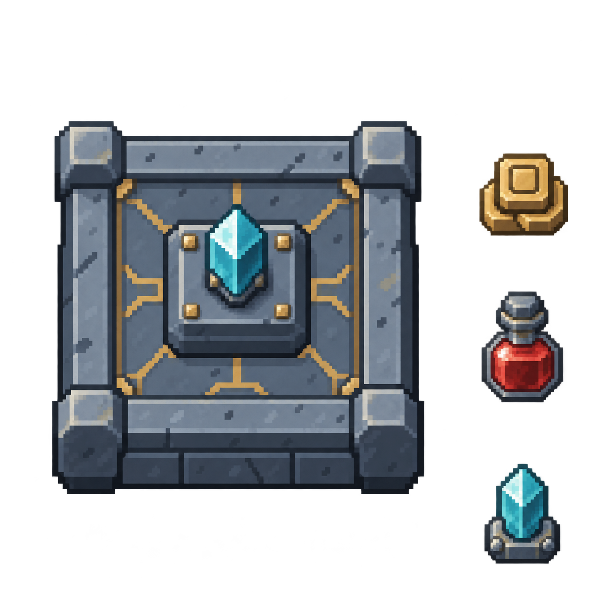

祭台世界62×62；金币、生命、能量完整帧均8×8，窄药瓶/晶体左右保留透明留白，避免紧裁后拉成方形。图集排版中大小不代表游戏内相对大小，必须按上述完整帧展示。

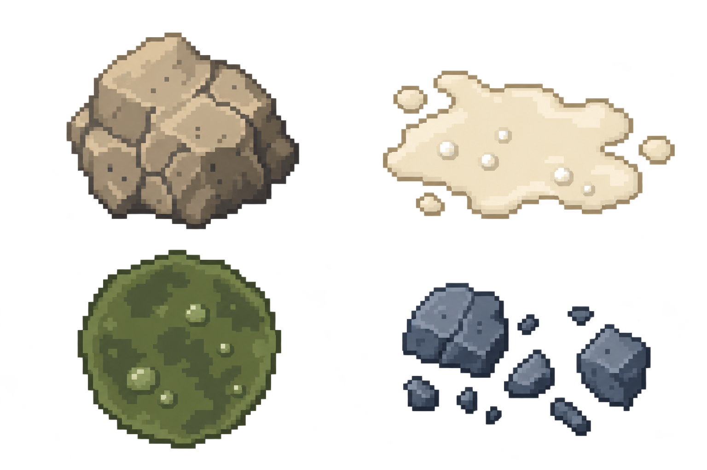

落石1:1、奶池22:15、毒区1:1、碎屑3:2。毒区为圆形顶视轮廓，不把椭圆源图压成圆；危险边界仍由现有代码绘制，不能以外围软透明像素代替判定范围。PNG的透明RGB预览可能显示柔光底，运行必须使用原alpha，不将RGB背景烘焙成黑底。固定对象池、预警时序、伤害与判定半径不改变；碎屑保留为储备帧。

## 9. 完整索引与无损导出

当前15张运行图集、128个命名帧；包括四主题40地板、12完整墙体、32门、4障碍、4边框、12地刺、4水晶、12共享机关/物件/装饰、4大厅/补给、4危险区/碎屑。

| 用途       | PNG原件（`art-src/maps/sources/`） | 运行WebP（`public/assets/demo/`）   |
| ---------- | ---------------------------------- | ----------------------------------- |
| 墙体       | wall-variants-v19-approved.png     | map-wall-variants-v19-approved.webp |
| 四主题地板 | ground-<theme>-v7.png（4张）       | map-ground-<theme>-v7.webp          |
| 北门       | north-gates-v4b.png                | map-north-gates-v4b.webp            |
| 南门       | south-gates-v4b.png                | map-south-gates-v4b.webp            |
| 侧门       | side-gates-v4d-approved.png        | map-side-gates-v4d-approved.webp    |
| 障碍       | blocks-v4.png                      | map-blocks-v4.webp                  |
| 边框       | rims-v4.png                        | map-rims-v4.webp                    |
| 共享物件   | mechanisms-v4.png                  | map-mechanisms-v4.webp              |
| 主题水晶   | crystals-themes-v4.png             | map-crystals-themes-v4.webp         |
| 主题地刺   | spikes-themes-v4.png               | map-spikes-themes-v4.webp           |
| 大厅/补给  | hub-v4.png                         | map-hub-v4.webp                     |
| 危险区     | effects-v4c.png                    | map-effects-v4c.webp                |

[导出脚本](../art-src/maps/export_modules.py)只无损编码和测量帧矩形，不重画、改alpha或缩放PNG。非整块模块通过完整帧留白保持正确比例；全状态共享画幅与锚点。详细字节、尺寸、SHA及RGBA相等结果见 [导出报告](../art-src/maps/export-report.json)，源图内容边界见 [测量报告](../art-src/maps/frame-measurements-v4.json)。运行时已替换的旧WebP退出预缓存，原稿及历史记录保留。

## 新房型的模块拼接（#115）

新目录按风格组织，楼层编号不决定模型或配色。128个普通候选与固定功能房共用本页资源；起点/武器/终点为固定正方形，不沿用旧空房布局，终点无地面文字。房数是地牢配置，可独立调整。

45°轮廓按8单位网格连续排列完整墙块，单块保持原朝向与比例，不能生成旋转斜砖或将长墙拉斜。墙块的完整可见轮廓同时决定物理边界，门只在轴对齐直边上开设。障碍重复整数个完整方块；地刺为16单位整格。边框外扩3单位也计入摆放区域，物件之间保留净空。新房型的生成与验收见 [ADR 0042](adr/0042-style-room-catalog.md)。

## 10. 后续生成与验收

**可直接复制的通用prompt、各类别硬约束及新主题配套清单，统一维护在 [同系列生成 prompt](../art-src/maps/prompts/series-v4.md)。** 本批完整原始调用提示词见 [generation-records.json](../art-src/maps/prompts/unified-v4/generation-records.json)；墙体/门此前的逐轮反馈保留在 [审核记录](../art-src/maps/review/README.md)。

1. 先看本页实际图片与实际调用尺寸，固定地板和上传墙体参考，不链式引用偏离后的草稿。
2. 新主题补齐三墙、十地板、八门、一障碍、一边框、**一水晶和三态地刺**。底座颜色必须匹配该主题地板；共享物件可复用。
3. 为当前模型画完整逻辑帧和内部构件比例；状态共用原点，透明留白属于帧。生成后量alpha边界，不能把prompt目标值当成实测值。
4. 严禁非等比拉伸。当前确认稿的少量边缘裁切需记录；未来新增稿应直接满足模型比例。用同一世界尺寸比较像素密度、门墙接缝、平铺和危险边界。
5. 保留PNG与精确prompt，导出RGBA一致且单张<2MiB的WebP；更新帧注册、主题路由、PWA与本手册。验证换房、换层、读档、同seed一致、独立视觉随机和离线解码。
6. 本地检查、浏览器模拟、负责人真机体验分别记录；不将生成成功或外观认可写成已合并部署。
