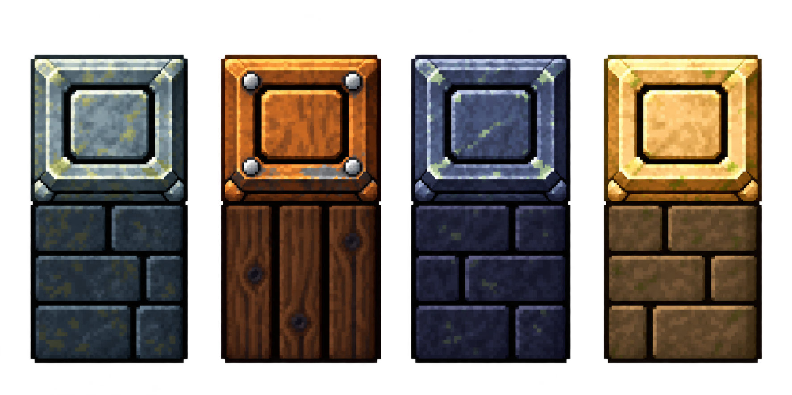
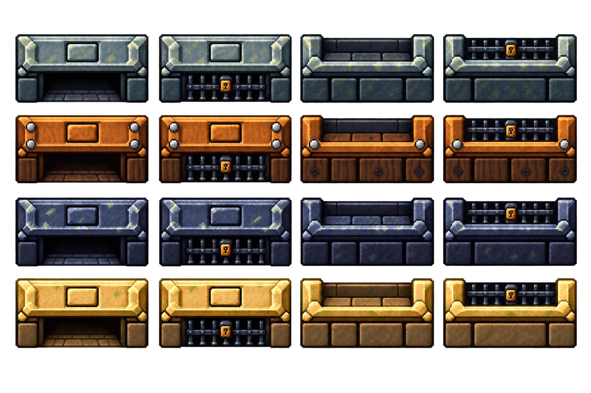
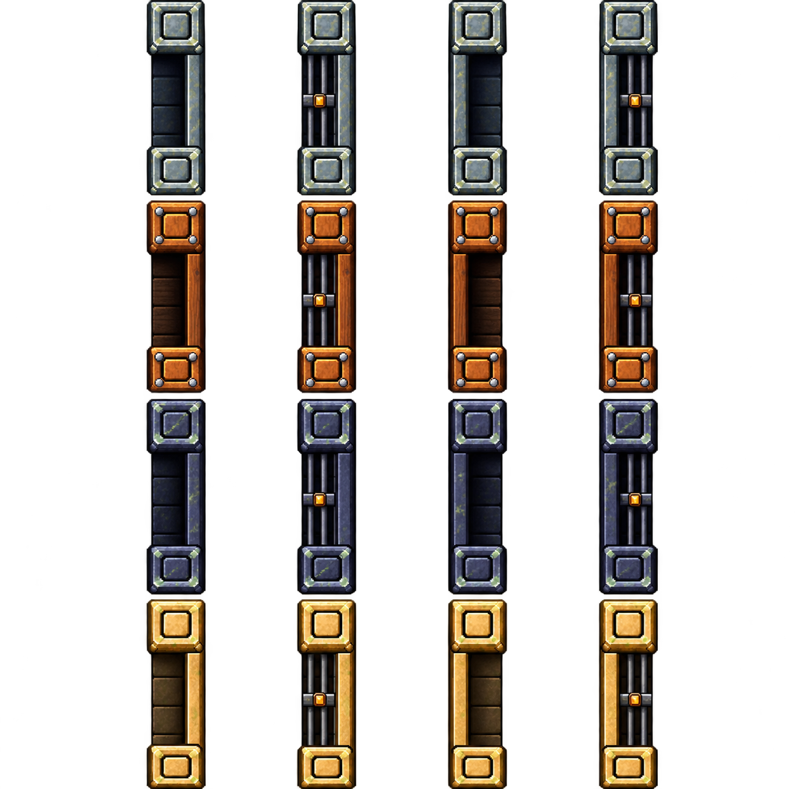
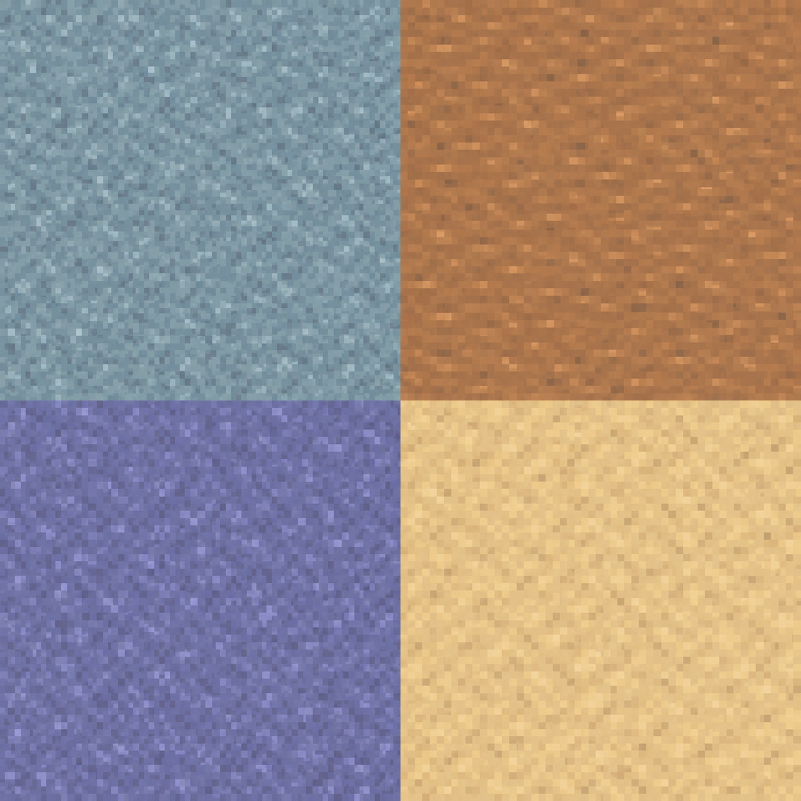
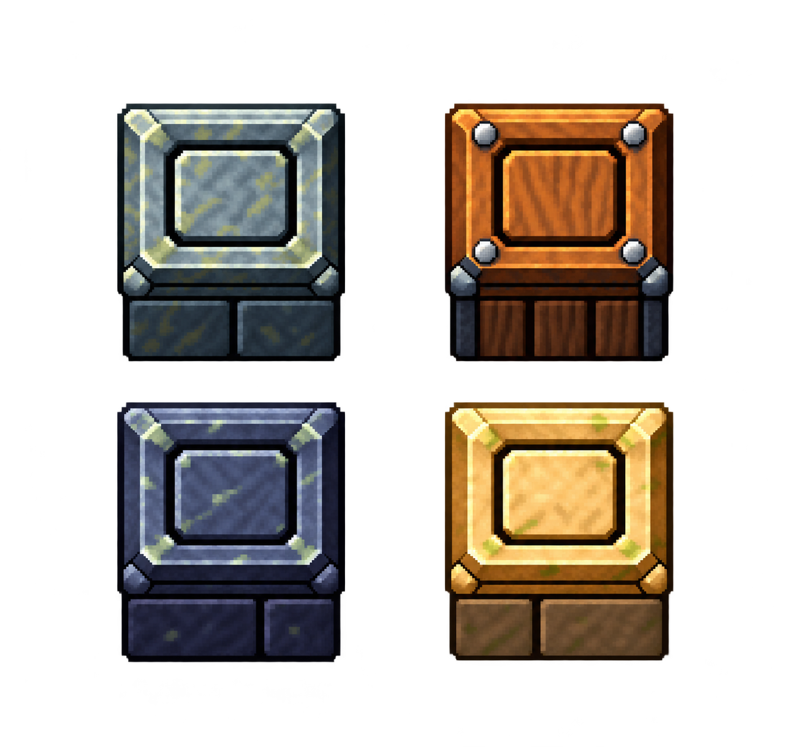
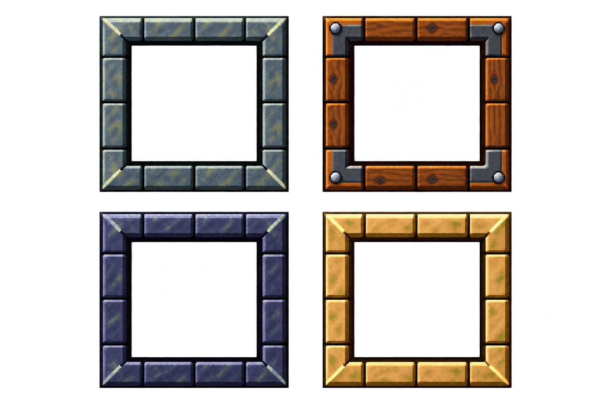
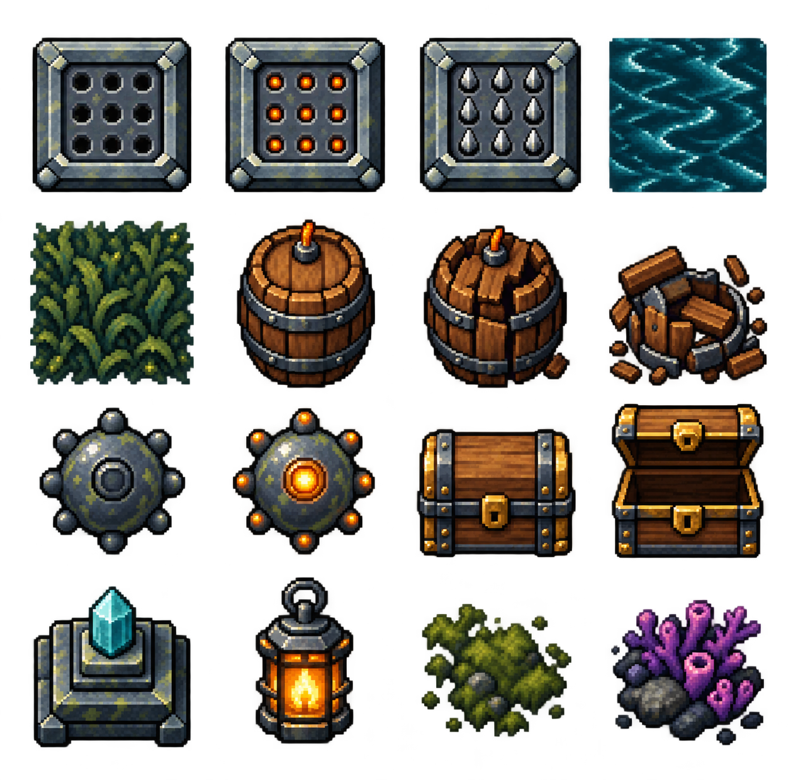
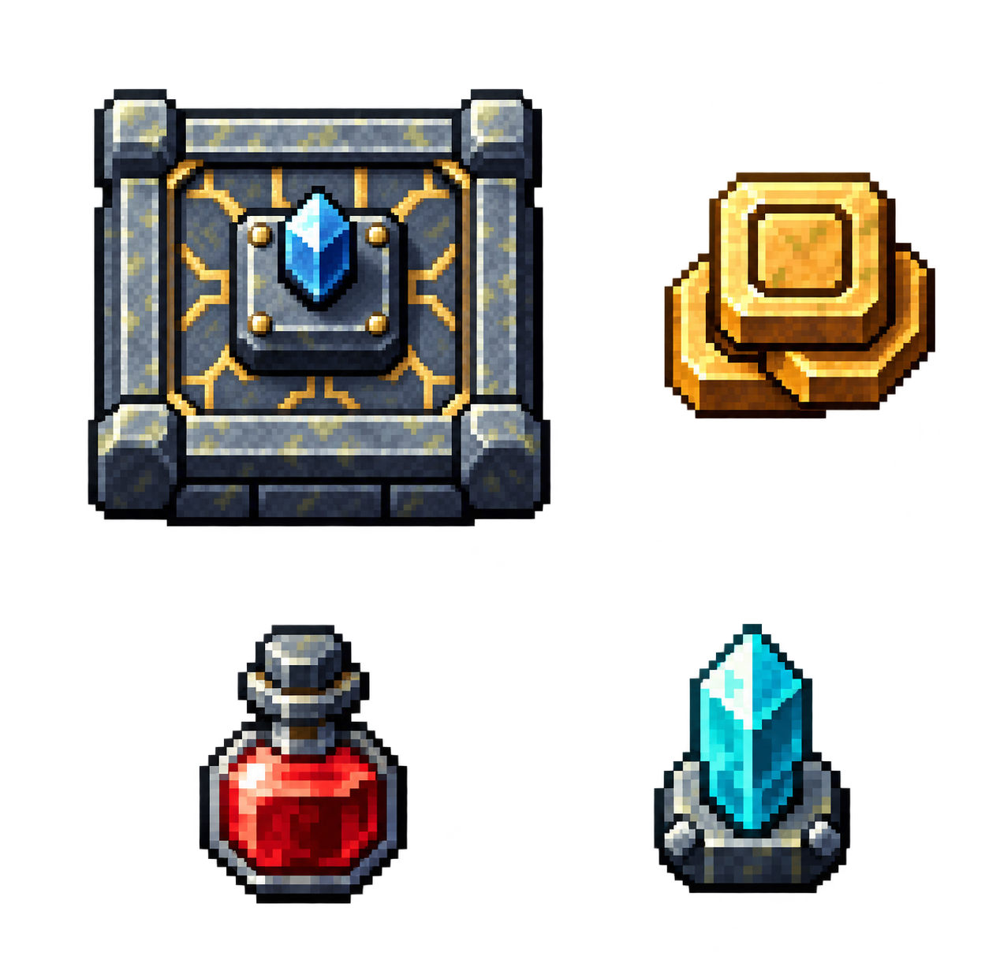
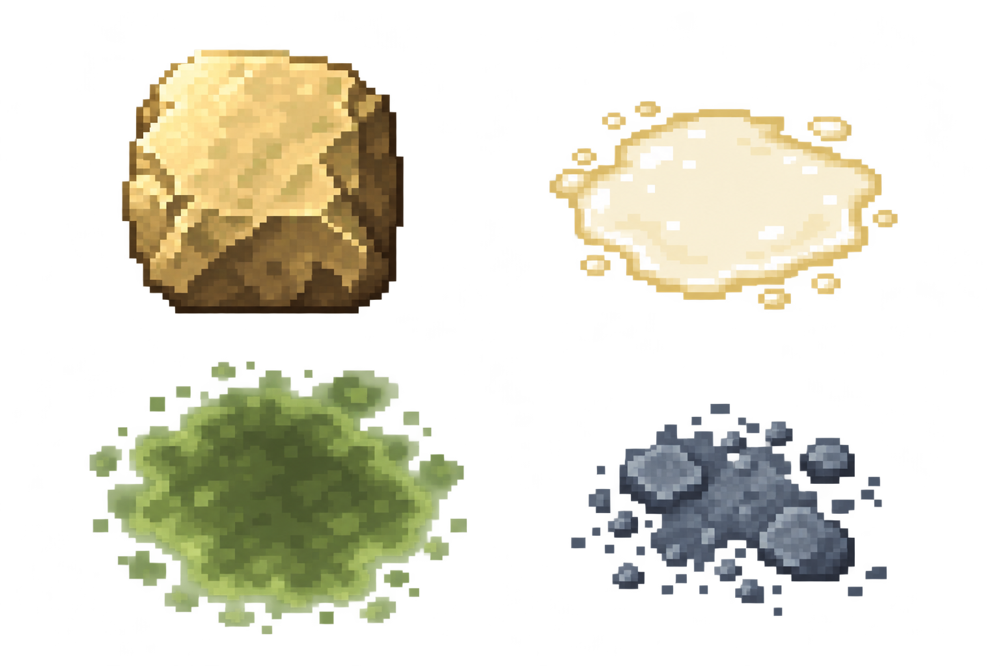

# 地图美术风格手册：固定参考、比例与生成规范

版本：2026-10-29，#133 已合并基线 + #135 纯纹理地板急修（待负责人实际测试）。目的：未来新增地图主题时，仍像与本批地图同时制作；变化集中在材质、主题色和少量装饰，保持相同视角、形体、像素细节、光照和拼接规则。

**当前基准是 wall-model-v17 + ground-v6 纯纹理稿 + 其余 v3 图集。** 本文图片直接引用这些实际运行资源，不是早期概念图。ground-v2/v3/v4/v5、旧门图、灰盒和被否决的墙体草稿仅保留历史，不能作为新图的风格参考。采用状态不等于已经合并部署；工程状态见 [ROADMAP](ROADMAP.md)。

## 1. 必须一起继承的视觉语言

| 项目       | 固定要求                                                                                                                                                                |
| ---------- | ----------------------------------------------------------------------------------------------------------------------------------------------------------------------- |
| 视角       | 横屏、俯视角的 2D 游戏；用可见顶面和正面表达体积。墙顶在画面中是正方形，不改成菱形等距视角，不加透视消失点。                                                            |
| 像素       | 中等偏细的像素风：轮廓、倒角、明暗由清楚的像素色块表达。不能是写实材质覆一层像素滤镜，也不能粗到明显比地牢门简陋。以同一游戏显示尺寸比较，不以 PNG 分辨率大小判断精度。 |
| 光照       | 以左上/上方受光为基准，顶部与上沿亮，正面和下沿暗；所有方向共享这一世界光照。墙顶与墙身对比明显，地板仅保留较弱的材质对比。不能旋转整张门/墙图导致光照方向乱转。        |
| 形体       | 厚实、紧凑、清楚的大轮廓；直线、矩形、方形凸台和少量倒角为主。装饰服从模块边界，不增加伸出拼接边的花纹。                                                                |
| 线条       | 接合边平直、材质色收边，不给每个墙块叠一圈浓黑外框。内部凹槽、门洞可以深暗，但不能把暗边变成整块贴图的外框。                                                            |
| 纹理       | 先能读懂砖块、木板、金属边，再添加少量斑点/磨损。重复单元不要出现大裂纹、密集噪点、醒目的破损、密集苔藓或贝壳符号。                                                     |
| 主次       | 地板低饱和、整体较淡，纯材质纹理不抢眼；墙顶/障碍靠体积区分，交互物与危险信号可局部鲜明。不要把背景整体提到近白，导致奶白攻击和亮色角色看不清。                         |
| 透明与阴影 | 独立物件保留透明外部和自身接触阴影；地面贴图不透明。透明角下必须铺地板，不画矩形黑垫。参考图集周围的预览底色/软光不等于应铺满地面的背景。                               |

## 2. 四主题配色关系

颜色以本页实际图片为准，以下是用途关系，不是要求新图逐像素采用某一固定色表。

| 主题              | 墙/门主体                         | 地板                         | 辅助材质与装饰                            |
| ----------------- | --------------------------------- | ---------------------------- | ----------------------------------------- |
| 海底石殿 `temple` | 冷蓝灰石材，浅灰顶沿，深蓝灰墙身  | 淡蓝灰石材，纹理对比低       | 暗铁、少量浅苔色；小面积青色水晶          |
| 沉船货舱 `wreck`  | 暖棕木材，亮木质顶面，深棕正面    | 较淡棕色木材；简短低对比木纹 | 铁包角/铆钉用于门和构件；地板不画圆形木结 |
| 珊瑚深渊 `abyss`  | 靛蓝/蓝紫石材，灰蓝亮边，深色墙身 | 较淡靛蓝石材                 | 少量浅色磨损；珊瑚可作小面积紫色点缀      |
| 奶池神殿 `milk`   | 暖浅砂岩/金黄顶面，土褐墙身       | 淡暖砂色石材                 | 少量苔色、暗铁；奶白危险区仍需单独可读    |

新增冰窟、火山等主题时，可以更换材质色和少量表面特征；保留上述“浅地面—亮墙顶—暗墙身”的层次、相同倒角尺度与像素细节。不要为每个新主题重新发明一种卡通/写实程度。

## 3. 墙体：整套风格的首要参考



- 一个完整相连的模型：正方形顶部 + 同宽长方形下部。顶部中央有小正方形凸起，外部轮廓仍严格方正；顶部不是浮在墙身上方的独立零件。
- **下部长方形高/宽 = 1.2，顶部高度另算。** 归一化顶面为 80×80、墙身 80×96；世界宽 8，顶面高 8，墙身高 9.6，完整可见模型高 17.6。
- 顶面明显更亮，墙身明显更暗，依靠大面积明暗和浅倒角表达体积。外侧不用厚黑框；内部凸台凹槽的暗线不延伸成每块墙的黑色包边。
- 横排显示顶和墙身，纵排由前方墙块覆盖后方墙身；整块模型不旋转。当前轴对齐轮廓沿 8 单位网格接合。未来 45° 墙需单独接入与验证，不在斜墙处设置门。
- 可见墙顶和墙身都属于不可通行部分；不能只改变图层遮挡来掩盖角色踩墙。几何契约见 [ADR 0041](adr/0041-modular-map-art.md)。

源图：[wall-model-v17.png](../art-src/maps/sources/wall-model-v17.png)。生成新主题墙体时必须把这张图作为视觉参考，新绘完整模型，不拼接旧图局部。

## 4. 地牢门：四个方向必须配套绘制

横向图集，每行一个主题；从左到右为北开、北锁、南开、南锁：



纵向图集，每行一个主题；从左到右为东开、东锁、西开、西锁：



- 门框与同主题墙体共享主色、亮顶、暗身、倒角和纹理密度。锁态使用清楚的暗铁栏杆与小面积锁件，不能用大范围发光盖过角色。
- 北/南、东/西是独立方向模型，不能把横门旋转 90° 当侧门。南门要与南墙顶线衔接，不能低一截或浮在地面上。
- 门位先留空，门后不放墙体。横门宽、侧门高必须占整数墙块；当前均为 **6×8 = 48 世界单位**。横门为 48×17.6，纵门为 8×48；纵门两端帽各 8×8，中段 8×32。
- 门的尺寸、切空和画面位置共用 `mapDoorRect`。生产门位读取物理 `center/entrance`，门图接合使用 `artCenter`；不要手写另一组偏移来凑图。
- 原图像素大小不是碰撞尺寸。尺寸校准在 `src/game/assets/mapDoorArt.ts`，帧矩形在 `src/data/mapArtFrames.ts`；新图必须保留明确的端帽和中段，方便同规则接入。

## 5. 地板：淡色、安静、直接平铺



- **地板只画连续的材质，不再画砖块或砖缝。** 石殿为冷蓝灰，沉船为暖棕，深渊为靛蓝，奶池为暖砂色；微小像素色块提供材质感，避免大云斑、斜向长纹、木板接缝、圆形木结和醒目重复符号。
- 低对比、均匀受光，背景层次让位给人物、怪物和弹体。像素来自原稿自身，不用模糊滤镜或降低全屏分辨率；不采用墙体的强浮雕明暗。
- **不旋转、不镜像，完整帧横纵平移重复。** 对边的材质应连续；不要增加独立暗边、黑框、边缘渐变，也不要以镜像补救接缝。纯纹理相邻像素可以不同，但周期边界不能产生高于内部材质变化的突变线；需看 2×2 以上实际重复与移动镜头。
- 四象限分别为石殿、沉船、深渊、奶池，每帧 627×627；完整帧最近邻绘制到 256×256 pattern，对应 32×32 世界单位。不要重新排列局部采样或添加程序砖缝。
- 地板连续铺在障碍、桶、机关和透明边角下，不按障碍碰撞矩形挖空。

源图：[ground-v6.png](../art-src/maps/sources/ground-v6.png)。完整生成提示词：[ground-v6.txt](../art-src/maps/prompts/ground-v6.txt)。v5 砖块稿仅作历史配色参考；负责人已豁免本次 Claude 复审，本版待其实际测试验收。素材和实际重复检查见 [#135 验证](testing/floor-actor-layers.md)。

## 6. 障碍：同一材料，独立轮廓



障碍沿用墙体的亮顶、暗面与方形凸台语言，但更矮、更紧凑，是独立物件，不能直接把墙体当障碍或把障碍旋转拼成墙。轮廓、倒角和接触阴影明确；周围透明，底层地面连续。室内障碍与完整/受击桶位于独立障碍层 25，人物/怪物模型位于其上方的 30 + y/10000；不让障碍遮住实体模型，也不改变碰撞。新图的底部和可见占地要适合既定碰撞足迹，避免用大幅非等比拉伸凑尺寸。当前竖图铺成方块的变形属于已有接入限制，不应作为未来资产的造型规范。

## 7. 陷阱、边框与地面接合



- 边框共享同主题墙/门的石材或木材、倒角、亮沿与暗内侧，表达“嵌入地面”的槽口，而不是另外贴一块黑色底板。
- 直边可延展，四角完整。渲染使用九宫格的八个边角，中心保留地板；当前世界厚度 3，采样切片比例 0.18。中心预览背景不能被当作实心地面盖上去。
- 机关外框与地板接触处没有透明裂缝、黑色矩形底、重复叠边或异常亮环。适配长条危险区时，角保持形状，中间直边延展；不能把整框随意压扁。

机关、物件与装饰图集如下，按行阅读：



| 行  | 从左到右                               |
| --- | -------------------------------------- |
| 1   | 地刺闲置、地刺预警、地刺激活、水流     |
| 2   | 海草、桶完整、桶受击、桶破碎           |
| 3   | 地雷普通、地雷点亮、宝箱关闭、宝箱打开 |
| 4   | 出口水晶、灯具、苔藓、珊瑚             |

地刺三态保持相同底座、孔位和原点，仅改变危险构件/提示；预警用可辨识的小面积暖色，激活用有体积的尖刺。水流方向和植物块面以像素色块表现，避免写实照片噪点。木桶/宝箱使用木材与暗铁，破损状态仍保留同一物件身份和锚点。地雷、出口、宝箱比背景更突出，不能通过重绘偷偷扩大或缩小攻击/碰撞范围。

闭宝箱、灯具、苔藓、珊瑚是已有储备帧；资源存在不等于当前每房都会生成，也不授权加入新玩法。桶的显示尺寸与物理直径校准由 #119 处理，不把当前差异当作新图比例目标。

## 8. 大厅、补给与环境危险区



祭台沿用墙门的石质边框、方形凸起、明顶暗面。水晶、金币、药瓶只在少量关键区域使用高饱和色，轮廓比地板清楚；不把整个底座画成明亮光团。主城地板与地牢共享规范，入口门也遵守整数模块规则。



落石继承砂岩块面；奶池保留奶白液体和泡沫，毒雾以绿色危险边缘、内部泡团表达范围，碎屑保留材料来源。局部半透明/柔和辉光可以辅助危险区，但主体仍是像素轮廓，不转成烟雾照片或写实粒子。危险边缘必须清楚，不能为了“融入地面”隐藏伤害范围；也不能把辉光误当成碰撞范围。

当前危险区固定池及提示形式由运行代码管理。重绘不改变时序、伤害、警示形状或判定半径；毒雾非正方源图被压成正方等已有问题应单独校准，不作为设计惯例。纯装饰与实际危险提示必须区分。

## 9. 当前完整资源索引

所有 PNG 原稿在 `art-src/maps/sources/`，运行 WebP 在 `public/assets/demo/`。图像帧由 `mapArtFrames.ts` 定义，图集 key/尺寸在 `mapArt.ts`。当前共九张图集、76 个命名帧。

| 用途             | 原稿                 | 运行文件                  |
| ---------------- | -------------------- | ------------------------- |
| 墙体             | `wall-model-v17.png` | `map-wall-model-v17.webp` |
| 地板             | `ground-v6.png`      | `map-ground-v6.webp`      |
| 上下门           | `horizontal-v3.png`  | `map-horizontal-v3.webp`  |
| 左右门           | `vertical-v3.png`    | `map-vertical-v3.webp`    |
| 障碍             | `blocks-v3.png`      | `map-blocks-v3.webp`      |
| 机关/交互物/装饰 | `mechanisms-v3.png`  | `map-mechanisms-v3.webp`  |
| 嵌地边框         | `rims-v3.png`        | `map-rims-v3.webp`        |
| 大厅/补给        | `hub-v3.png`         | `map-hub-v3.webp`         |
| 环境危险区/碎屑  | `effects-v3.png`     | `map-effects-v3.webp`     |

生成来源、历史与完整提示词见 [素材目录](../art-src/maps/README.md)；逐图尺寸、字节和摘要见 [export-report.json](../art-src/maps/export-report.json)。旧地图、旧门、占位图不在本风格基准内；角色、怪物、武器与 UI 保留各自规范，但新地图必须与它们同屏协调。

## 10. 新主题的实际制作顺序

1. 先读本页并打开实际图片：v17 墙体、上下门、左右门、当前 v6 纯纹理地板，以及本次要做的对应类别图集。每次生成都附实际参考图，并写清“风格参考”和“需保留的布局/模型”各是哪张，不能只写“像素地牢风格”。
2. 写出新主题的主材、暗面、浅地面、少量点缀色。先生成一块完整墙体和一扇门，确认它们能与旧主题并排而没有不同游戏的感觉，再扩到同主题其余类别。全部类别沿用同一组参考，不链式依赖多轮偏离后的草稿。
3. 为该主题补齐四向门开/锁、地板、障碍、机关边框及需要的机关/物件状态。共享物件可复用当前图集，不能为了新主题无端改变可辨识轮廓或状态语义。
4. 地板先锁定无砖缝的材质与均匀色调，再检查横纵周期边界；保持不旋转、不镜像的直接平铺。墙/门严格遵守模块比例，角与端帽不随意拉伸。独立物件保留透明区域，尺寸和状态锚点一致。
5. 保留最终 PNG 原稿和完整提示词；只对选定素材做无损 WebP 编码。使用 `python art-src/maps/export_modules.py` 的导出/元数据流程，帧数据再按仓库格式化。布局参考图不进入运行时资源列表。每张运行 WebP <2 MiB，PNG/WebP 解码 RGBA 一致；版本和预算可从导出报告核对。
6. 将新图与现有图按相同世界尺寸并排，看像素大小、倒角厚度、材质明暗、地面安静程度。通常还应看横/纵平铺、门墙连接、角色/怪物/弹体可读性、危险区与透明角。工程、PWA、真机与上传按当时 AGENTS/负责人要求执行；本轮地板免测不自动变成未来所有美术都免验收。

### 通用生成提示词骨架

```text
为《AI娘大战奶蛙》制作 [主题] 的 [资源类别及全部状态]。
参考图 1：已确认 v17 墙体，决定材质细节、像素密度和亮顶暗身。
参考图 2：[当前同类资源图集]，决定视角、造型语言、状态与构图。
参考图 3：[需要固定的布局图/端帽比例图]，只决定几何；不得自行改动。
新主题材料与配色：[明确填写]。只改变主题材质和有限装饰，保持同一游戏风格。
中等偏细像素画，清楚像素色块与浅倒角，顶面/上沿受光、正面较暗；
平直模块边缘，无浓黑外框，无写实纹理/模糊滤镜/亮色塑料卡通。
大轮廓优先，适量简洁磨损，不加大裂纹、密集噪点、贝壳或醒目重复符号。
严格沿用参考视角，不把方形墙顶画成菱形，不旋转门模型来凑方向。
[插入下面对应类别的硬约束。]
独立物件透明背景；地板不透明且无暗边。无文字、水印、标注或额外场景。
```

| 类别        | 追加硬约束                                                                                                                      |
| ----------- | ------------------------------------------------------------------------------------------------------------------------------- |
| 墙          | 新绘完整一体模型；方形顶部与同宽长方墙身直接相连，墙身高/宽 1.2；顶面中央方形凸起；顶亮身暗；平直外缘，纹理适合重复。           |
| 门          | 四方向分别绘制开/锁态；横向宽/竖向高均六个墙块；材质与墙一致；侧门双端帽加中段；门后留空，斜墙不设门。                          |
| 地板        | 无砖块/砖缝的纯像素材质；对边色调和细节连续，完整帧正向平移重复；不旋转/镜像，不加外框/暗边；低对比、均匀受光；木纹无圆形木结。 |
| 机关边框    | 同主题材料，九宫格八边角、中心留空、直边连续，能与地板齐接；不画实心黑底，不挤压四角。                                          |
| 障碍/交互物 | 独立透明轮廓，亮顶暗面、紧凑接触阴影；同物件各状态大小/锚点一致；关键交互色局部突出，不能全物体发光。                           |
| 危险区      | 像素边缘/泡团/材料碎块；危险轮廓清楚，允许局部半透明；不把软光当实际范围，不改变既定预警和玩法语义。                            |

### 出图后必须排除的偏离

- 精度明显粗于门，或比门写实许多；把全屏渲染降分辨率当作像素风。
- 墙身过长、顶部不方、浮空分离、底座收窄、外缘厚黑框；横墙图旋转后当竖墙。
- 门不是整数墙块、门后垫墙、南门低于墙线、侧门不匹配当前造型。
- 地板出现暗边/黑框、砖缝/木板分块、周期突变线、圆形木结、噪点或明暗抢过角色。
- 障碍透明角下是空洞，机关边框重复接头或带实心黑底，危险区被装饰遮蔽。
- 只凭提示词声称一致，而没有与本页实际资源按游戏尺寸对照。

新基准获负责人确认后，在本页更新对应图片、版本和新增的例外，保留旧记录的历史标记。**同一批次的一致感来自固定参考与固定规则的共同延续。**
