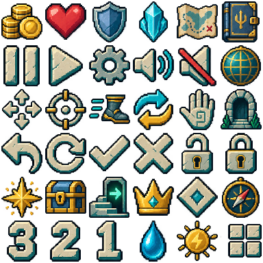
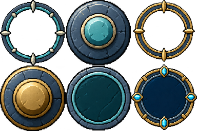

# 图片 UI 风格与生成手册（#117）

## 基准与交付

延续当前地图的蓝灰石材、青绿暗面、黄铜和青色晶体配色；使用实际图片绘制 UI，动态文字独立保留。世界墙体 v19、地板 ground-v7 及角色/武器素材不在本次重绘范围。

本系列为 GPT 通过 imagegen 生成的项目素材，尚待负责人画面验收。完整原稿、逐字提示词、切片坐标和 SHA 在 [art-src/ui](../art-src/ui/README.md)。不引用外部游戏截图或第三方素材。




## 复用规则

- 面板使用低饱和深蓝中心，边缘用材质色高光；不画醒目裂纹、贝壳、浓黑外轮廓或大面积噪点。
- 图标正视、孤立、真透明。圆盘和图标等比缩放；不要烘焙文字、价格、等级或语言。
- 框架为九切片：源格 128²，切片 18，显示边宽 3–10 CSS px。只延展空白中心和连续边条，角饰不拉长。新增窗口沿用相同框架，不为每种长宽重绘整张大图。
- 普通按钮使用 normal；悬停/键盘焦点/选择使用 focus；按下使用 pressed；禁用使用 disabled。保留原生 disabled、aria-pressed、aria-expanded 与清晰焦点轮廓；颜色不是唯一状态信号。
- 天赋树：可购星标、缺点数金币、前置锁、满级勾；详情继续解释状态，选择另加青色轮廓。连线复用图片纹理，不改变依赖关系。
- 字体为系统原生字体，不对整屏应用像素化。像素采样只作用于图片；中文和英文均检查，手机横屏长说明允许滚动。小于等于 680 CSS px 的窄屏为每个天赋分支保留 210 px，可横纵滑动，不挤压英文节点。
- 图标源格 64²，运行图集 384²；触控源格 128²，运行图集 384×256。圆盘中间透明，攻击/移动旋钮单独叠加。尺寸来自原有 INPUT_UI/uiRect，与保存布局和命中区共用，不重新定义输入范围。
- 倒计时牌和 3/2/1 从现有 PauseState.remaining 选择图片；图片层不得拥有额外计时器、模拟步骤或恢复状态。
- 所有尺寸是运行尺寸，不能将 1536px 原稿直接载入游戏。新增输出单文件小于 2 MiB，进入 Workbox 预缓存并做真实断网解码。

## 未来扩充提示词

完整本次提示词见 [prompts.json](../art-src/ui/prompts.json)。生成新同系列图标时替换下列最后一行即可；须附上述实际图集作为参考，并在编辑已有图片时保留 alpha。

```text
Production pixel-art UI sprites for AI VS NAIWA, matching the supplied approved UI atlas.
Orthographic front view, crisp deliberate pixel clusters, blue-grey slate,
desaturated teal, warm brass, ivory and small cyan crystal accents.
Thin material-colour edges; quiet dark centers; no bloom, realistic texture,
heavy black cartoon outlines, shells, cracks, baked text or background halos.
One isolated symbol per fixed cell, genuine alpha transparency, fully inside
its cell with padding. Keep equal visual weight and readability at 18–24 CSS px.
Do not stretch the icon. Generate only: [new icon list and exact cell layout].
```

生成面板沿用 prompts.json 的 frames 条目；触控圆盘沿用 controls 条目。生成器不保证严格网格或指定分辨率，**必须以实际图像校准切片**：本次图标原稿为 1254²，行距并非等分，export.mjs 固定了实测行列界限，再扫描 alpha 收紧并等比装入标准格。不能盲目按提示中的 1536² 去切。

## 界面覆盖清单

| 界面             | 图片内容                                        | 保留的语义/行为                      |
| ---------------- | ----------------------------------------------- | ------------------------------------ |
| 加载、开屏       | 加载槽、按钮三态/禁用、设置图标                 | 原加载进度、开局/续玩和存档提示      |
| 主城、入场确认   | 图鉴/祭台/门图标、确认框和按钮                  | 原交互距离、旧局替换确认             |
| 战斗 HUD         | 生命/护甲/能量槽与图标、金币状态板、提示板      | 原数值、4 Hz 文字刷新、保存布局      |
| 地图             | 图片背景、房间/宝箱/出口/Boss 图标              | 路线几何、探索状态、按修订号重画     |
| 暂停             | 图片菜单、继续/返回/布局图标                    | 原输入暂停、保存与退出               |
| 设置             | 声音/闪烁/语言、启用/禁用视觉                   | 原设置键与语言重建                   |
| 布局编辑         | 实际圆盘/槽预览、图片工具栏、滑条/滑块、按钮    | 拖动、键盘、取消/重置/保存与写盘失败 |
| 图鉴             | 外框、卡片、编号、详情区、返回                  | 原怪物画像裁剪、方向键/手柄/触屏滚动 |
| 天赋树           | 节点四状态、图片连线、分支/详情、购买/重置/取消 | 原数值、条件、点数、档案、焦点与滚动 |
| 奖励、商店、结算 | 选择/购买/返回按钮、奖励板                      | 原奖励、花费、结算和档案保全         |
| 恢复倒计时       | 牌面、手绘 3/2/1、提示板                        | 原 PauseState 冻结与恢复截止点       |
| 触控与鼠标       | 双圆盘、旋钮、动作按钮、暂停、准星              | 原尺寸、双指、零死区、自瞄/手动分类  |
| 横屏与 PWA 提示  | 图片面板、更新/稍后按钮                         | 原生命周期暂停、更新/离线策略        |

开发调试文字、伤害数字和物品动态标签仍为实时文字；未注册到生产场景的 M1 历史原型不作为新产品界面。测试夹具使用同一资源注册，不增加运行时回退图或随机。
