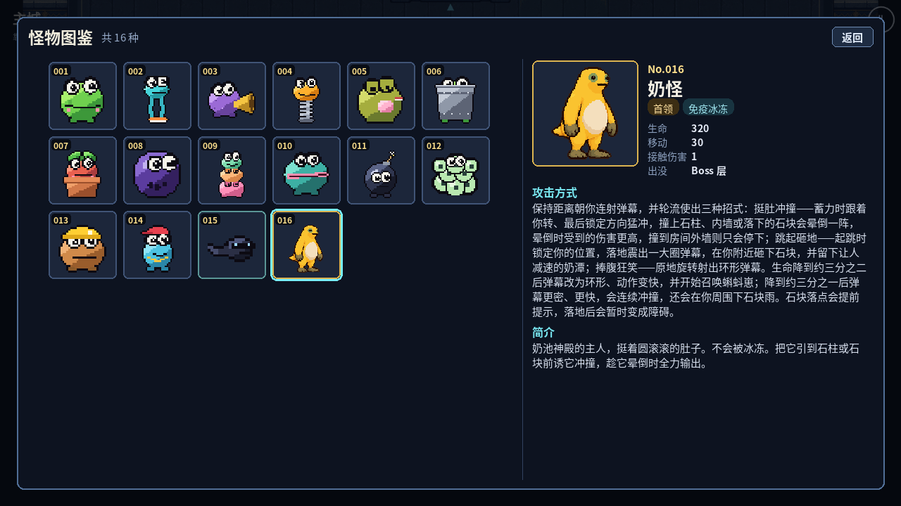
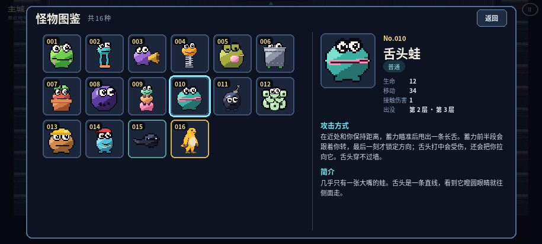

# 主城怪物图鉴（#99 设计稿）

起草：Claude，2026-10-25。契约见 [ADR 0036](../adr/0036-bestiary-catalog.md)。画面方案由 Claude 主导；GPT 实现入口、面板、输入、资源绑定、离线与性能验证，可在保持本稿结构的前提下调整细节。

## 1. 范围

- 主城常驻「图鉴」入口；打开后横屏左右分栏：左侧可纵向滚动的方形卡片网格，卡片左上角固定编号；右侧显示选中怪物的名字、攻击方式和简介。
- 默认展示 data 里的**全部**怪物（当前 16 种，含首领奶怪和只会被分裂/召唤出来的蝌蚪崽）。不加「未遇见」锁定、问号占位或解锁收费。
- 先复用现有怪物图集；#100 重绘后只换图集，编号和帧映射不变。

## 2. 目录与编号

编号按首次出现的楼层排定，之后的小怪和首领排在最后。编号一经分配就不再改；以后新增怪物取当前最大编号 + 1，删除怪物时编号保留，不复用。

| 编号 | ID               | 名称     | 分类 | 出没                                                |
| ---- | ---------------- | -------- | ---- | --------------------------------------------------- |
| 001  | `naiwa_chaser`   | 大头蛙   | 普通 | 第 1、2 层                                          |
| 002  | `naiwa_scout`    | 腿蛙     | 普通 | 第 1、3 层                                          |
| 003  | `naiwa_spitter`  | 喇叭蛙   | 普通 | 第 1、3 层                                          |
| 004  | `naiwa_hopper`   | 弹簧蛙   | 普通 | 第 1、2 层                                          |
| 005  | `naiwa_gasser`   | 放屁蛙   | 普通 | 第 1、3 层                                          |
| 006  | `naiwa_tank`     | 铁桶蛙   | 普通 | 第 2、3 层                                          |
| 007  | `naiwa_turret`   | 盆栽蛙   | 普通 | 第 2、3 层                                          |
| 008  | `naiwa_charger`  | 保龄球蛙 | 普通 | 第 2、3 层                                          |
| 009  | `naiwa_splitter` | 叠罗汉蛙 | 普通 | 第 2 层                                             |
| 010  | `naiwa_tongue`   | 舌头蛙   | 普通 | 第 2、3 层                                          |
| 011  | `naiwa_bomber`   | 炸弹蛙   | 普通 | 第 2、3 层                                          |
| 012  | `naiwa_brood`    | 蛙卵团   | 普通 | 第 3 层                                             |
| 013  | `naiwa_burrower` | 地洞蛙   | 普通 | 第 3 层                                             |
| 014  | `naiwa_dancer`   | 街舞蛙   | 普通 | 第 3 层                                             |
| 015  | `naiwa_tadpole`  | 蝌蚪崽   | 小怪 | 由叠罗汉蛙、蛙卵团、奶怪产生（第 2、3 层、Boss 层） |
| 016  | `naiwa_boss`     | 奶怪     | 首领 | Boss 层                                             |

「出没」和「由……产生」不手写，由 `bestiaryCards()` 从遭遇表 `ENCOUNTERS` 和怪物的 `split`/`summon` 字段推导。中文名沿用怪物美术生成器里的设定名；英文名见 `src/i18n/en.json` 的 `enemy.*`。

## 3. 文案与实际 AI 的对照

攻击方式和简介写在 `bestiary.<id>.attack` / `.desc`，按 `EnemyAi`、`moveEnemy` 和 `CombatWorld` 的实际行为编写，不写阿拉伯数字。生命、移动速度、接触伤害这些数字由界面从 data 读取，调数值时文案不会过时。

`tests/unit/sim/bestiary.test.ts` 的「说明与实际 AI 一致」逐句对照文案：比如炸弹蛙「碰到不疼」对应 `contactDamage = 0`，保龄球蛙「从不慢慢走近」对应冲锋没有触发距离，奶怪「约三分之二、三分之一」对应两个阶段的血量阈值。改了怪物数据导致断言失败时，同步改文案。

核对中发现并已按实际 AI 写入的两处：

- 保龄球蛙：美术说明里写「撞完会晕」，实际 AI 是撞完原地停下恢复，没有晕眩。图鉴写的是「冲完要停下来好一会儿」。
- 奶怪冲撞：撞上石柱、内墙或落地的石块才会晕倒（晕倒时受到的伤害更高）；撞到房间外墙只会停下，不会晕。

## 4. 画面布局

示意图用真实图集帧和中文文案绘制：

- **面板**：覆盖整个画布，四周按安全区内缩（桌面 24 px；手机左右至少避开刘海，示意图为 44 px）。半透明深蓝底，压暗背后的主城。打开期间主城暂停（与天赋面板相同的 `interaction` 暂停），不移动、不进门、不开祭台。
- **标题栏**：左「怪物图鉴 · 共 N 种」（N 来自目录长度），右「返回」按钮。
- **左栏（约 58% 宽）**：
  - 方形卡片网格，按可用宽度自动排列列数（`auto-fill`）。桌面卡片约 96 px、间距 10 px，手机约 64 px、间距 8 px。
  - 卡片内放静态帧：先裁掉帧内透明边距，再等比放大到占满卡片内框（约 70%），不变形，`image-rendering: pixelated`。
  - 编号固定在左上角的深色小标签里，三位数（`001`），不随滚动或图片大小移动。
  - 首领卡片用金色边框，小怪用青绿色边框，选中卡片加亮青色外框。
  - 纵向滚动，`overscroll-behavior: contain`，`touch-action: pan-y`，滚动和点击都不穿透到主城。
- **右栏（约 42% 宽）**：
  - 上半部分：大预览图（桌面约 150 px，手机约 92 px），旁边是「No.016」、名称、分类标签（首领/小怪/普通）和「免疫冰冻」等特性标签。
  - 事实四行：生命、移动（0 显示为「不走动」）、接触伤害、出没。
  - 下半部分：「攻击方式」「简介」两段，整栏可纵向滚动；奶怪的说明最长，手机上需要滚动阅读。
- **朝向**：帧里朝左的（目前只有奶怪）水平翻转，所有怪统一朝右显示。

## 5. 输入与焦点

- **入口**：主城面板里常驻一个「图鉴」按钮，不需要走到某个位置，不占用地牢门和祭台的交互。建议同时给键盘和手柄各配一个快捷键，具体用哪个键由 GPT 查重后决定（当前手柄已用 0/1/3/9/12/13）。
- **打开**：焦点落在上次查看的卡片上（同一页面会话内记住，默认 001），右栏同步显示该卡片。
- **网格导航**：方向键、十字键或左摇杆在网格里按行列移动，焦点移到哪张卡片，右栏就显示哪张，不需要再按确认；超出可视区时自动滚动到可见。Tab 在「网格 → 返回按钮」之间切换。
- **关闭**：按「返回」、Esc 或手柄 B 关闭，回到主城，清空主城输入（与天赋面板相同）。
- **触屏**：点卡片即选中；在网格里拖动只滚动，不选中。

## 6. 性能与资源

- **不新建纹理**：卡片用 DOM 显示图集里的一帧（CSS 背景定位，或打开面板时用离屏 canvas 截一次帧并缓存）。图集 `monsters-v1.png`、`naiguai-v1.png` 已经在 PWA 预缓存里，图鉴不新增资源。
- 透明边距的裁切结果按怪物 ID 缓存，同一页面会话只算一次。卡片 DOM 在面板第一次打开时建好，之后只切换选中状态和右栏内容，反复开关不增加节点和监听。
- 目录随怪物数量增长；几百张卡片以内一次建好即可，超过时再考虑按可见区域虚拟化。

## 7. 接线约定（GPT）

- 数据入口：`bestiaryCards()`（`src/sim/meta/bestiary.ts`），返回按编号排好序的只读数组；字段见 ADR 0036。
- 文案：`t(card.name)`、`t(card.attack)`、`t(card.desc)`、`t('bestiary.role.' + card.role)`；界面标签用 `bestiary.*`（已在中英文里提供）。出没楼层用 `bestiary.floor` / `bestiary.bossFloor` 拼接；小怪再加一行 `bestiary.spawnedBy`，`{names}` 填产生者名称。
- 图片：`card.frame` 给出图集文件、纹理 key、帧左上角、帧宽高和朝向。
- 不要在界面里硬编码怪物数量、编号或名单；新增怪物只需在 `BESTIARY` 加一行（漏加会编译失败），界面自动出现。
