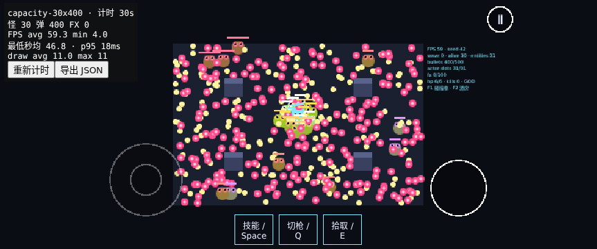

# Issue #18：性能与真机兼容测试

本页记录《AI 大战奶蛙》的测试方法。浏览器模拟视口不是手机实测；真实设备结果返回前，#18 的手机验收保持未完成。正式画面仍待画面方案。

## 两种负载

| 入口                     | 负载与用途                                                                    | 限制                                                                                        |
| ------------------------ | ----------------------------------------------------------------------------- | ------------------------------------------------------------------------------------------- |
| `?stress=1&seed=42`      | 30 只混合怪、400 发真实 sim 分配编号的弹丸、四根柱子；自动填满后计时          | 专门测物理/绘制。弹丸无限寿命、墙壁反弹、命中不结算伤害，不能代替完整战斗 CPU/事件/特效开销 |
| `?stress=combat&seed=42` | 相同混合怪、柱子、导航；补充能量，玩家无敌，正常命中/死亡/回收/反馈，持续补怪 | 弹量随实际交战变化；按住射击或手柄 RT，移动到柱子两侧验证绕路                               |

混合怪包含 scout/chaser/tank/spitter/turret/charger/boss，覆盖 4/6/9/12 半径。战斗仍由真实 CombatBridge 在 WORLD_STEP 推进。无额外 sim 步，不伪造实体/子弹编号，不改正式战斗逻辑，不写检查点或战绩。池与显示对象均预热；F1/F2 可用。固定负载正常开火达到上限后停止发射，瞬时特效会自然结束，所以需要另跑真实战斗模式。

## 统计口径

- `averageFps`：完成渲染的帧数 / 实测墙钟时间，使用 `performance.now()`，不采用 Phaser 平滑后的 delta。
- `minFrameFps`：1000 / 最慢单帧间隔，保留卡顿；`minSecondFps`：最慢完整约一秒窗口的平均帧率，两者分别报告，不互相替代。
- `p95Ms`：固定直方图的毫秒上界，1 ms 精度，超过 1000 ms 的样本归入最后一格；`worstMs` 不截断。
- `drawAverage/drawMax`：Phaser WebGL 4.1 的 drawElements 和 drawInstancedArrays 调用次数，包含调试面板。Canvas 后备没有 draw call 统计，`drawCallsAvailable=false`。
- 初次达到负载后才开始记录，此后保留真实战斗死亡/补怪的耗时。手动暂停、物理暂停、后台和竖屏休眠间隔不计入；不是把长帧任意剔除。
- `actorMin/bulletMin/peakBullets/peakFx/minChildren/maxChildren` 用来核对实际负载和对象数量。固定模式若最小怪数不是 30、最小/最大弹数不是 400，该段不满足固定负载前提，重新计时。
- 页面上的「重新计时」重置全部计数；「导出 JSON」包含模式、种子、URL、构建 JS 文件名、UA、GPU（浏览器允许时）、视口与 DPR。退出场景会恢复绘制方法并清理全部计数监听。

## 真机步骤（待执行）

1. 使用包含 #57–#60 与本压测 PR 的同一构建，在 iOS Safari 与中端 Android Chrome 上各跑一次；记录具体机型、OS/浏览器版本、刷新率、是否省电/充电/录屏、测试时长与构建提交。别把模拟 UA 当设备信息。
2. 横屏打开固定模式，等左上角显示「计时」、30 怪/400 弹。F1 关闭，先运行 30 秒预热，再重新计时 5 分钟。先导出 JSON，再截屏，避免截图读回开销污染测量。
3. 在真实战斗模式再测 5 分钟。持续移动到柱子两侧、持续射击，确认绕墙怪与不同半径同时活动。单独记录低帧率时间点和当时怪/弹/特效数。
4. 多指：左拇指持续移动、右拇指持续射击，第三指点技能；不松开其他手指。分别松开/移出/系统打断触摸后不能卡住移动或射击。点暂停/继续，旋转竖屏再回横屏，重复验证。
5. 音频（合入 #60 后）：首次真实触摸解锁，分别用触摸和手柄暂停/继续至少 5 次；每次恢复后立即射击听测。切后台 10 秒、锁屏 10 秒、系统音频中断后返回；若需授权，真实触摸一次再听。返回菜单再继续也要有声音，不能累加声部。记录具体操作与是否需要额外手势。
6. iOS Safari 与 Android Chrome 分别提交 JSON、截图、机型信息和听测/多指结论到 #18。Android 目标：平均 ≥55 fps、最低 ≥45 fps；同时列出两种最低值，单帧不达标时不以秒均代替通过。
7. 不达标时另录开发者工具 Performance/Web Inspector 轨迹，区分 JS/GC、Arcade 碰撞/导航与 GPU/draw call；录制本身会影响性能，应与未录制的一段分开。交给 Claude 讨论 sim 或共享层的优化，不在这里改玩法数值。

当前没有连接的 iOS/Android 真机；真机帧率、听测、系统中断和多指兼容均待设备执行，不能据桌面自动化作通过结论。

## 可复现自动化

```sh
npm run check
npm run test:e2e -- tests/e2e/stress.spec.ts
STRESS_SECONDS=30 npm run test:e2e -- tests/e2e/stress.spec.ts --workers=1
```

自动化验证目标负载、实际 draw call、固定显示对象数、测量导出、双指移动+射击及 touchCancel、退出/重新进入时监听清理。所有模拟结果与真机结果分开记录，原始记录在 `docs/testing/performance/`。

## 2026-10-24 自动化记录（非真机）

环境：Linux 容器、Chromium 156、ANGLE/Vulkan SwiftShader 软件渲染，单 worker；桌面与 Pixel 7 横屏只模拟视口/UA。来源为 main `0b7b151` + 本压测改动，尚未叠加 #57–#60。原始 JSON 带构建 bundle 文件名；截图在导出之后取得。每个场景独立记录约 30 秒，不能代替真机 5 分钟温升测试。

| 模拟项目         | 模式            | 秒   | 平均 FPS | 最慢单帧 FPS | 最低秒均 FPS | draw 均/峰 | 最少怪 | 弹 最少/峰 | 显示对象 最少/峰 |
| ---------------- | --------------- | ---- | -------- | ------------ | ------------ | ---------- | ------ | ---------- | ---------------- |
| desktop          | capacity-30x400 | 30.1 | 60.0     | 28.3         | 59.1         | 6.0/6      | 30     | 400/400    | 645/645          |
| desktop          | combat-mixed    | 30.1 | 60.1     | 28.5         | 59.9         | 6.0/6      | 27     | 0/101      | 645/645          |
| mobile-landscape | capacity-30x400 | 30.2 | 59.3     | 4.0          | 46.8         | 11.0/11    | 30     | 400/400    | 645/645          |
| mobile-landscape | combat-mixed    | 30.2 | 60.0     | 29.9         | 59.0         | 10.7/11    | 26     | 0/102      | 645/645          |

四段记录对象数均固定。固定负载保持 30 怪/400 弹；真实战斗包含死亡和补怪，不能按固定弹量解释。平均帧率接近 60，但有低于 45 fps 的单帧；容器调度、软件 GPU 与浏览器开销混在一起，尚不能把卡顿归因于 sim、GC 或 Arcade。draw call 稳定也不等于 GPU 一定达标。真实手机是否满足 #18 目标仍未验证，不关闭 Issue。

原始记录：[desktop capacity](performance/desktop-1.json)、[desktop combat](performance/desktop-combat.json)、[mobile viewport capacity](performance/mobile-landscape-1.json)、[mobile viewport combat](performance/mobile-landscape-combat.json)。


