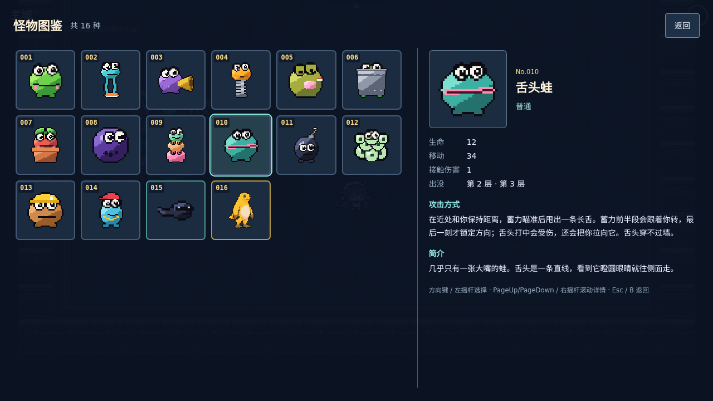
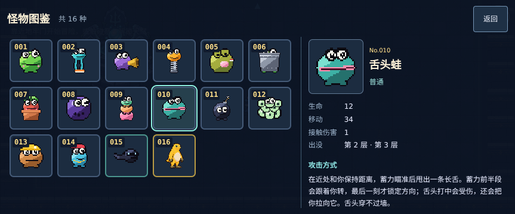
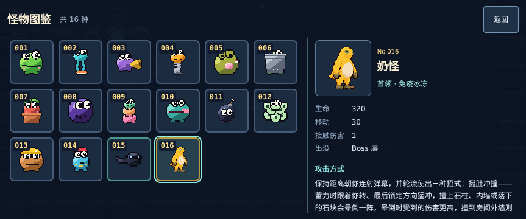

# #99 主城怪物图鉴接线验证

## 初版基线与范围

- main：`bdc441a60d125991bd3fe55a2ef4b625740339d2`；#98 已由负责人验收。
- Claude #106：`e9c9a96a42d6f25354e40edf504c07a20c7b0442`，包含 ADR 0036、设计、16 种怪物目录与文案。本地完整检查通过，评审未发现阻塞问题。目录的深层只读约束及蛙卵团召唤上限文案的精确性作为非阻塞建议留在该 PR，由 Claude 处理。
- GPT #107：`27515cff8898e7492906e290d8aae4bb5a24bf9c`，base 为 `claude/99-bestiary-contract`。提供裁剪坐标缓存、四向导航、样式与参数，本身尚不挂载 UI。
- 接线分支 `gpt/99-bestiary-ui` 叠在 #107 上，接入主城常驻按钮、面板、输入与离线验证。不修改 sim、怪物资源或存储格式，不启动 #100 / #101。

## 运行时行为

主城点击「图鉴」、按 I 或标准手柄 X 打开。只读取 `bestiaryCards()`，编号、名单、帧与文案均来自契约。左栏方形卡片保留间距与编号；右栏随选择更新，包含名称、属性、出没/产生者、攻击方式、简介和冰冻免疫提示。全部怪物立即可见。

- 左右栏独立滚动，`overscroll-behavior: contain`。触屏拖动只滚动，点按才选择。
- 方向键 / 左摇杆 / 十字键四向选择；Tab 切换当前卡片与返回；PageUp/PageDown 或右摇杆滚动详情；Esc / B / 返回关闭。
- 打开使用 interaction 暂停；关闭走现有输入清理，先松开手柄再接受新输入。打开、失焦或切后台后手柄需回中，不消耗后台期间的长按。
- DOM 首次打开才构建，在同一主城反复开关复用。离开主城销毁 DOM 和监听；只跨场景保留已选 ID 及数值裁剪坐标。
- 从已经加载的原图集读取静态帧，每个 ID 首次扫描透明边距；临时 canvas 扫描后清空。CSS 背景按裁剪结果定位、等比铺满，朝左帧镜像，保留 `image-rendering: pixelated`。不生成图片文件或新增 Phaser 纹理。

## 初版本地检查（#108 `05e25e1`）

#106 精确 head、#107 等价文件树以及接线完整文件树均通过 `npm run check`：Prettier 3.9.10、ESLint、TypeScript、54 个测试文件 / 405 项单测、Vite 构建与 PWA 生成。

相关 e2e 共 76 项：**71 通过，5 项条件跳过，0 失败，0 flaky**；2 workers、0 retries，耗时约 4.5 分钟。范围为：

```text
bestiary.spec.ts         bestiaryLifecycle.spec.ts
hub.spec.ts              talents.spec.ts
input.spec.ts            lifecycle.spec.ts
save.spec.ts             resumeProduction.spec.ts
pwa.spec.ts
```

使用仓库桌面 1280×720、Pixel 7 横屏 863×360 的 Chromium 项目，额外覆盖 915×412、568×320。当前执行环境用外部 Playwright 配置指定可运行的 Chromium 软件渲染二进制；仓库浏览器配置与锁定依赖未改。5 项跳过是上述文件已有的仅触屏条件分支和新增图鉴触屏专用用例在桌面跳过，不是重试通过。

覆盖内容：

- 逐一检查全部目录卡片和中英文详情；独立扫描原图 alpha 校验每张图裁剪比例、背景坐标、朝向和像素显示。
- 键盘/手柄四向导航、详情滚动、选择保留、窄横屏、返回后继续移动/进入祭台；CDP 原生触摸拖动不误选，点按正常。
- 真实 HubScene 物理位置在图鉴打开时不变；关闭无键盘或手柄残留输入；切后台时按住 B 不会在恢复时关闭图鉴。
- 图鉴操作前后冒险与档案原文不变。既有天赋、结算、存档恢复、生命周期和输入用例通过。
- 生产子路径构建中，断网刷新并关闭重开后，进入主城打开图鉴、逐个查看怪物；继续验证现有 PWA 更新流程。没有修改预缓存策略。

测试调试阶段修正了三个探针问题：旧移动输入仍处于既有减速时不能当作关闭泄漏；Playwright 会重装自身命中拦截监听；重建主城时 Phaser 文本测量也会读取 canvas。最终测试等待实际速度归零、仅过滤已确认的 Playwright 拦截监听，并比较打开图鉴前后的 canvas 读取增量；生产移动物理未改变。

## 初版资源与生命周期

`bestiaryLifecycle.spec.ts` 用独立测试入口观察真实场景，不向正式构建加入调试接口；附件保留每轮 CDP 监听明细。

| 观测项                                                 | 桌面       | Pixel 7 横屏 |
| ------------------------------------------------------ | ---------- | ------------ |
| Phaser 纹理总数（首次打开前后相同）                    | 23         | 23           |
| 主城 display list 项数                                 | 700        | 700          |
| WORLD_STEP / scale / game pause 监听                   | 1 / 12 / 1 | 1 / 12 / 1   |
| window / document 监听（排除 Playwright 自身命中拦截） | 31 / 21    | 37 / 21      |
| 首项选中时面板后代 DOM 数                              | 92         | 92           |
| 首次打开 alpha 扫描次数                                | 16         | 16           |
| 后续每次打开新增 alpha 扫描                            | 0          | 0            |

连续开关 8 次、主城与菜单往返 3 次后上述数量不增长；离开主城图鉴 DOM 为 0，回城重新打开后 `#hub-panel` / `#bestiary-panel` 各为 1。详情只在选择变化时更新，不在帧循环重建。

| 构建产物        | #106 基线            | 接线后               |
| --------------- | -------------------- | -------------------- |
| JS / gzip（kB） | 1639.68 / 448.18     | 1652.11 / 451.87     |
| CSS（kB）       | 9.59                 | 13.09                |
| Workbox 预缓存  | 20 项 / 11318.89 KiB | 20 项 / 11334.45 KiB |

预缓存增加 15.56 KiB，运行时图片字节不增加。文档截图不进入 `public/`，不随游戏预缓存。这里检查的是资源数量和工作量；没有据此声称真机 FPS、Safari 或长期内存表现达标。本轮没有运行 WebKit，也没有重跑仓库所有 e2e；仍需负责人 iPhone 验收。

## 截图与人工复查

截图来自本轮自动化的真实生产 UI。二进制文件通过文件选择器上传，远端 Git blob SHA 和字节数与下表一致。

| 文件                            | 尺寸     | 字节数 | Git blob SHA                               |
| ------------------------------- | -------- | ------ | ------------------------------------------ |
| `bestiary-desktop.png`          | 1280×720 | 178424 | `fd839850f2b71e965eb78d519f8dea9ca36dd475` |
| `bestiary-mobile-landscape.png` | 863×360  | 127314 | `048607c5dac8b9981c4b1baa7b85b43c7020d8f1` |
| `bestiary-offline.png`          | 863×360  | 133649 | `2ed0d19e320309e2b4bcab30b3abaa65f6be2913` |







人工复查：进入主城打开图鉴，逐个查看怪物；左右栏分别滑动，确认拖动不误选；返回后移动和祭台交互正常。安装后断网重开，再进入图鉴查看静态图片与长说明。手柄用 X 打开、十字键/左摇杆选择、右摇杆滚动、B 返回。

远端自动 CI 保持关闭；本轮不合并，等待 Claude 交叉评审与负责人验收。

## Claude 复审后的增量修复

### #106 上游复测

精确 head `5e4846c9d8373bee8d8dc52e2dc50b130039959a` 在独立工作区通过完整 `npm run check`：格式、lint、类型、54 个文件 / **407 项单测**、构建及 PWA 全通过。新增深层冻结测试及双蛙卵团真实 CombatWorld 30 秒测试通过；前轮两项非阻塞建议均已处理。

当前 #107 / #108 尚未 rebase，因此 #108 的单测仍为 405 项；#106 合并后 rebase 时保留上游 `src/sim/meta/bestiary.ts`、`tests/unit/sim/bestiary.test.ts` 和对应中英文文案。不改写 Claude 分支。

### #108 鼠标松开与焦点同步

新增 e2e 先在 `05e25e1` 的旧生产构建上复现：卡片按下、移动到详情区松开，方向键将焦点移到 003，但 `aria-pressed` 仍为 002，原断言失败。

修复把 `pointerup` / `pointercancel` 清理移动到 window 捕获阶段，使用面板同一 AbortSignal，且按 pointerId 匹配当前手势；不依赖网格收到松开事件，也不受 UI 冒泡拦截影响。`open()` 清空 pointer 和 dragged，避免关闭期间丢失松开事件影响下一次打开。触屏拖动后仍抑制误点击。

新增用例覆盖：网格外松开后键盘选择、再次网格外松开后手柄选择、相同 pointerId 的取消事件，以及鼠标保持按下时关闭重开。每步核对实际焦点、唯一 `aria-pressed` 和右栏名称一致；松开路径使用真实鼠标输入，取消路径显式派发测试事件。

修复后完整 `npm run check` 通过（54 个文件 / 405 项单测，格式、lint、类型、Vite 和 PWA 均通过）。增量 e2e 重跑 `bestiary`、`bestiaryLifecycle`、`hub`、`input`、`lifecycle`、`pwa` 六个文件的桌面与 Pixel 7 横屏项目，2 workers、0 retries：

- 首轮 **28 通过、3 条件跳过、1 浏览器启动失败**。失败的是手机「全部条目、裁剪比例、键盘二维选择、尺寸变化与返回主城」；Chromium 在 `browserType.launch` 阶段以 SIGSEGV 退出，尚未加载游戏，不是断言失败。
- 保留首轮结果，只对上述启动失败用例单独重跑（1 worker、0 retries），**1 项通过**。合计 29 个可执行用例都有通过结果；不将首轮写成全绿。
- 新增鼠标回归在两种视口都通过；原生触屏拖动/点按、手柄、后台恢复、输入与主城流程、断网重开和 PWA 更新通过。
- 生命周期检查仍为 8 次开关、3 次主城往返；纹理 23、主城 display list 700、WORLD_STEP / scale / game pause 监听 1 / 12 / 1，首次扫描 16、后续 0，均不增长。window / document 监听变为桌面 33 / 21、手机 39 / 21：新增的 2 个 window 捕获监听随同一 AbortSignal 清理，往返不会累积。
- 构建 JS 为 1652.38 kB（gzip 451.91 kB），预缓存 20 项 / 11334.71 KiB；没有新图片或样式改动，沿用初版截图。

本轮未重跑完整仓库 e2e 或 WebKit，不外推真机 FPS。#107 head 保持不变；#108 只追加输入修复、回归测试和验证文档，等待 Claude 增量复审。合并顺序仍为 #106 → #107 → #108，#100 / #101 不启动。
