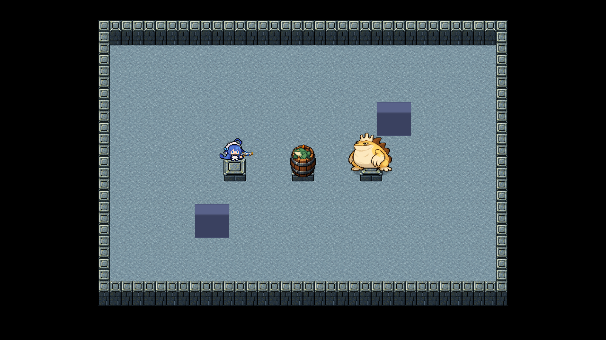
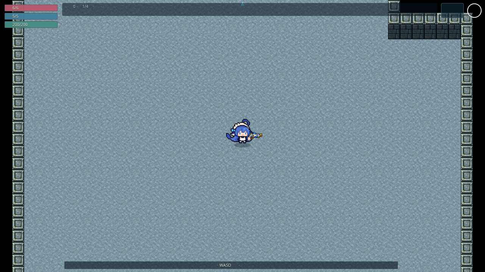

# #135：实体高于障碍、纯像素材质地板

基线 main `8ac9a39b58aa96f7a4deee30f574e21661312545`（已合并 #133）。2026-10-29 实施。负责人明确豁免本次 Claude 复审，本地检查后交其实际测试、合并；未改 main、未启用或触发远端测试 CI。

## 实现与边界

- 新增障碍层 25：ModularRoomArt、LegacyRoomArt、RoomArena 无美术回退，以及完整/受击木桶均低于人物、普通怪、Boss 的 `30 + y/10000`。实体之间继续按 y 排序，手持武器和弹体/特效层保持既有关系。破桶仍是地面残迹。无每帧新增对象。
- ground-v6 为四主题无砖缝纯像素材质，主色仍为冷蓝灰/暖棕/靛蓝/暖砂。完整 627×627 主题帧最近邻绘制到 256×256，直接重复为 32×32 世界单位；无镜像、旋转、重排、程序补边或运行时混合滤镜。
- 九图集仍 76 帧，其余八图逐字节不变。PNG 原样保留，WebP 仅无损编码，解码 RGBA 完全相同；旧运行 ground-v5 删除，原稿保留历史。
- 未改 `src/sim`、房型、碰撞尺寸、导航、面积、武器/AI 或存档逻辑。#134 阴影规则独立排期，当前模块墙仍烘焙在地面画布；不要把本次实体遮挡修复当作阴影遮挡完成。

## 本次实际验证

Node 22.23.4；既有本地 Chromium/软件 WebGL，桌面与 Pixel 7 横屏模拟。没有新增依赖，未执行远端 CI。

- 完整 `npm run check` 通过：Prettier、ESLint、TypeScript、64 文件 / 524 单测、Vite + PWA 构建。
- 本次针对性浏览器组合最终 **32/32 通过**（按下表各项末次结果汇总，不是宣称首轮全绿）：

| 项目                            | 桌面 + 横屏结果 | 内容                                                                                                        |
| ------------------------------- | --------------- | ----------------------------------------------------------------------------------------------------------- |
| mapArt                          | 10/10           | 正式主城、四层生产场景，九图资源加载、无页面异常                                                            |
| mapArtMatrix（不含 800 房压测） | 6/6             | 墙顶/墙身方向、门洞、障碍透明角下地板、八片机关边框                                                         |
| mapLayers 图层                  | 8/8             | 四主题 × 五次前后位置/换布局复用，真人物/普通怪/Boss 的 ActorArt、手持武器高于模块障碍、Arcade 灰盒障碍与桶 |
| mapLayers 地板                  | 8/8             | 实际烘焙 2×2 区域与原帧最近邻直接重复逐字节相同，无旋转/镜像/重排；周期边界强度检查                         |

初轮 32 项中 22 通过、10 失败：新增 fixture 把 StaticGroup 默认 Sprite 当作 Image 筛选，漏统计灰盒障碍；旧门洞 probe 使用物理 center，未跟随 #133 的 artCenter。已修正 fixture 的 Sprite 类型、选取非空布局及门洞采样中心。第二轮相关 18 项中 10 通过、8 个障碍统计仍失败，补全 Sprite 类型后图层 8/8。首轮类型检查另报测试 Canvas drawImage 的 tuple 展开错误，改显式坐标后完整 check 通过。生产图层修复没有因此反复改变。

旧 wallArtProbe 的“相邻边像素必须相同”是镜像地板时期的断言，v5 起已不适用；删除该项，改由新 floorPatternProbe 检查完整帧直接重复及实际周期边界强度。不是只删失败测试。

边界强度为 256² 原帧 RGB 相邻列/行的平均绝对差（0–255）。纯随机材质不要求相对边逐像素相同；此检查只排除突出于内部纹理的接缝线，不等于证明任意缩放和屏幕上都不可见。

| 主题 | 左右周期边界 / 内部最大 | 上下周期边界 / 内部最大 |
| ---- | ----------------------- | ----------------------- |
| 石殿 | 8.77 / 13.03            | 8.82 / 16.48            |
| 沉船 | 5.40 / 6.51             | 5.17 / 11.47            |
| 深渊 | 9.36 / 14.55            | 7.25 / 13.35            |
| 奶池 | 7.49 / 10.79            | 6.42 / 10.40            |

## 图片与资源完整性

下图为测试 fixture 故意构造重叠，验证人物、普通怪、Boss 不被障碍遮住；不表示允许人物走入碰撞体。灰盒方块用于检查无美术回退。

正式生产场景：`?scene=Game&seed=42&god=1&floor=1`，1280×720，未修图。

| 文件                                  | 字节      | Git blob SHA                             |
| ------------------------------------- | --------- | ---------------------------------------- |
| art-src/maps/sources/ground-v6.png    | 1,537,333 | d83b0129ab1cc02023ba8b655bb6660e60ec06fc |
| public/assets/demo/map-ground-v6.webp | 1,136,944 | 1bda2892095064abb5746c3b0185afd40462386b |

两张图片通过 GitHub 网页文件通道上传到功能分支后，远端 tree 的 SHA/字节与本地一致。九运行图合计 8,485,908 字节，较 v5 减少 144,248；未缩减 Git 历史。生产构建 PWA 29 条、19,849.57 KiB，含 v6、不含 v5。四主题地板 pattern 理论 RGBA 缓存仍约 1 MiB，无新增图集数量和每帧地面重画。

## 负责人实际测试

合并部署完成后，可用 `?scene=Game&seed=42&god=1&floor=1`，依次改 floor=2/3/4；进入有柱子、桶的战斗房，从其上侧/下侧绕行，看人物、普通怪和 Boss 模型是否始终完整显示。继续看四主题颜色、移动镜头时细纹是否闪烁、弹体可读性与换房卡顿。当前软件 Chromium 检查不是手机性能或 WebKit 验收，本次没有跑全量 E2E 或 800 房组合压测。

旧问题仍单独保留：画布/离屏墙层换房上传、奖励安全回退偏左上、桶显示宽 18 与碰撞直径 14、#134 阴影层。此次不改变这些玩法或扩展新房型。
