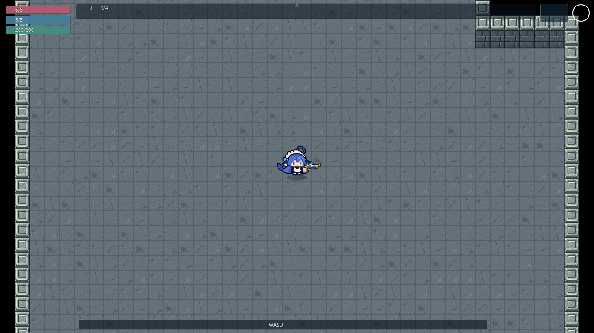

# #137：十款墙宽方砖与材质色墙边

基线 main `e14ea32d4a5488da233be927e989d9907783734d`（#136 已合并）。本批在 `gpt/137-floor-variants` 交付；当前保持 Draft，待 Claude 复审及负责人实景/真机验收，最终由负责人合并。

## 实现与范围

- 接入负责人已确认的四主题 ground-v7，每主题十款方砖。每格 8×8 世界单位，与墙宽相同；正向逐格随机选款，不旋转、镜像或整图重复。
- 四张源 PNG 保留原字节，运行 WebP 无损。5×2 切帧后各边内缩 8 源像素，最近邻绘入 64×64 缓存，外圈 1 像素统一主题材质色；相邻共同边合计 0.25 世界单位。具体色值、完整提示词和实际图片见 [风格手册](../MAP_ART_STYLE.md)。
- RoomArena 从原始冒险 seed、floor、roomId 派生独立表现流；ModularRoomArt 按固定网格顺序抽款。不会抽取 live root/AI/掉落 RNG，不新增存档字段。重新建同一房得到同一画面；主城默认 seed 0。只在建房绘制，仍为单张地面 CanvasTexture，没有逐砖对象或每帧地面重画。
- 按负责人补充将 v17 黑色墙边改为主题材质色，接入 wall-model-v18。图集仍为 1774×887，自动测量新的非透明顶/身边界；世界宽、高宽比、门洞及物理轮廓保持原值。新图不等于 v17 历史验收自动覆盖 v18。
- 删除被替代的两个运行文件 ground-v6、wall-model-v17；历史源图保留。运行注册、帧映射、导出器、技能测试 fixture 同步引用新版本，构建预缓存不存在这两个旧文件。未展开其他资源清理或后续队列。

## 本地验证

Node 22.23.4；Chromium 153.0.8010.0 / SwiftShader；桌面和 Pixel 7 横屏模拟，workers=1、retries=0、沿用单项时限。无新增依赖。完整数据、源文件摘要和截图摘要见 [JSON](floor-variants.json)。

| 批次                               | 结果                    | 实际覆盖                                                                                                                                    |
| ---------------------------------- | ----------------------- | ------------------------------------------------------------------------------------------------------------------------------------------- |
| 本次完整 `npm run check`           | 64 文件 / 525 单测通过  | 格式、ESLint、类型、单测、Vite/PWA 构建                                                                                                     |
| 上一会话启动的 32 项定向浏览器批次 | 24 通过、8 失败         | 四层生产加载、大厅、墙顶/转角/门洞、透明障碍铺底、整数门连接及角色图层；8 失败均为地砖参考像素对照                                          |
| 修复测试参考后的地砖复跑           | 8/8 通过，0 跳过/重试   | 四主题 × 双端，每次读取 384 块实际地砖；每主题十款全部出现、边框色逐像素一致、seed 42→77→42，恢复相同摘要、换种子不同，场景对象和纹理数稳定 |
| 新增门墙实景与 PWA 定向批次        | 10/10 通过，0 跳过/重试 | 四主题 × 双端的整房、四向门及开锁连接；双端真实子路径断网刷新、关闭后重开，十二张地图 WebP 全部离线可解码                                   |

**42 个不同组合按末次分批结果均通过，不是单批整套 E2E 全绿。** 未因测试修复改动生产画法。最初失败与命令完整保留在 [初次日志](floor-variants-initial.txt)。

失败原因定位：原测试重复使用同一参考 Canvas，前两款与实际缓存相符，第三款开始不符，但边色和重复 seed 摘要始终一致；改成每款独立一次绘制/读回后八项严格像素断言全部通过。这符合 Chromium 重复读回触发绘制后端切换、最近邻取样舍入变化的表现。修复仅隔离测试参考画布，未放宽断言、加重试或延长时限。

这里的 42→77→42 是表现层重建探针，**不冒充完整生产存档往返测试**；生产 seed 派生由代码检查确认，本批未复跑完整同版本恢复链。更新仍沿用已合并的结束旧冒险、保护局外档案策略。

## 实景

原样保存十四张截图，不修图。`production` 是实际生产入口的正常镜头；`room` 和门近景通过已有 fixture 调整生产 DemoSession/RoomArena 的镜头取景，不能当作正常游戏镜头尺寸。下表提供四主题对照：

| 主题      | 正常生产镜头                           | 整房取景                         |
| --------- | -------------------------------------- | -------------------------------- |
| 石殿      | [生产](floor-v7-temple-production.png) | [整房](floor-v7-temple-room.png) |
| 沉船      | [生产](floor-v7-wreck-production.png)  | [整房](floor-v7-wreck-room.png)  |
| 深渊      | [生产](floor-v7-abyss-production.png)  | [整房](floor-v7-abyss-room.png)  |
| 奶池/Boss | [生产](floor-v7-milk-production.png)   | [整房](floor-v7-milk-room.png)   |

四向门连接：[北](floor-v7-temple-north.png)、[南](floor-v7-temple-south.png)、[东](floor-v7-temple-east.png)、[西](floor-v7-temple-west.png)。另有 [手机横屏沉船](floor-v7-wreck-mobile.png)、[大厅](floor-v7-hub.png)。其他主题门连接也已运行上述检查，未把全部相似截图重复提交。

## 资源与限制

| 指标                     | 基线 / 本批                                                              |
| ------------------------ | ------------------------------------------------------------------------ |
| public 当前文件总量      | 18,613,274 → 20,859,436 字节，净增 2,246,162                             |
| 当前 Workbox 预缓存      | 32 项，22,574,613 字节；无旧地板/旧墙体运行图                            |
| 本批五张 WebP            | 地板 750,424 / 849,936 / 888,950 / 851,924；墙体 875,818 字节，均 <2 MiB |
| 地板源图解码 RGBA 理论值 | 6,290,064 → 25,160,304 字节                                              |
| 地砖缓存 RGBA 理论上限   | 1,048,576 → 655,360 字节                                                 |

public 对照直接来自基线 Git 文件尺寸与当前文件，不是重新构建基线的总包对照；预缓存为当前生产构建实测。十二张图集的原稿/运行摘要和 RGBA 无损结果见 [导出报告](../../art-src/maps/export-report.json)。新地板保留四份完整原稿，源图解码约增加 18 MiB，不能写成总体内存优化；缓存数值不是 GPU 显存测量。仍沿用地面和离屏墙层各 2624×1984，每次建房整图烘焙/上传。本批未做 FPS ABAB、800 布局压力、WebKit/Safari 或物理手机验证，细边随镜头移动时是否闪烁仍由负责人试玩确认。

提交通过文件选择器上传二进制，文字通过 GitHub 插件提交；最终必须核对远端完整 tree 与本地。未改 main、未自行合并、未启用/触发/重跑远端测试 CI；#134、#115–#119/#129 仍按原队列。
