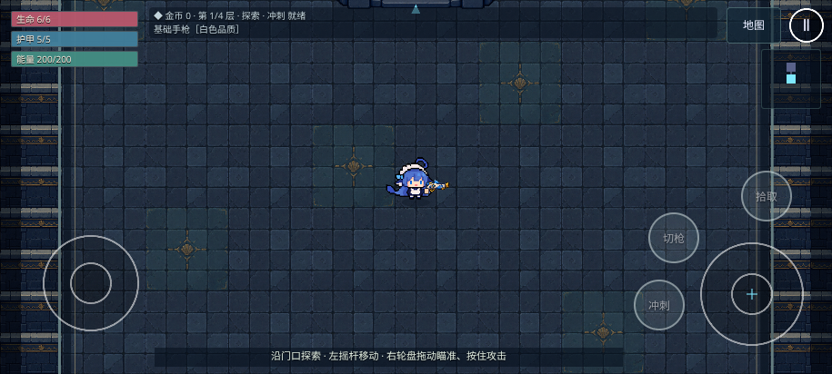
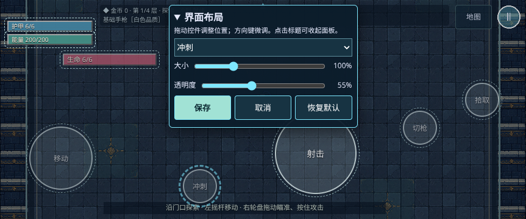
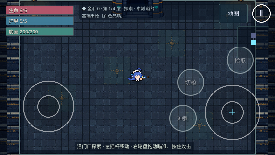

# 全屏地图与可保存 UI 验证

基线：main `5737473`，PR #91 已合并。负责人随后要求全屏地图与覆盖式控件，详见 [ADR 0029](../adr/0029-fullscreen-custom-ui.md)。本轮替代上轮侧栏布局，原验证记录保留为历史。

## 使用方法

标题页「设置」→「界面布局」，或局内暂停 →「界面布局」。选择或直接拖动生命、护甲、能量、移动摇杆、射击轮盘、冲刺、切枪、拾取任一控件；调整大小、透明度后保存。拖动时可收起面板；键盘可用 Tab 选中控件、方向键微调、Escape 取消。

保存写入本浏览器的 `avn.ui-layout.v1`，立即应用到绘制与命中区域，并在刷新、换场景及离线重开后恢复。取消不写入；恢复默认需要点击保存确认。浏览器拒绝存储时提示失败、保留草稿。可保存位置按安全画布比例记录，窗口改变后限制在可见范围内；控件重叠时要求移开再保存。

## 验证范围

- 使用实际生产构建、Chromium 153、桌面与 Pixel 7 横屏模拟。额外尺寸为 915×412、844×390、667×375、568×320；WebKit 和手机真机本轮未执行。
- UI 通过真实 DOM/PointerEvent 交互；手机拖动使用 Chromium 原生多点触摸。测试在修改后的射击位置实际出弹，旧射击位置失效，移动后的冲刺按钮仍可触发技能。
- 检查保存与刷新、旋转后恢复、取消不写入、恢复默认、相互重叠、固定地图/暂停入口避让、存储失败及原设置兼容。离线测试从标题设置保存后断网刷新，再关闭重开地牢并检查 HUD 布局仍恢复。
- 相机检查覆盖整个 canvas，像素/朝向、门口、切房、鼠标瞄准、触摸首发等待和有符号触点继续回归。
- 镜头矩形使用不足半个 CSS 像素的取整容差（915×412 的整数渲染缓冲差约 0.03 CSS px）。受击测试入口由 2 HP 改为 6 HP，避免首次 2 点伤害直接致死而跳过待检测的受击动作；仅修改测试存档。

本机测试工具与字体放在仓库外，无依赖/锁文件变更，远端 CI 保持关闭。imagegen 仅按参考图制作布局概念示意，不加入运行素材或充当截图。没有新增运行图片，PWA 资源数量维持 15 项。

## 本地回归记录

- `npm run check`：格式、ESLint、TypeScript、307 项单测（44 个文件）及生产构建通过。环境为 Node 24、Chromium 153；仓库约定的 Node 22 与 WebKit 本轮未运行。
- 首轮完整桌面/手机回归：161 通过、16 平台跳过、3 失败、无重试。两项失败是旧测试仍从 `.demo-status` 查找 HP，而生命条已独立；另一项瞄准测试在低帧率下把两次同帧读取误判为镜头稳定。修正为读取独立生命条，并在多个实际推进的模拟帧中等待镜头稳定，射线误差阈值仍保持 0.5。
- 最终回归覆盖布局编辑、原生触屏拖动、新位置实弹与冲刺、镜头、角色朝向、主城、结算、高清坐标和 PWA 离线。使用仓库 Playwright 配置，仅将可执行浏览器与输出目录指向仓库外的本地测试工具；远端 CI 未启用。
- 宽屏放大后的 72 项定向回归为 58 通过、13 平台跳过、1 失败。眼睛检测发现差异位于脸部裁片第 0、1 列、第 26 行，映射到蓝色鬓发边缘；检查错误地把活动鬓发也纳入眼睛。现在排除两侧 8 个源像素的鬓发区域（实际双眼均完整保留），眼睛逐帧与左右镜像仍要求零像素差异，且记录异常像素坐标供诊断。生产角色代码与 PNG 均未修改。
- 最后针对变更的眼睛检查、地图入口避让、布局编辑与完整相机回归：**12 通过、2 平台跳过、0 失败、0 重试**（桌面与手机）。两个平台完整待机/行走循环一致，左右镜像差异均为 0；新位置开火/冲刺、刷新恢复、原生拖动及存储失败均通过。

最终生产构建预缓存 15 项、10835.94 KiB。新增布局对象仅在初始化/编辑/窗口变化时创建，帧循环不新增显示对象；墙外背景复用一张现有墙砖纹理。

## 实际画面

截图以原始 PNG 文件通道上传到功能分支；Git blob SHA / 字节数：

| 文件                     | 字节数 | Git blob SHA                               |
| ------------------------ | -----: | ------------------------------------------ |
| fullscreen-ui-phone.png  | 600804 | `006b87a077356545281d04ab036d11fa9b9e9f83` |
| fullscreen-ui-editor.png | 361888 | `f13a68bc3903e7bd0c82c772ac30c94f0631972b` |
| fullscreen-ui-small.png  | 281544 | `6e424695a950c4e8decdde9d17cb881a4f2ff012` |

## 验收边界

模拟不能代替真机的拇指舒适度、刘海安全区和长时间帧率测试。控件按用户选择覆盖场景；不同宽高比可能令定制布局靠近或重叠，必要时重新编辑或恢复默认。编辑器支持触屏、鼠标与键盘；手柄在编辑状态被隔离以免误触，编辑面板暂不提供专用手柄导航。
