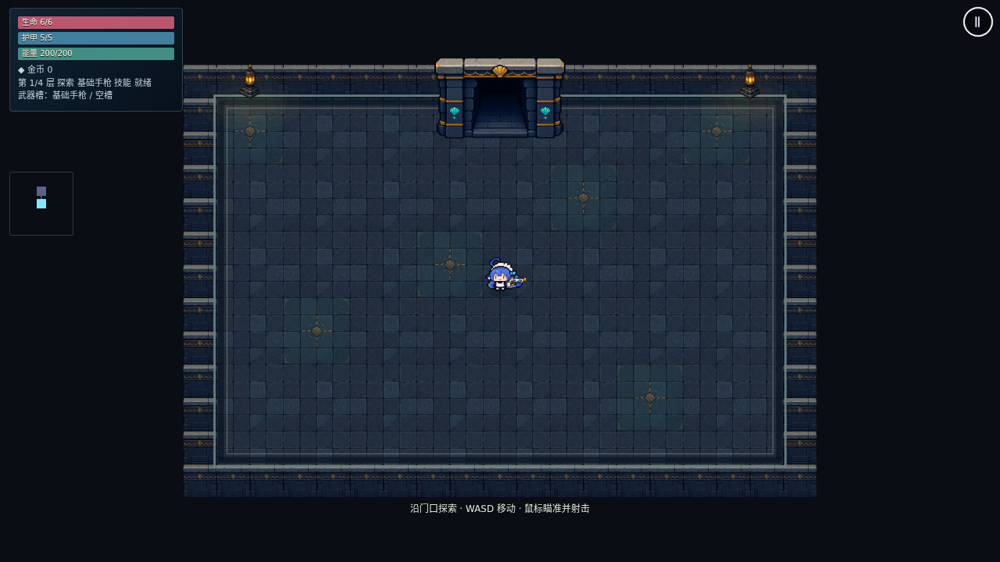
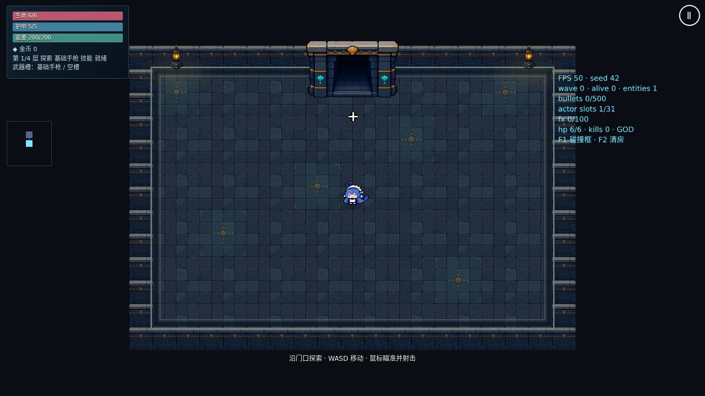

# PR #83：高清像素画、动作与触屏验证

## 本轮结果

- 480×270 逻辑世界直接绘制到 1920×1080 画布；界面文字保持高清，游戏 PNG 单独使用 NEAREST 采样。
- 大肥鱼采用负责人补发的透明动作图：待机 6 帧上下摆尾，行走 8 帧；起步、停步重置视觉时钟，暂停冻结动作。受击 2 帧和死亡 4 帧沿用上轮指定的旧图。
- 十二件武器使用负责人补发的原图；手为贴图上的长方形。重新定位手块中心并扩展裁切，避免切掉枪口、弹匣、法杖边缘和刀尖。固定枪口相对新握把重新标注，动画时钟不进入 sim。
- `CHARACTER_ART` 按玩法角色 ID 注册图集、动作序列、时长、比例与固定持握点，加载器及渲染器共用；当前仍只有大肥鱼，没有新增选人界面。
- 接续上轮开放 / 锁闭门框资源，四个显示对象预热复用。
- 触屏开火不被兼容鼠标事件抢走输入来源；基础手枪可在零能量时开火，耗能武器提示能量不足。

## 验证范围

本轮重新运行 `npm run check`，格式、lint、类型、40 文件 / 288 项单测和生产构建均通过。端到端覆盖桌面、Pixel 7 横屏，以及 iPhone 13 横屏 WebKit。此前本地 Chromium 使用 SwiftShader 生成下方截图；续接环境没有保留该浏览器，重新安装时下载包无效，因此本轮完整浏览器回归以 PR 当前提交的 CI 为准，未将上次中断的测试记为通过。模拟手机不能代表真机性能。

重点回归包括六帧待机 / 八帧行走的完整循环、暂停冻结、四向翻面 / 握持 / 遮挡、移动中的身体中心瞄准、真实双指开火、兼容鼠标事件、零能量存档续玩、近战中保存恢复、完整三层流程及断网重开。正式结果及 CI 链接见 [PR #83](https://github.com/marchosias142857/ai-vs-naiwa/pull/83)，以当前提交为准。

生产预缓存为 15 项、约 10.98 MiB；七张 PNG 均小于 2 MiB。PWA 用例在断网重开后逐一请求七张图片，并确认角色视觉存在。附件哈希和来源见 [美术记录](../../art-src/demo/README.md)。

## 实际运行截图

## 负责人试玩

合并 PR 后等待 main 的 Pages 部署成功，再打开正式网址：

- `?seed=42&god=1`：开局、待机摆尾、移动、双指射击、暂停与刷新续玩。
- `?seed=42&weapon=rifle_auto&god=1`：自动步枪、握持与能量提示。
- `?seed=42&weapon=anchor_hammer&god=1`：近战挥动和暂停续玩。

真机帧率、长期发热、手感与画面最终确认仍需负责人试玩。已有存档在构建 / 数据指纹变化后按既有规则回退至该层入口，并提示原因；不承诺跨版本逐弹恢复。PR 未合并前，线上仍是 main 版本。所有 PR 由负责人合并。
