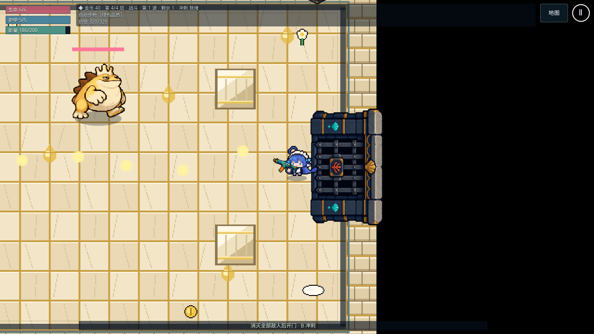
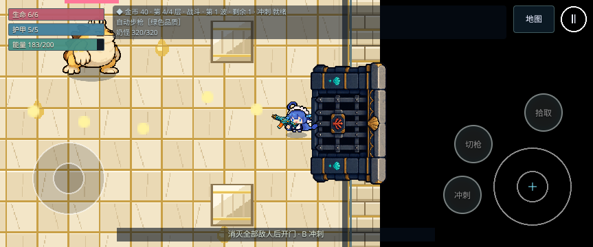

# #114 动态几何适配与现有房间导航

日期：2026-10-27。基线 main `a6a8d2d8ce766a7492d3e0dd773cf6a2d4dbe486`（#124）。分支 `gpt/114-live-geometry`。

## 范围与行为

- LiveRoomGeometry 复用静态快照和固定动态圆槽，桶/落石按原槽号保留稳定 ID；查询与 sync 分开，阻挡变化才递增 revision。不重建战斗中的静态多边形，查询与同步没有显式对象分配。
- 复用 RoomGeometry 原圆形窄相位；只是将内部 circle 改名为带 @internal 说明的 accumulateCircle，公式与 #124 接触语义不变。
- RoomArena 按现有物理 Box 坐标编译矩形/内墙；Boss 四柱类别为 pillar。prepareGeometry 同步当前池并使导航缓存失效；steer 每次只准备一次，网格批量查询复用快照与输出对象。
- 生产导航从扩大矩形检查改为完整圆/胶囊，并把已落石加入绕行；立桶在路径中途也能截住。不是只换接口名字，可能改变后续战斗移动轨迹。
- 未改 EnemyAi/CombatWorld/AiHost、数值、随机调用、WORLD_STEP 次序、存档字段、物理体、美术或房间目录。RoomDirector/isFree 的旧刷怪回退保持，后续与出生锚点一起改。现有 LOS 回调留给 Claude 接 AI；本 PR 不代写已分工的 AI 规则。

## 验证

- Node 22.23.4 下 `npm run check` 全部通过：格式、ESLint、TypeScript、58 个测试文件 / 459 项单测、生产构建。比 #124 新增 8 项单测。
- 本轮 Chromium 153 浏览器回归 14/14 通过，桌面与手机横屏各 7 项：实际走门/清房/暂停、Boss 实际命中与结算、子路径 PWA 离线刷新及关闭重开、生产入口存档恢复、完整 JSON 往返后逐物理步一致、stress=1 与 stress=combat 的测量导出和退出清理。
- 浏览器回归使用现有 Playwright 测试与构建产物；本地临时配置指定已安装 Chromium、单 worker、无重试，未改仓库测试配置。没有执行 WebKit 项目，也没有把上述筛选回归写成全套 E2E 通过。
- 构建主包 1,668.30 kB（gzip 457.34 kB），离线预缓存 20 项 / 11,539.80 KiB。压力回归检查现有功能与计数器断言，不构成新增 FPS A/B 或内存分配证明。
- 提交前查看 GitHub CI 工作流仍为手动 Disabled；未启用、触发或重跑远端 CI。

新增单测覆盖动态落地/破桶/移除、查询只读、revision 与固定对象身份、动态/静态混合的掩码/同距/法线/接触等价、真实 CombatWorld save/load/clearHazards 与 RNG 不变、实际 RoomArena 全布局/Boss 坐标、同一步内导航失效与恢复。游戏层单测只替代绘图/Arcade 接口，RoomArena、NavigationGrid 与 CombatWorld 使用真实实现；不能替代浏览器物理验证。

## 本轮浏览器截图

现有 Boss 房的桌面与手机横屏运行记录；只记录本轮回归画面，不作为动态圆槽、导航正确性或新地图美术的证明。

## 限制与交接

当前仍是旧矩形地图；新轮廓物理/模板、freezeV1 与版本化存档、RoomDirector 确定性出生回退、正式美术和 200 组合验收未完成。固定圆槽复用由单测检查；没有新的相同负载 FPS A/B 或堆分配剖析，不能把模拟耗时当帧率。WebKit/Safari/iPhone 真机无本轮验证。

Claude 从最新 main 接 AI，生产查询可通过 provider 在每次决策取 RoomArena.prepareGeometry 返回的只读 GeometryQueries，避免把一次快照永久缓存。动态适配与导航 PR 也交 Claude 复审，由负责人合并。远端 CI 继续关闭，不启动 #115–#119。
