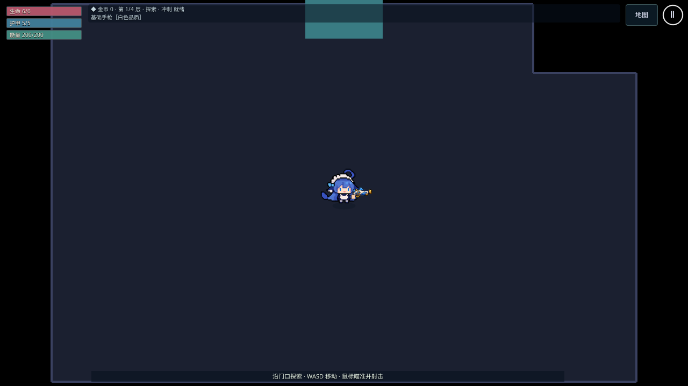
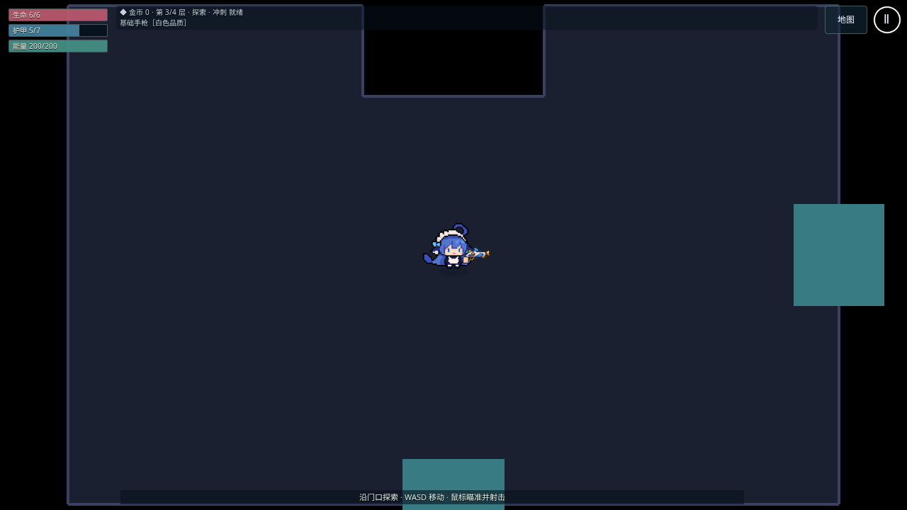
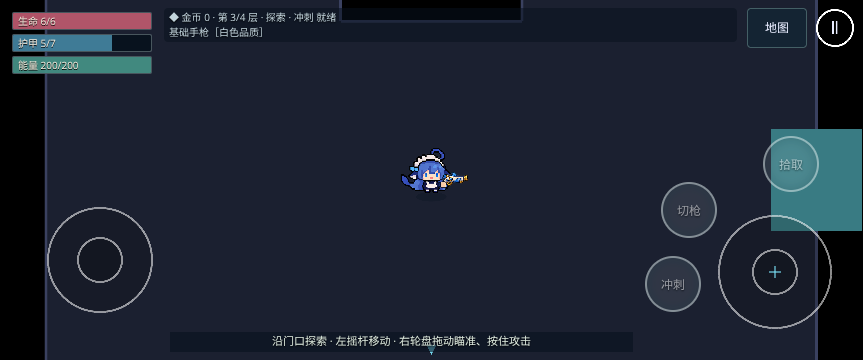

# #114 三项基础交付验证

基线 main `60c35eb`（#131 合并）。本批连续实施更新存档边界、模板锚点/RoomDirector、非矩形灰盒物理；契约见 [ADR 0040](../adr/0040-map-foundations.md)。运行代码为 `3df2e55ce33dc04744e0e671305944be71073b9e`；其后增加测试、文档、报告和截图，已审 head `8524de6` 的 src tree 仍为 `72d9142a9f036534424867fa676f049a1d0365d6`。Claude review 5683888966 确认代码无阻塞，本次更正文档；线上灰盒替换仍待负责人确认，PR 保持 Draft。

首轮 88 项 Chromium：82 通过、1 桌面竖屏条件跳过、5 失败。两个 Boss 击杀时限失败；PWA 横屏项目在测试切到竖屏之后重载，启动仍被横屏遮罩挡住；两个档案保护样本使用了不存在的 vitality 天赋 ID，在新局读档时触发了既有损坏修复。后两类修正测试样本/操作顺序，不放宽断言或超时。初始结果保留，不写成全绿。

候选接线自审发现静态枪口/近战回调被改为包含动态落石，额外改变了旧武器语义；修复为静态轮廓查询，并新增单测保证完整 AI provider 仍包含落石。该修正只排除了动态阻挡，静态查询加入外墙仍会改变武器行为，详见下文限制。原 main 同一 Boss 用例独立桌面/横屏 2/2 通过；候选诊断采样版本桌面 1/1 通过，诊断读取不能代替原用例的最终复跑。中间修正批有一次浏览器启动 SIGSEGV（未进入游戏）和一次 Boss 超时，另四项通过。最终结果另记。

数值几何以半径 6 玩家与各楼层实际普通怪半径（Boss 14）验证；保留所有未破桶。采样中心额外加 CONTACT_EPSILON 保守净空，避免将可离开但不能再次进入的接触容差薄层误当作独立可达区域。连边仍用实际半径的 sweepCircle，八邻接不能穿角。2 单位全目录扫描，最紧沉船布局另做 0.5 单位扫描。旧沉船三桶对半径 9 的真正封闭口袋在新目录展开两侧桶后消除。

## 限制与线上行为

本批为灰盒，正式地图美术未接入。`DemoSession` 无条件以 `new RoomArena(scene, bridge, false, true)` 关闭 RoomArt：**本 PR 合并后，main 自动部署会把线上全部地牢房间（包括 Boss 房）的地板、墙体和装饰门画面替换为灰盒，直到正式模块美术上线；并非仅调试参数可见。** 负责人尚未确认接受线上灰盒过渡；若不接受，备选是新轮廓先只在调试参数下启用，当前代码尚未实现该备选。

外墙加入 `RoomArena.lineOfSight → traceStaticSegment` 后，经 `CombatWorld.los → Arsenal` 影响特殊弹体穿墙判断和光束 reach，也影响枪口检查与近战命中。**武器行为确有变化**：弹跳弹在外墙消耗反弹次数、回旋镖更早折返、光束停在墙上。Claude 的 sim 对照中，玩家 `(340,135)` 朝东开火时，main 的 `bubble_bouncer` 飞到 x=696、`fin_boomerang` 飞到 x=463.7、`lantern_beam` 长 260，均穿墙；本 PR 分别反弹、折返、光束缩至 19.6。Claude 作为武器机制负责人接受这是顺带修复 main 旧 bug，本次不改代码；负责人试玩应留意贴外墙时的弹跳次数、回旋镖手感和光束长度。对照来源为 review 5683888966，不是 GPT 本次新跑的结果。

没有改 AI 技能、碰撞半径或 WORLD_STEP；后续排队任务未启动。不声称 WebKit/Safari/iPhone 真机或新 FPS A/B 已验收，压力场景仅功能检查。CI 网页已只读确认手动 Disabled。

## 最终验证（UTC 2026-10-28）

- Node 22 完整 `npm run check`：62 文件 / 516 单测，格式、ESLint、TypeScript、Vite/PWA 构建全部通过。
- 筛选 legacyCatalog、updateBoundary、save、resumeProduction、productionGeometry、demo、pwa、stress 八个 spec，桌面/Pixel 7 横屏 Chromium，单 worker、零重试：96 项中 94 通过、1 桌面竖屏条件跳过、1 横屏 Boss 击杀在原 35 秒等待内超时，耗时 11.0 分钟。
- 同一最终代码、原用例、原断言与超时，横屏 Boss 隔离进程复跑 1/1 通过（24.3 秒）；不是单次整批全绿。整批间歇超时根因未确认，保留为复审关注点；不据此声称已经证明纯环境问题。初次/中间/基线/诊断/最终/隔离结果均保存在 [逐项报告](map-foundations/report.json)。
- 新增真实 Arcade 检查：模板可连接门双向进出、缺角实体阻挡与子弹、浅凹口视线阻断、潜地怪绕行及出土净空。四层桌面/横屏生产截图均通过。更新检查从带 Game 参数的 URL 仍回 Menu，天赋点、合法已购天赋、备份与模拟未来资源逐字节保全；再次同版本 reload 恢复 Game。既有完整快照物理步/随机状态、离线重开及实际 SW 更新接受流程通过。

## 面积、连通性和包体

[全目录 2 单位采样](map-foundations/clearance.json)覆盖 19 种形式、64 个房型/半径组合，全部单连通分量；所有门、交互和最大怪物出生候选净空通过。全目录地形可通行比例最低 93.30%，玩家中心相对同轮廓空房最低 80.47%。

最紧的 wreck/combat_1 [0.5 单位复核](map-foundations/clearance-fine.json)：地形可通行比例 **93.13%**，玩家中心相对同轮廓空房 **80.39%**，相对完整室内面积 **71.24%**。80% 目标采用前两项口径，不将绝对玩家中心比例写成 80%。所有适用普通怪半径仍为单连通；怪物中心面积不套用玩家 80% 指标。采样不等于连续解析证明。

同依赖独立构建 main 对比：[包体记录](map-foundations/build-comparison.json)。game JS 1,673,203 → 1,678,378 字节（+5,175）；gzip level 9 为 452,154 → 453,875（+1,721）。全部 16 个 public 文件逐字节相同，预缓存仍 20 项；没有资源删减或包体优化承诺。

## 复现与截图

运行 `npm run check`；浏览器命令为 `npx playwright test tests/e2e/{legacyCatalog,updateBoundary,save,resumeProduction,productionGeometry,demo,pwa,stress}.spec.ts --project=desktop --project=mobile-landscape --workers=1`。本机临时配置只替换 Chromium 路径/启动参数、报告路径并复用先前 check 的生产构建，不修改单项超时/断言。独立 Boss 复跑添加 `--grep '右摇杆瞄准与 Arcade' --project=mobile-landscape`。

灰盒试玩：本地 preview 的 `/?scene=Game&seed=42&god=1&floor=1`，分别换 floor=2/3/4；实际走门进入战斗、保存退出后同版本继续。验证更新请用隔离浏览器测试档，执行 updateBoundary/PWA 测试。

三张截图通过 GitHub 网页文件选择器上传到本功能分支，fetch 后核对远端 Git blob 与原始字节完全一致。它们展示生产灰盒；正式模块美术仍待本批复审、合并后实施。

## Boss 超时后续定位与测试修正（2026-10-28）

本节为后续新执行记录，前述初次及最终 96 项记录保持原样。[增量逐项报告](map-foundations/boss-followup.json)包含诊断失败和最终复跑；本次只修改 demo E2E 与文档，生产 src/public、构建配置与锁文件均与前一 head f2e89df 相同。

核对此前保留的失败 HUD：四次进入游戏后的 Boss 超时均为能量 0/200，Boss 分别剩 36、36、20、26/320 HP。测试固定站在入口向最近敌人连射，能量耗尽仍不换枪；此后等待无法造成伤害。先前“根因未确认”现在可收窄为明确的无能量停火分支；每次发射/命中差异的完整逐步来源没有量化，不把它定为纯性能或环境问题。

通关用例现在耗尽时通过正常手柄换枪，保持 RT 按住，使用免费基础手枪继续。50 秒用例总时限和截图后 35 秒等待总预算均不增加。新增 20 初始能量的短用例：先等步枪耗尽且残弹归零，再在持续 RT 下换枪，验证能量仍为零且产生新弹体，避免残弹误判。未改变武器能耗/伤害、AI 或游戏自动换枪行为。

整份 demo 首轮 18 项中 17 通过；桌面通关已在时限内成功，但 3 只召唤小怪让最终击杀为 54，旧断言写死 51 而失败。修正为击杀至少包含入口 50 + Boss 1，同时新增 alive=0、活动敌人列表为空，保留 won、通关界面、RT 不跳过结算、回主城和不可继续已结算冒险的检查。该断言变更是允许合法召唤结果，不声称全部旧断言未变。

修正后最终 Boss 通关/耗尽换枪 × 桌面/横屏 **4/4 通过、0 重试**。其余 14 个 demo 项已在前一整份批次通过，之后仅改变 Boss 击杀统计断言及说明；不是新运行了之前的完整 96 项。最新完整 check 再次通过 **62 文件 / 516 单测**、格式、lint、类型和构建。开发诊断中 20 能量直接打完整 Boss 的横屏试验仍超时（剩 23 HP），该试验未作为交付用例；另一次 Chromium 启动 SIGSEGV 在 2ms 内失败，未进入游戏。以上均单独保留。

本机依赖目录失效后从远端 head 重建，按锁文件 npm ci，使用 Node 22 / Chromium 153.0.0 / SwiftShader。旧报告与本次浏览器环境不混写。正式美术、WebKit/真机和新性能量化仍未开展；该轮交付时 PR 保持 Draft 等待 Claude 对更新 head 复审，后续状态见下节。

## Claude 复审与文档修正（2026-10-28）

[Review 5683888966](https://github.com/marchosias142857/ai-vs-naiwa/pull/132#pullrequestreview-5683888966) 审查 head `8524de6b2b3bc89b94be95f0a9b53d264fa88633`、base main `60c35eb`，结论代码无阻塞。Claude 已核对 RoomDirector 锚点回退、pending/RNG 保留、更新只清局内键及 AI 几何规则；精确 canOccupy 使 400 种子中 14 个 Boss 出生点变化，seed 42 不变。上述核对及其单测结果为 Claude 独立证据，不冒充 GPT 新执行。

本次仅修改 ADR、验证记录、ROADMAP 和 PR/Issue 说明，删除不准确的武器行为不变表述，补充线上灰盒替换的实际影响。仅做 Markdown 格式、diff 和代码树一致性检查；未重跑单测、E2E、sim 对照或性能，不将前述 516 单测及浏览器结果写成本次执行。线上灰盒过渡待负责人明确确认，确认后才按 AGENTS 改为 Ready for review，仍由负责人合并。

非阻塞建议登记如下，本次未改代码或补跑实验：

- 交互锚点的安全回退改为离原锚点最近的合法候选，同距按 ID；当前按 y/x 取首个候选，神殿 combat_3 奖励为 `(144,71)`，沉船 combat_3 为 `(176,71)`，沉船 combat_2 为 `(208,71)`。
- 将 roomCatalog 中沉船 ID/桶下标特例移到 modularV2 的按 ID 覆盖表，并增加 modular_v2 内容基准测试。
- 发布指纹的路径排序改为码点排序，路径分隔符统一为 `/`；当前 localeCompare 和系统分隔符仍有跨环境稳定性限制。
- 明确可解析 ID 的编译契约：`modular_v2/abyss/boss` 可解析但 compileRoom 抛 blocked port，正常流程不可达；测试应要求 ID 能编译或被 resolve 拒绝。
- Boss 横屏最终 43.5 秒接近 50 秒预算，建议用未修改的原 Boss 测试，在同一环境对 main `60c35eb` 与本分支各跑数次、对比剩余 HP，进一步排除命中率回退。此对照尚未执行，不据现有通关结果声称已排除。
