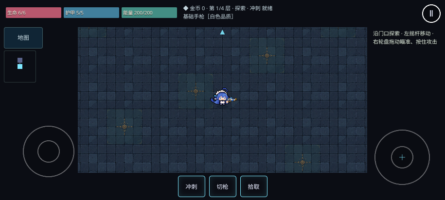
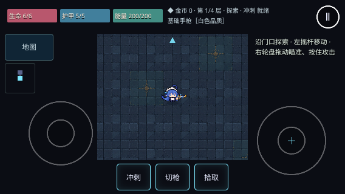
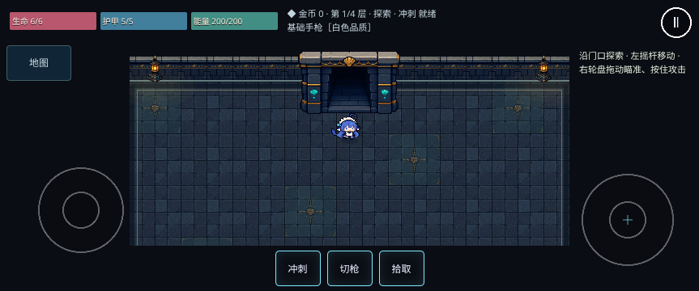

# 手机跟随镜头与紧凑 HUD 验证

基线：main `6ad14ad`（PR #90 之后）。范围仅为负责人选择的试玩反馈第 1 项；方案见 [ADR 0028](../adr/0028-room-camera-and-control-rails.md)。

## 画面与操作

- 主城与正式地牢放大 1.5 倍，镜头随玩家移动并限制在房间边界；换房、换层和调整窗口时直接定位。
- 横屏利用安全区内的完整宽度。顶部状态条、可收起的左侧地图、底部三按钮和两侧触控均位于世界视口之外；门口和屏外敌人有方向标记。
- 在相同画布高度下，角色显示尺寸增加 50%；915×412 的宽屏手机还收回了原 16:9 黑边占用的空间。实际可见范围随手机尺寸变化。
- 地图默认收起，按「地图」展开。移动从左侧下半区起手，远拖不使摇杆基座进入房间；右轮盘操作规则保留。

## 本地验证

浏览器使用 Chromium 153，Playwright 项目为桌面和 Pixel 7 横屏模拟；额外检查 915×412、844×390、667×375、568×320。测试专用浏览器与字体放在仓库外，无项目依赖或锁文件变更。执行环境为 Node 24；项目 Node 22 要求未变。

- `npm run check`：格式、lint、类型、305 个单元测试及生产/PWA 构建通过。
- 完整桌面与手机浏览器回归：159 通过、15 平台跳过，0 失败、0 重试。覆盖存档、离线、暂停恢复倒计时、死亡、完整通关、武器与输入。
- 最终触控器重新创建边界修正、小屏地图修正后，重新运行 `npm run check` 及镜头、主城、脸部、高清画面、移动射击、瞄准、美术相关回归：34 通过、10 平台跳过，0 失败、0 重试。
- 最后为 568×320 扩宽生命/护甲/能量区域后，`npm run check` 再次通过，镜头及高清画面定向复测 8 通过、2 平台跳过，无失败或重试；三个最终截图取自此轮。
- 新增检查：HUD 与相机视口实际矩形无重叠；真实移动后门口完整出现、切房后玩家可见；移动镜头后的鼠标瞄准正确且点击侧栏不射击；主城切换地牢后，触点仍限于侧栏，远拖可移动、释放可停止。
- 旧的眼睛回归按实际镜头取样：两方向各 14 个待机/行走帧保持一致，左右逐行镜像像素差异为 0。

复现使用仓库的正常命令：

```sh
npm run check
npm run test:e2e -- --project desktop --project mobile-landscape --workers 2
```

本次因标准浏览器下载不可用，使用仓库外临时 Playwright 配置指定测试浏览器可执行文件和中文字体；未改动仓库测试配置。WebKit 未执行，浏览器模拟不能代替 iPhone/安卓真机测试。

## 画面记录

以下为生产构建实际运行截图，没有替换画面或缩放编辑；仅保存在文档目录，不进入游戏离线包。







### 截图文件校验

通过本地文件通道上传到功能分支后，核对远端 Git blob SHA 与字节数。

| 文件                      | 字节数 | Git blob SHA                               |
| ------------------------- | -----: | ------------------------------------------ |
| `mobile-camera-door.png`  | 116712 | `8fb8577339fd8fd6741b39df5b04d5e12395a252` |
| `mobile-camera-phone.png` | 326386 | `0a0a83c10b2edc5807489f318b39658f357059ff` |
| `mobile-camera-small.png` | 124470 | `6db5a3ad4feb0851455b569afa4321994ef3afa0` |

## 手动验收

1. 正常标题进入主城，确认空手角色放大且随移动跟镜；走近门后进入新冒险。
2. 打开地图，左手移动并向房间外缘远拖，右手按住轮盘射击；确认控件没有挡住房间、门或子弹。
3. 用 `?scene=Game&seed=42&god=1` 重复靠近不同方向的门并切房，确认镜头不会从上一间房拖移。
4. 暂停后退出标题并继续冒险，核对存档位置、倒计时、触控释放及左右朝向眼睛。
5. 真机检查刘海安全区、持续帧率、发热，以及较小屏幕上的视野与拇指舒适度。

## 已知取舍

放大使可见范围缩小；屏外敌人的攻击规则沿用现状，方向标记不展示完整屏外弹道。没有调整 Boss、伤害、掉落、金币、房间生成或存档格式。真机性能、WebKit 和新视野下的难度仍待验收。
