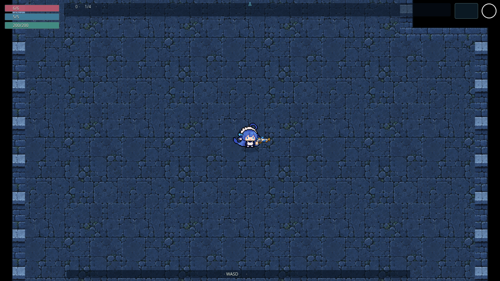
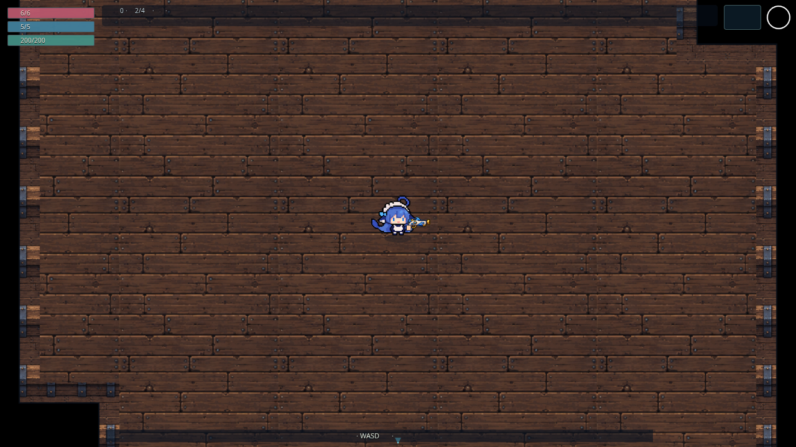
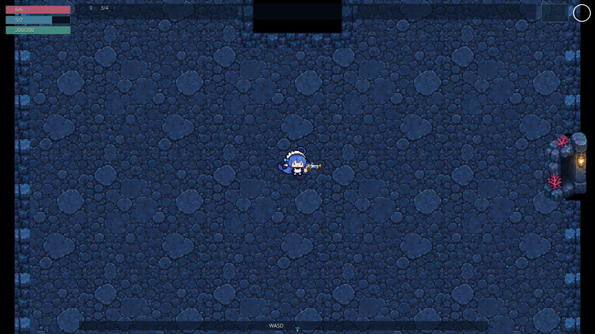
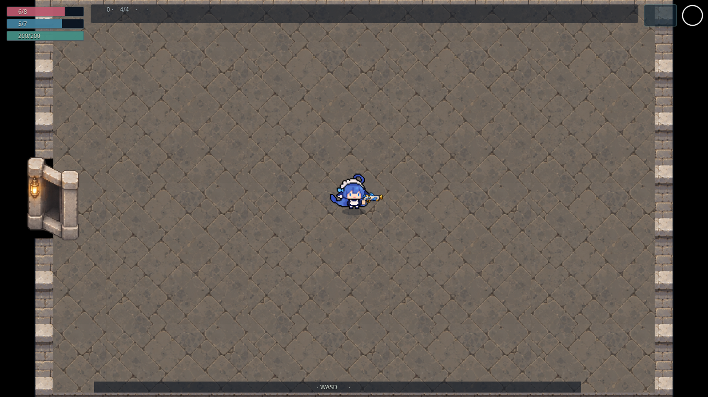
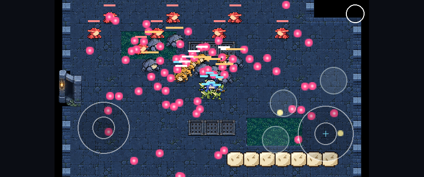
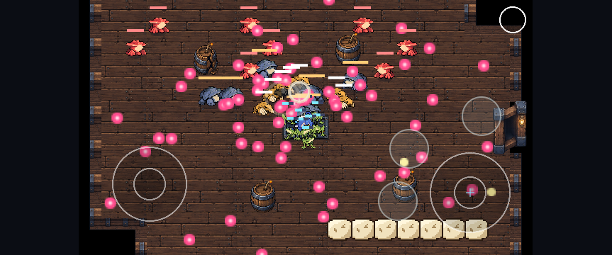
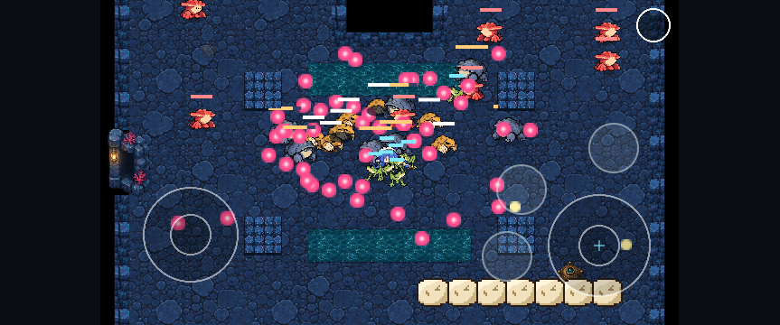
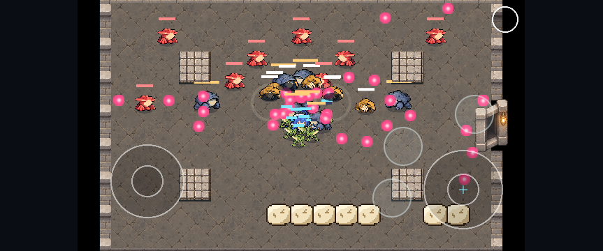
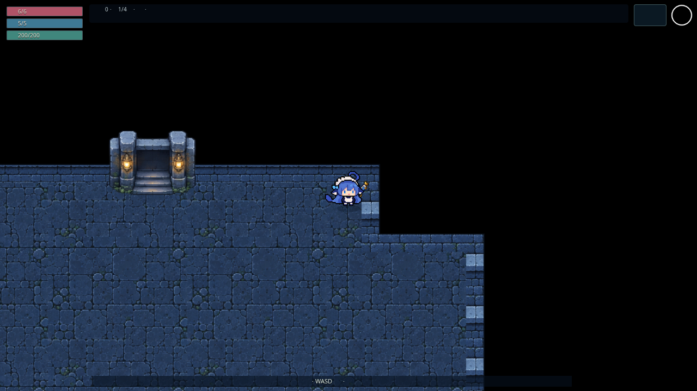

# #114 正式模块美术与面积扩充验证

> 后续状态：Claude review 5686698325 对 `f386549` 无代码阻塞，但负责人否决本页初版墙体画面。以下截图和数字是该版本的历史证据，不代表美术验收通过。长方体墙、新地板与独立障碍的增量记录见 [v2 画面验证](wall-art-v2.md)。

2026-10-28。本批从已合并 #132 的 main `0ea5e721bf2329276f262a2c4e72643437be5f0a` 开始；绝对面积另以 #132 前 `60c35eb` 冻结的 legacy_v1 为基线。分支 `gpt/114-modular-map-art`。实现契约见 [ADR 0041](../adr/0041-modular-map-art.md)。负责人认可的是 v2 概念方向，正式画面与手机真机尚待验收。

## 面积与真实物理

19 房型、64 组适用身体半径，包含所有未破桶。常规网格 2 单位；额外以 0.5 单位采样，使用圆扫掠验证相邻单元连边。新连通面积与旧房全部合法中心面积比较（旧孤立口袋也计入基准），避免通过选取旧的小连通分量降低门槛。四向入口按最大怪物半径 14 检查，门口通路按玩家完整半径验证。

| 主题            | 扣障碍面积 / 原矩形 | 玩家可达中心面积 / 原矩形 |
| --------------- | ------------------: | ------------------------: |
| 石殿            |     112.30%–112.72% |           112.93%–114.70% |
| 沉船            |     111.23%–112.99% |           111.74%–117.05% |
| 深渊            |     111.23%–112.00% |           110.84%–113.04% |
| 奶池（含 Boss） |                100% |                      100% |

0.5 网格完整 20/20 测试通过，64/64 半径组合单一连通分量。最低地形可通行比例 **94.08%**，最低玩家可达中心相对同轮廓空房比例 **83.22%**。数据见 [clearance.json](modular-map-art/clearance.json)；这是采样复核，不冒充连续解析面积证明。额外高精度运行使用 `ROOM_CELL_SIZE=0.5 ... --testTimeout=30000`，只扩大这一 CPU 采样任务的时间预算，没有调整仓库默认测试或游戏计时。

真实 DemoSession/Arcade fixture 核对实际 world bounds、各墙/机关位置、root RNG、同版本恢复及所有链接门的进出。前三层从玩家中心 `(122,100)` 向西真实移动后停在 x=102，证实新增空间不是装饰。缺口挡玩家/子弹/LOS、地下绕行及双向走门通过。奶池保持旧 bounds。

## 资源与画面

三张图集共 **4,662,720 字节（4.45 MiB）**，64 个素材帧：16 地形材质、32 四向门状态、16 机关/交互/装饰。PNG 原图和提示词见 [源文件说明](../../art-src/maps/README.md)；导出为解码 RGBA 相同的 WebP，每张 <2 MiB。无新增依赖、无第三方下载素材。构建指纹包含新图片，上线会结束旧冒险、保全局外档案。

一间房使用固定 1312×928 CanvasTexture、16 个障碍槽；只有换房烘焙，不逐帧重画整间地面。四主题各 200 个不同缺口布局（最大半径 14.02 网格连通）在桌面/横屏各跑一次，反复 show 前后 Phaser 显示对象数与纹理 key 集合不变。该 fixture 验证模块组合上限内的复用，不是 #115 的 200 个生产房型，也不是逐帧性能报告。

正式场景四层图片加载、主城/门/祭台，以及真实 DemoSession 的四主题密集摆场均检查。密集 fixture 以原房型布置 30 只怪、7 块落石，推进既有 AI/弹体/机关；它是人工初始布置的可读性样本，不冒充正常关卡会同时产生该组合。普通怪动画、技能提示与落石视觉维持现有素材，地图主体采用新图集。水流的流向由原速度/方向驱动纹理滚动；岸沿不改变推力、伤害区或身体半径。

## 本地验证与失败保留

Node 22.23.4、项目锁定依赖、Chromium 153、SwiftShader、单浏览器 worker，无自动重试。桌面 1280×720 与项目 Pixel 7 横屏配置；截图与 1080p 内部渲染/相机倍率应分别理解，CSS 截图不等于物理手机像素。没有运行 WebKit/Safari/iPhone。

- 初批生产美术/目录 18 项：15 通过、3 失败。桌面 seed=0 目录恢复超过 30 秒；两端深渊绕行断言期待 x>272，但旧目标 `(292,65)` 在变浅缺口旁已落入怪物停靠半径，怪物合法停在 `(262.0,83.0)`。将 fixture 目标移到 `(320,65)`，保持原 600 步与合法性/绕过缺口要求，未改 AI。
- 目录/物理/200 组合首复跑 5 通过、1 桌面 seed=0 超时。独立再跑原 30 秒预算 **6/6 通过**，目录桌面 25.2 秒、横屏 24.5 秒。初次并发本地检查时的超时保留，不声称已定位唯一原因。
- 广泛筛选 116 项：**110 通过、4 条件跳过、2 失败**。两端旧镜头用例仍寻找原矩形东北角；新轮廓实际停止于 `(330,45)`，保持人物居中。用编译后的真实角点及角色半径更新断言，四向真实移动、居中误差和黑底检查保留。未增加该测试时间预算。
- 高精度面积第一次沿用每项 5 秒，7 项超时、13 通过；增加显式采样任务预算后 20/20，无面积或连通断言失败。
- 开发检查曾暴露类型导入、无 DOM 单测引入 Phaser、测试桥接桩缺少 setRoomBounds；修复后 518 项通过。最终资源完整性还拦截过一次导出/文件同步期间出现的空 WebP：从已核对远端 blob 恢复，导出改为先写临时文件、验证后原子替换，不允许发布半个文件。
- 视觉自查修正水面跨行导致的破桶帧污染，仅修改裁切坐标。给实际障碍增加短地面阴影以区分可走地板，未扩大物理 footprint。

逐项浏览器状态和初次失败见 [browser-runs.json](modular-map-art/browser-runs.json)。最终增量与同负载性能另在本记录末尾追加，不覆盖历史结果。

## 限制与交付

- 保留 #132 接受的外墙武器行为：弹跳弹耗反弹次数、回旋镖折返、光束止于墙。此次普通层外墙变远，使接触位置/折返距离相应变化；出生候选和随机接受率也可能变，不能宣称跨版本全程 RNG/武器体验相同。未改 AI/Arsenal 实现或数值。负责人试玩应关注这些边缘行为。
- 原镜头缩放保持，因此新增房间面积有部分需移动后才能看到；房外黑底和人物居中保留，不缩小角色来把整个房间塞进屏幕。
- 模块 renderer 当前覆盖规定外包框内的轴对齐轮廓，不承诺任意斜边/任意尺寸。旧美术仍被预加载并预缓存，后续按已排队的资源清理处理，本批不报体积优化成果。
- WebKit/Safari/iPhone 真机、长时间 GPU/堆内存曲线未测。软件渲染帧率不外推手机，模拟步数不当 FPS。正式画面仍由负责人验收。
- 首次交付时，运行时三张 WebP 已通过 GitHub 文件选择器提交为 `7a696af`，但原始 PNG 的网页提交被浏览器安全策略拒绝（URL 协议校验未授权）。随后提供完整 Git bundle，由负责人在自己的 Mac 上完成 GitHub CLI 登录，并通过普通 Git 推送至 `614838d6a009589420a9c606fdedcc49083932a6`；上传阻塞现已解除。没有绕过浏览器拒绝，也未通过文本 API 传输图片编码。
- 未改 main、未合并、未启用/触发/重跑远端 CI，#115–#119/#129 仍未启动。Claude 尚未复审本批。

## 最终增量

最终运行代码 `src` tree 为 `f9e066a86c85a4b3b9aa1ccc36aead4744dbb02f`，`public` tree 为 `132e87df46cd9fac6725ffce7e2389ea923e4989`；后续记录/截图和基准脚本不改变这两棵树。完整 `npm run check` **63 文件 / 518 单测**、格式、lint、类型、生产/PWA 构建通过。

裁切/障碍阴影及镜头断言修正后的定向 Chromium 桌面/横屏 **26/26 通过，0 跳过/失败/重试**：四层生产画面、四主题密集场景、真实走到四向实际墙角及走门、子路径离线关闭重开、固定负载/战斗压力与退出再进清理。不是单次整套 E2E 全绿；前述失败仍保留。

验证目录曾残留上一轮 JS bundle，导致中间构建报 24 个预缓存条目。改在隔离的干净构建目录验证，最终为 **23 条目 / 16,110.06 KiB**，三张新 WebP 均列入。只清理临时构建输出，没有删除仓库旧素材或修改 Workbox 策略。

四层正式场景（桌面 CSS 截图）：

| 石殿                                         | 沉船                                         |
| -------------------------------------------- | -------------------------------------------- |
|  |  |
|  |  |

真实 Arcade 密集摆场（手机视口 fixture，使用固定测试相机/画布比例；不是正式 UI 自动适配的截图）：

| 石殿                                                | 沉船                                                |
| --------------------------------------------------- | --------------------------------------------------- |
|  |  |
|  |  |

## 同负载帧率对照

使用 `scripts/benchmark-map-art.mjs` 分别重新构建未修改 main `0ea5e72` 和候选。独占浏览器，两组 ABAB；每轮 seed=42、1920×1080、DPR 1、暖机后至少 240 渲染帧，断言恒定 30 怪 / 400 弹。main 的 StressRun 仍使用旧 RoomArt（只有生产 DemoSession 在 #132 关闭美术），候选用模块画面；压测两边仍为相同矩形和旧障碍，不把面积变化混入这一负载。

| 组/轮 | main FPS | 候选 FPS | main / 候选 p95 ms | draw call | 显示对象 main / 候选 |
| ----- | -------: | -------: | ------------------ | --------- | -------------------- |
| 1/1   |    18.31 |    18.30 | 105 / 104          | 9 / 9     | 827 / 746            |
| 1/2   |    18.83 |    16.54 | 99 / 113           | 9 / 9     | 827 / 746            |
| 2/1   |    17.98 |    17.82 | 108 / 107          | 9 / 9     | 827 / 746            |
| 2/2   |    18.45 |    17.92 | 108 / 102          | 9 / 9     | 827 / 746            |

两组原始结果分别见 [首轮](modular-map-art/performance-first.json) 和 [复核](modular-map-art/performance.json)。四个候选均略低，其中第二对下降约 12.2%，复核两对约 -0.9% / -2.9%；未证明性能无回退，更不能宣称提速。对象减少不等于 FPS 改善。此为 SwiftShader 软件渲染，不代表手机；标准 StressRun 无 HazardLayer，未覆盖密集雨特效及四主题各自 GPU 表现。负责人需结合新画面做真机验收，保留这项风险给 Claude 复审。

隔离构建的预缓存文件从 main 20 项 / 11,827,398 字节增至候选 23 项 / 16,497,258 字节（按清单逐文件求和），增加 4,669,860 字节。新增图集本身 4,662,720 字节，其余为代码增量；没有清理旧资源。Workbox 控制台 KiB 与本表脚本逐 URL 统计分别保留，不混称历史 Git 仓库体积变化。

分批记录按用例/项目去重，共 132 个 Chromium 组合；采用修复后的定向结果为 128 通过、4 条件跳过。这是各阶段与定向补验汇总，不能称为一次完整测试集全绿。

## 远端交付核对（2026-10-28）

负责人推送后，GitHub 远端分支确认指向 `614838d6a009589420a9c606fdedcc49083932a6`。完整根 tree 为 `130bd7ea928803d1d7c995d11d59d26d6f705473`，与本地交付包一致；逐项核对全部 624 个文件的路径、mode、blob SHA 和字节数均相同，其中包含 3 张运行时 WebP、3 张原始 PNG 和 9 张本批验证截图。`src`、`public` 仍为上述实际测试的 tree。

交付状态补丁只更新本记录和 ROADMAP，做文档格式、diff 和 tree 一致性检查；没有重跑单测、浏览器或性能测试，不将已有结果记为新运行。以 Draft PR 交 Claude 复审，正式画面和真机性能仍待负责人验收，#114 保持开放。
