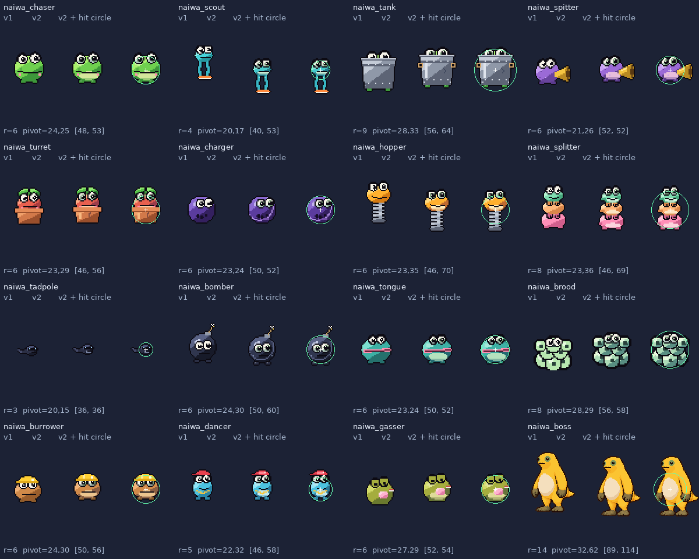
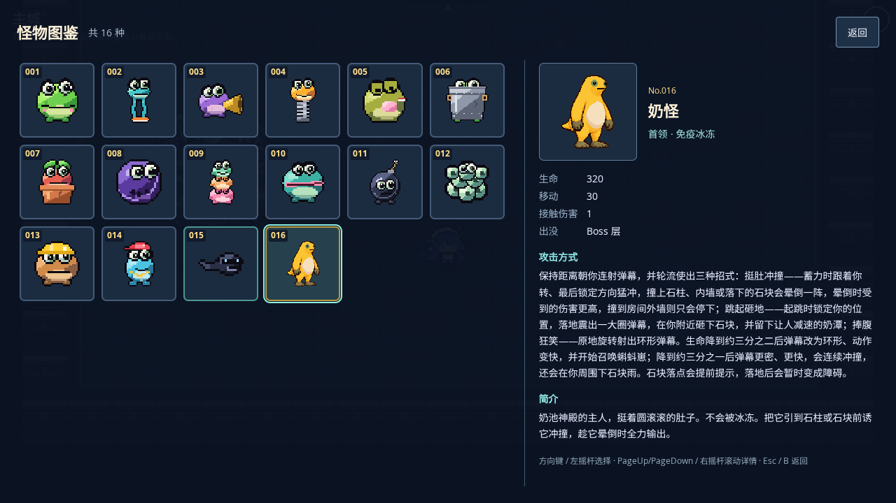

# #100：怪物图集 v2 与碰撞校准验证

基线：已合并 #109 的 main `9dda783e6ed5e9444a827fc19e53af10c6d7a753`。负责人本轮明确指定 GPT 独立实现本项；#99 已完成，#101 未启动。运行时新增依赖为 0。

## 前后对照与全部清单



每格按相同身体圆心摆放：左 v1，中 v2，右 v2 + 绿色物理圆/白色圆心。普通怪按图集像素 2 倍展示、奶怪 1 倍，便于检查细节；游戏内全部仍为 0.5 世界单位/图集像素。半径全部维持旧值，主体锚点与留白分离。

| 怪物 / ID                   | 精绘与锚点调整                         | 半径旧→新 | pivot 旧→新（图集像素，含各自留白） | v2 注册动作及帧数                                                     |
| --------------------------- | -------------------------------------- | --------- | ----------------------------------- | --------------------------------------------------------------------- |
| 大头蛙 / `naiwa_chaser`     | 腹部亮块、脸颊层次与眼睛               | 6→6       | (16,17)→(24,25)                     | idle 12, move 8, windup 2, attack 2, recover 2, death 5               |
| 腿蛙 / `naiwa_scout`        | 青色肚皮、腿部亮线与鞋面；圆心移回头身 | 4→4       | (12,21)→(20,17)                     | idle 8, move 8, death 5                                               |
| 铁桶蛙 / `naiwa_tank`       | 桶身明暗、提手、铆钉、划痕；主体居中   | 9→9       | (20,22)→(28,33)                     | idle 8, move 8, death 5                                               |
| 喇叭蛙 / `naiwa_spitter`    | 紫色腹部、铜喇叭分层；喇叭不决定圆心   | 6→6       | (18,16)→(21,26)                     | idle 12, move 8, windup 2, attack 2, death 5                          |
| 盆栽蛙 / `naiwa_turret`     | 花盆高光/裂纹、暖色肚皮与叶片          | 6→6       | (15,20)→(23,29)                     | idle 8, windup 2, attack 2, death 5                                   |
| 保龄球蛙 / `naiwa_charger`  | 球面高光/反射、完整滚动周期            | 6→6       | (17,16)→(23,24)                     | idle 8, move 8, windup 4, attack 4, recover 4, death 5                |
| 弹簧蛙 / `naiwa_hopper`     | 头身腹部与弹簧层次；固定圆心覆盖主体   | 6→6       | (15,34)→(23,35)                     | idle 8, windup 2, air 2, attack 2, death 5                            |
| 叠罗汉蛙 / `naiwa_splitter` | 三层腹部与侧手；保留分裂轮廓           | 8→8       | (15,29)→(23,36)                     | idle 8, move 8, death 5                                               |
| 蝌蚪崽 / `naiwa_tadpole`    | 墨镜、下巴反光、尾摆完整周期；排除尾巴 | 3→3       | (10,6)→(20,15)                      | idle 8, move 8, death 5                                               |
| 炸弹蛙 / `naiwa_bomber`     | 轮廓反光、铆钉，引信蓄力留白           | 6→6       | (17,24)→(24,30)                     | idle 8, move 8, windup 4, death 5                                     |
| 舌头蛙 / `naiwa_tongue`     | 大嘴、青色皮肤与腹部层次               | 6→6       | (17,16)→(23,24)                     | idle 12, move 8, windup 2, attack 2, death 5                          |
| 蛙卵团 / `naiwa_brood`      | 卵壳高光、内部胚胎与尾部细节           | 8→8       | (20,18)→(28,29)                     | idle 8, move 8, windup 2, attack 2, death 5                           |
| 地洞蛙 / `naiwa_burrower`   | 安全帽条纹、灯光、脸部层次             | 6→6       | (17,20)→(24,30)                     | idle 12, move 8, buried 2, windup 2, attack 2, death 5                |
| 街舞蛙 / `naiwa_dancer`     | 帽缝/徽记、金链，八帧旋转              | 5→5       | (15,24)→(22,32)                     | idle 8, move 8, spin 8, death 5                                       |
| 放屁蛙 / `naiwa_gasser`     | 梨形腹部、皮肤层次，保留捏鼻与气团     | 6→6       | (18,18)→(27,29)                     | idle 8, move 8, death 5                                               |
| 奶怪 / `naiwa_boss`         | 原图 12 帧、32 色清理，以肚皮锚点对齐  | 14→14     | (41.5,68)→(32,62)                   | idle 2, move 8, windup 1, attack 1, air 1, recover 1, spin 2, death 1 |

奶怪源图 SHA-256：`fabe60c7745deae9eae8140cfac2a688250da41d412fc71a2c0f84b92d0fbcc4`，与基线逐字节一致。保留其轮廓、配色依据和全部原有动作，不另造 Boss 形象。普通怪新增原生形状细节与动作中间参数，不采用全屏降分辨率或平滑位图插帧。

## 身体、状态与恢复

- `ENEMIES`、攻击数据、导航配置和全部运行时碰撞实现未改变。美术生成器删除复制的 radius，改为显式主体 pivot 和独立脚底线 shadowY；API 的旧“脚底中心”注释改为实际的身体圆心（ADR 0037）。
- 普通怪原生朝右、奶怪原生朝左，镜像时 origin 同步镜像。透明边距、喇叭、尾巴、引信、帽子、烟团以及 `lift` 不参与物理形状。影子按独立脚底线定位，长腿不悬空，腾空时影子不跟着抬升。
- 7 种实际怪物半径为 3/4/5/6/8/9/14；玩家未引入额外半径。8 个导航缓存足够，新增单测防止以后类型扩充静默超过容量。
- 新增真实 Arcade 用例：Boss→蝌蚪，再正序和倒序遍历全 16 类，共 34 次槽位获取；逐项检查 radius、offset、圆心、预警停用、死亡停用、回收、读档恢复。四方向各测试命中圆内外边界，实际阻挡墙面、世界角落和圆形桶；所有动作/兜底与左右翻面绘制前后物理快照必须完全相同。
- 现有单位/集成用例补充覆盖：`enemyAi` 的腾空免接触和钻地免命中、`muzzle` 的近墙枪口、`melee` 墙体遮挡、`traps` 近战/弹体打桶、`snapshot`/`parseSnapshot` 半径与恢复、`entities` 门口/内墙寻路、跨房与实际 Arcade 存档。
- 存档 schema 和 dataHash 不变；生产模块内容哈希随构建更新，旧构建继续沿用现有入口兜底。同构建完整存档保留飞行子弹、近战、尸体与槽位顺序。

## #101 的动作缺口（本项不提前替换预警）

| 招式                         | 本项保留的帧/区间                              | #101 需要补足                                                          |
| ---------------------------- | ---------------------------------------------- | ---------------------------------------------------------------------- |
| 大头蛙扑咬 / 保龄球冲锋      | windup→attack→recover；球滚动 8 帧             | 预备、冲出、撞击方向的明确时间标记                                     |
| 喇叭 / 盆栽射击              | windup、attack                                 | 喇叭口、嘴口发射点与放弹帧区间                                         |
| 弹簧跳砸                     | windup→air→recover，lift 独立                  | 起跳/落地事件、地面落点与冲击圈同步                                    |
| 舌击                         | windup、attack；现有线/舌判定保留              | 舌根挂点、伸出/停留/收回独立阶段                                       |
| 蛙卵召唤 / 叠罗汉分裂        | 卵 glow/popped、death 5 帧                     | 出卵/散开与实际生成事件对齐                                            |
| 地洞潜行                     | buried、windup、attack                         | 入地/出地过渡和地表运动提示                                            |
| 街舞旋转                     | spin 8 帧                                      | 螺旋弹发射节拍与朝向挂点                                               |
| 炸弹 / 毒气                  | fuse 膨胀变色、气团姿态                        | 爆炸/放气独立动作区间与边界提示                                        |
| 奶怪顶撞/跳砸/旋转/召唤/落石 | 已有 12 张原画映射到各 pose；spin 借用捧腹两帧 | 独立招式原画不足；需在已确认形象上补画和标记。death 继续抖动→狂笑→溶解 |

所有红色危险提示、弹体、区域与伤害时机保留。缺失动作继续按 `POSE_FALLBACK` 逐项回退到相近动作或 idle。

## 本地检查

环境为 Node 22.23.4、锁定的项目依赖、Chromium 153 / SwiftShader；使用外置 Playwright 配置指定验证浏览器，未改仓库依赖或默认配置，未启用/触发远端 CI。

- `npm run check`：格式、lint、类型、54 个测试文件 / 408 单测、生产构建全部通过。
- 10 个相关 E2E 文件，桌面与横屏手机视口首轮 **119 通过 / 4 按条件跳过 / 1 浏览器启动失败**。失败是 Chromium 进程启动阶段 `SIGSEGV`，尚未执行到游戏断言；该原始用例不改断言、不放宽超时复测通过。
- 最终代码额外复测 **10/10 通过**：两个视口各覆盖完整待机/行走循环、实际 PNG 帧审计、真实 Arcade 身体/影子检查、子路径离线重开与连续发布更新。首次启动失败的原始用例包含在其中。
- 全图集审计：390 个注册帧、16 种怪物；每个视口完成 4038 次动作/朝向绘制、34 次实体获取，物理快照保持一致。最终影子脚底线和图块去重纳入额外复测。
- 独立实际升级：在同一子路径从 main `9dda783` 的真实生产构建升级到 v2；waiting 期间旧图片仍可取，用户确认后断网重开，新图片 SHA-256/尺寸与本地完全一致，旧 v1 缓存 URL 数量为 0，逐个打开 16 张图鉴卡成功。原始数据见 [升级记录](monster-pwa-update-v2.json)。



## 资源与性能成本

| 运行资源 | v1 尺寸 / PNG 字节 | v2 尺寸 / PNG 字节 | RGBA 解码估算旧→新    |
| -------- | ------------------ | ------------------ | --------------------- |
| 普通怪物 | 1024×365 / 42,921  | 1024×800 / 62,511  | 1,495,040→3,276,800 B |
| 奶怪     | 340×333 / 27,384   | 364×348 / 34,900   | 452,880→506,688 B     |
| 合计     | 70,305 B           | 97,411 B           | 1,947,920→3,783,488 B |

运行 PNG 增加 **27,106 B**；两张纹理 RGBA 估算增加 **约 1.75 MiB**（不含驱动额外开销）。增加来源是动作补帧与保证死亡/引信不裁切的透明边距。普通怪 373 个注册帧实际复用 250 个唯一图块，把未去重的 1024×1153 图集缩为 1024×800，节省 1,445,888 B 解码空间。仍然只有 2 张怪物纹理，每张 PNG 远低于 2 MiB，最大边长 1024，未新增逐怪纹理。

Workbox 预缓存仍为 20 项，构建报告从 11,334.90 KiB 到 11,362.87 KiB；旧 v1 PNG 从 public 移除，文档截图不进入运行包。图鉴沿用注册表与一次 alpha 裁剪缓存，重复打开不新建纹理；已有 FxBudget、500 弹体、31 演员和反馈池容量未改变。

相同生产压力场景 ABAB 对照：`?stress=1&seed=42`，1920×1080、DPR 1，预热至 30 怪 + 400 弹，点击“重新计时”，至少 120 个实际渲染帧后导出；四轮均独立浏览器上下文，测量时无并行测试。原始值见 [性能记录](monster-performance-v2.json)。

| 顺序 / 构建   | 帧数 | 软件渲染平均 FPS | p95 帧耗时 | draw 平均 | 场景对象最少/最多 |
| ------------- | ---- | ---------------- | ---------- | --------- | ----------------- |
| 1 / baseline  | 123  | 17.50            | 112 ms     | 9         | 823/823           |
| 2 / candidate | 123  | 13.76            | 152 ms     | 9         | 823/823           |
| 3 / baseline  | 124  | 16.39            | 116 ms     | 9         | 823/823           |
| 4 / candidate | 124  | 16.44            | 125 ms     | 9         | 823/823           |

四轮怪物最少均为 30、子弹最少/最多均为 400，draw 平均均为 9，对象数固定为 823。软件帧耗时存在波动，这组记录不支持宣称 FPS 提升。

**这里的帧率只描述这台共享机器上的 SwiftShader 软件渲染，不是手机 FPS 或真机达标结论。** 图集增加的解码内存明确列出，负责人仍需在目标手机确认画面与手感。

## 文件上传与复现

两张运行 PNG 和两张验证截图均经 GitHub 网页文件选择器上传到 `gpt/100-monster-audit`；拉取分支后逐项核对 Git blob SHA 与字节数，未使用 Base64/data URL。完整清单见 [文件哈希](monster-assets-v2.json)。普通怪原始精绘版本上传后，另提交了像素完全相同帧的图块去重。

```sh
python3 art-src/monsters/build_monsters.py --preview /tmp/monster-preview
python3 art-src/naiguai/import_naiguai.py art-src/naiguai/source.png --preview /tmp/monster-preview
npm run check
npm run test:e2e -- tests/e2e/monsterArt.spec.ts tests/e2e/entities.spec.ts tests/e2e/art.spec.ts tests/e2e/bestiary.spec.ts tests/e2e/bestiaryLifecycle.spec.ts tests/e2e/pwa.spec.ts tests/e2e/save.spec.ts tests/e2e/resumeProduction.spec.ts tests/e2e/stress.spec.ts tests/e2e/roomCamera.spec.ts --project=desktop --project=mobile-landscape --workers=1 --retries=0
```

两次生成的 PNG blob SHA 一致。`?scene=Game&room=boss&seed=42&god=1&debug=1` 可检查奶怪；主城按 I 可逐个查看静态形象；`?stress=1&seed=42` 可查看混合体型、石柱和持续弹幕。最终美术/手机验收和合并由负责人完成；#101 继续排队。
