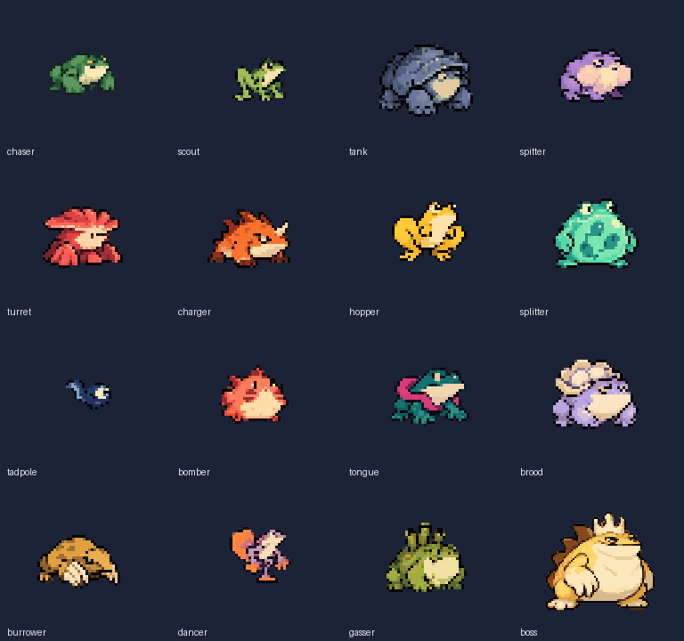
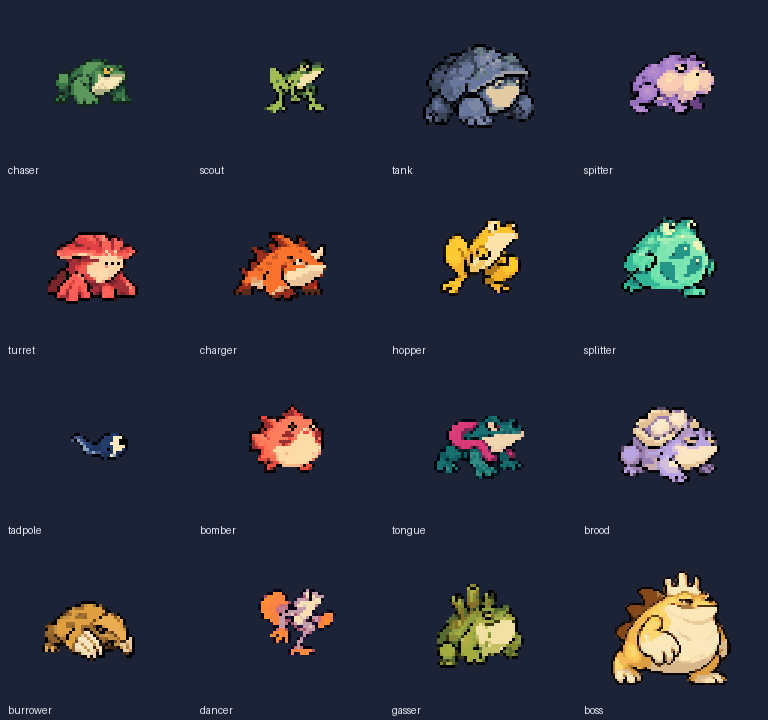
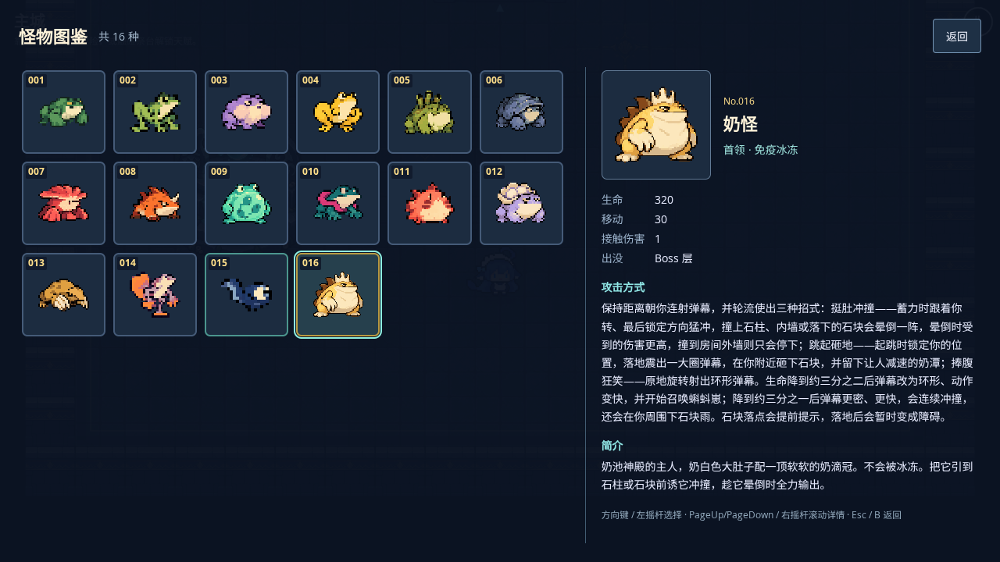

# #100：新青蛙图集 v3 验证记录

本轮从 main `9dda783e6ed5e9444a827fc19e53af10c6d7a753` 开工，负责人选定新青蛙造型后，又要求降低精度和动作帧数。PR #110 已撤回旧 v2 精绘，改为全新原画与少帧像素动画。本文只记录 v3；最终画面、身体命中手感和 iPhone 试玩仍待负责人验收。

## 实际像素预览

下图直接放大运行图集的待机帧，GIF 为 4 帧移动循环。普通怪放大 3 倍、奶怪 2 倍用于看清像素；游戏运行仍按各自统一 scale=0.5，不降低画布分辨率。

设计源图、逐帧原画、提示词、原生尺寸/锚点清单、重建命令均在 [art-src/monsters-v3](../../art-src/monsters-v3/README.md)。v1 旧资源可在基线提交查看，未作为本轮造型参考；v2 方案仅留在 PR 历史，不再打包。

## 完整清单与碰撞

| ID / 新名称         | 原生帧尺寸（含留白） | 身体 pivot | 脚底 Y | 半径（前 → 后） | 特殊行           |
| ------------------- | -------------------- | ---------- | ------ | --------------- | ---------------- |
| `chaser` / 巨爪蛙   | 37 × 26              | 16, 15     | 22     | 6 → 6           | laugh            |
| `scout` / 苇腿蛙    | 36 × 30              | 20, 16     | 27     | 4 → 4           | laugh            |
| `tank` / 陶甲蛙     | 48 × 40              | 23, 24     | 36     | 9 → 9           | laugh            |
| `spitter` / 鼓腮蛙  | 42 × 29              | 20, 17     | 25     | 6 → 6           | laugh            |
| `turret` / 菌冠蛙   | 44 × 35              | 20, 20     | 31     | 6 → 6           | laugh            |
| `charger` / 角冲蛙  | 47 × 33              | 19, 20     | 29     | 6 → 6           | laugh            |
| `hopper` / 蓄跳蛙   | 41 × 36              | 20, 19     | 31     | 6 → 6           | air              |
| `splitter` / 腹囊蛙 | 52 × 35              | 25, 20     | 31     | 8 → 8           | laugh            |
| `tadpole` / 蝌蚪崽  | 27 × 21              | 18, 12     | 17     | 3 → 3           | laugh            |
| `bomber` / 膨爆蛙   | 36 × 30              | 16, 17     | 27     | 6 → 6           | laugh            |
| `tongue` / 围舌蛙   | 41 × 34              | 20, 21     | 30     | 6 → 6           | laugh            |
| `brood` / 负卵蛙    | 50 × 36              | 24, 23     | 33     | 8 → 8           | laugh            |
| `burrower` / 铲爪蛙 | 44 × 33              | 20, 21     | 29     | 6 → 6           | buried           |
| `dancer` / 鳍舞蛙   | 38 × 29              | 19, 14     | 26     | 5 → 5           | spin             |
| `gasser` / 烟管蛙   | 39 × 38              | 19, 25     | 34     | 6 → 6           | laugh            |
| `boss` / 奶怪       | 91 × 75              | 45, 46     | 70     | 14 → 14         | air, spin, laugh |

全部身体圆继续由 sim/Arcade 决定，不跟随图片、左右翻面或腾空升降。图片 pivot 定位到主体，固定 `shadowY` 代表地面；长腿、尾巴、爪子、菌冠、卵囊与烟管均为外观附属。没有调整半径、攻击数值或存档格式。全部怪物七种半径，玩家不新增半径，既有导航缓存容量 8 无需修改。

## 动作与当前范围

普通怪每种 24 帧，奶怪 32 帧，合计 392 帧。待机 4 帧 / 0.96 秒、移动 4 帧 / 0.36 秒、受击 2 帧 / 0.16 秒；蓄力/攻击/收招各 2 帧，使用已有状态时长，播到末帧保持。跳跃 4 帧也到末帧保持；钻地、旋转仍循环。普通死亡 4 帧 / 0.45 秒，奶怪死亡分段总计 3 秒不变。

受击动作只覆盖 idle/move/recover，结束后继续原动作时钟；不会遮住蓄力、攻击、腾空或钻地，也不破坏冻结表现。图鉴使用同一注册表的静态帧，名称与外观描述中英文已同步。

#101 仍需逐招审核实际发射/命中时刻与动画对应：喷吐/扇形射击的出招事件、舌击拉回、召唤出生时刻、落地冲击和 Boss 各阶段。当前只按已有 pose 接入新帧，部分普通种类的笑脸为备用表情；未新增 sim 出招阶段，也未移除或替换红色预警、弹体和光束提示。

## 自动化与实测

- `npm run check`：54 个单测文件、408 个用例通过，格式、lint、类型与生产构建通过。
- `monsterArt.spec.ts`：桌面与手机横屏 4/4 通过。实际解码全部 392 个 PNG 帧，检查非空、硬 alpha、边界透明和循环帧确有姿态变化；实际 Arcade 覆盖所有动作/兜底、翻面、腾空、影子、冻结、受击恢复、单次动作末帧保持、圆周探针、墙角/圆桶、存档恢复与死亡停用；34 次大小交替获取（包括奶怪→蝌蚪）。
- 另 9 个相关 E2E 文件桌面/手机横屏：116 通过、4 条件跳过、0 失败。与上述 4 个专项用例合计 120 通过、4 跳过，覆盖动画、实体池、图鉴生命周期、PWA、存档、正式入口恢复、压力和镜头。首轮在进度输出停止刷新后主动中断，未产生完整报告；这里只统计完整重跑。详见 [逐项回归结果](monster-regression-v3.json)。
- 同一子路径从 main 真实构建升级到 v3：waiting 期间旧图仍可取；确认更新后断网重开，新图字节数、尺寸和 SHA-256 与本地一致，旧 v1 缓存条目为 0，全部 16 张图鉴卡逐个打开成功。见 [升级原始记录](monster-pwa-update-v3.json)。
- 构建和浏览器验证均使用锁定依赖与 Node 22。测试环境为 Chromium 153 / SwiftShader；手机横屏项目为浏览器模拟，不代表 iPhone 真机。

## 资源与性能

| 资源   | main v1 PNG | v3 PNG    | v3 尺寸    | v3 RGBA 估算 |
| ------ | ----------- | --------- | ---------- | ------------ |
| 普通怪 | 42,921 B    | 87,864 B  | 1024 × 602 | 2,465,792 B  |
| 奶怪   | 27,384 B    | 36,487 B  | 512 × 537  | 1,099,776 B  |
| 合计   | 70,305 B    | 124,351 B | 两张纹理   | 3,565,568 B  |

PNG 合计增加 54,046 B；RGBA 解码估算比 main 的 1,947,920 B 增加 1,617,648 B（约 1.54 MiB），不含驱动开销。使用精确索引 PNG 压缩，编码前后逐像素 RGBA 一致。生产 precache 为 20 项 / 11,390.96 KiB；原画和验证图不进入生产包。源与成品文件的字节数、SHA-256、Git blob SHA 见 [摘要清单](../../art-src/monsters-v3/source-hashes.json)，图集坐标与帧数见 [构建报告](../../art-src/monsters-v3/build-report.json)。

同一生产压力场景做 ABAB 对照：`?stress=1&seed=42`，1920×1080 / DPR 1，预热到 30 怪 + 400 弹后重新计时，至少 120 个实际渲染帧；每轮独立上下文，测量时没有并行浏览器测试。原始数据见 [性能记录](monster-performance-v3.json)。

| 顺序 / 构建   | 渲染帧 | 软件渲染平均 FPS | p95 帧耗时 | draw 平均 | 对象最少/最多 |
| ------------- | ------ | ---------------- | ---------- | --------- | ------------- |
| 1 / baseline  | 124    | 18.35            | 110 ms     | 9         | 823/823       |
| 2 / candidate | 124    | 18.00            | 104 ms     | 9         | 823/823       |
| 3 / baseline  | 122    | 18.12            | 103 ms     | 9         | 823/823       |
| 4 / candidate | 124    | 18.03            | 112 ms     | 9         | 823/823       |

四轮 draw 平均均为 9、对象数固定为 823。结果不支持宣称帧率提升；这些数值只描述共享机器上的 SwiftShader，不代表目标手机 FPS。像素风格、少帧循环衔接与真实命中手感仍需人工确认。

## 人工复核

1. `npm run dev`，主城打开图鉴检查全部 16 种；大图和战斗形象应一致。
2. `?scene=Game&seed=42&debug=1&god=1` 检查普通怪移动、受击、左右翻转、贴墙和近战接触。
3. `?scene=Game&seed=42&debug=1&god=1&room=boss` 检查奶怪跳跃、旋身、大笑和死亡；预警仍可见。
4. 在 iPhone 横屏检查像素粗细、4 帧循环衔接、命中手感与长时间游玩。自动化通过不代替本项主观验收。

23 个实际二进制文件（18 张设计/动作原画、2 张运行图集、3 份预览）已通过 GitHub 网页文件选择器上传本任务分支；拉取后逐一核对 Git blob SHA 和字节数一致。未使用 Base64/data URL。重建两张运行 PNG 的 SHA-256 完全一致。
