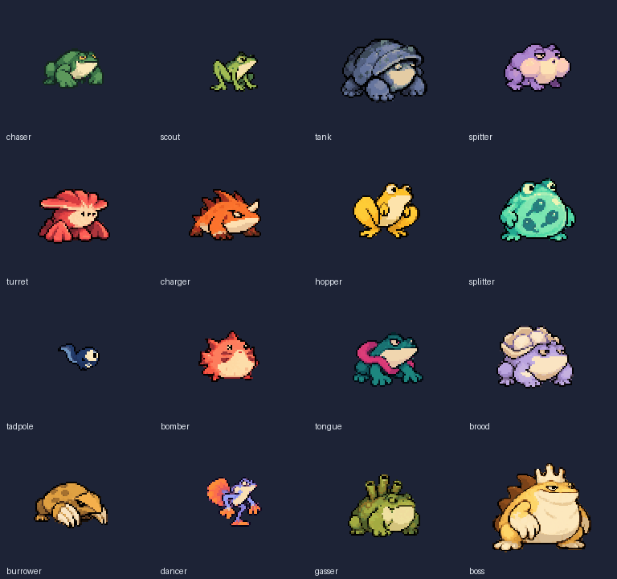
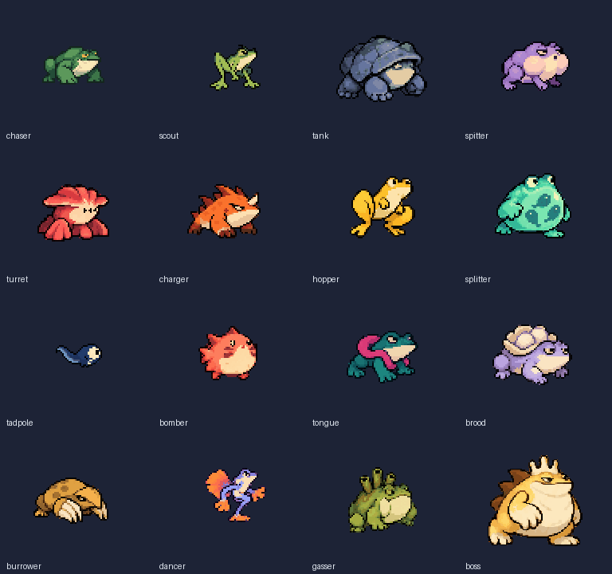
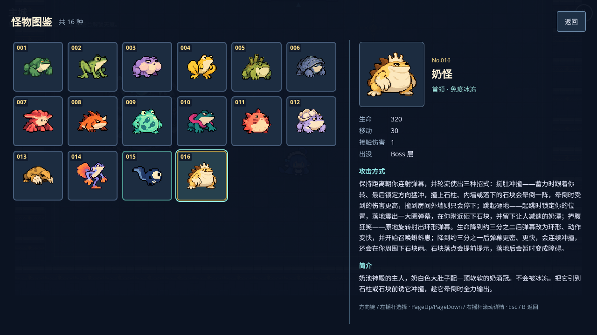

# #100：适中精度 v4 补丁验证

基于已合并 #110 的 main `e1fe232446a8c3f11ceb8cace3b93e916651d127`。负责人认为 v3 像素过粗，本轮从相同原画恢复适量细节，保留青蛙设计与精简动作。#100 仍待负责人画面和真机验收，未启动 #101。

## 改动与预览

- 原始设计与 17 张动作源图不变；导出线性像素密度乘以 1.5，普通怪颜色预算 14 → 18、奶怪 20 → 30，巨爪蛙保留固定高对比色板。
- 美术 scale 从 0.5 改为 1/3，抵消像素密度变化；含留白的世界边界因采样取整最多相差 1 个世界单位。物理圆、玩法数值、动作映射和运行时动画代码未改。
- 普通怪每种 24 帧、奶怪 32 帧，总计 392 帧；待机/移动各 4 帧及全部动作时长保持不变。逐种原生尺寸、锚点与帧数见 [构建报告](../../art-src/monsters-v3/build-report-v4.json)。
- 从源图重新采样，保持 0/255 alpha 与清晰轮廓。没有降低画布分辨率，也未新增共享契约字段、依赖或 CI 变更。

预览与 v3 使用相同展示比例：普通怪 v4 放大 2 倍（v3 为 3 倍），奶怪 v4 放大 4/3 倍（v3 为 2 倍），便于比较相近显示大小下的细节。





## 本地验证

- `npm run check`：格式、lint、类型、生产构建通过，54 个单测文件 / 408 个用例通过。
- 本次重跑 `monsterArt.spec.ts`、`bestiary.spec.ts`、`pwa.spec.ts`，桌面与手机横屏合计 15 通过、1 条件跳过、0 失败。跳过项是桌面的触屏专用测试；手机项目通过。未把 v3 的完整回归计入本次结果，详见 [本次回归记录](monster-regression-v4.json)。
- 两种视口各检查 392 帧透明边界和内容；实际 Arcade 各覆盖 2,192 次动作/朝向绘制、34 次大小交替获取，包含翻面、腾空、身体圆、墙角/圆桶、恢复和死亡停用。
- 同源子路径真实 v3 → v4 更新：waiting 期间旧图可用；确认更新后断网重开，v4 图集字节数、尺寸和 SHA-256 正确，旧 v3 缓存条目为 0，16 张图鉴卡逐一打开。详见 [升级证据](monster-pwa-update-v4.json)。
- 同一生成器重建两张运行 PNG 后 SHA-256 不变。18 张既有原画未改；5 个新增二进制文件经 GitHub 文件选择器上传。远端全部 23 个相关文件逐字节、Git blob SHA 与 SHA-256 核对一致，见 [摘要清单](../../art-src/monsters-v3/source-hashes-v4.json)。



## 资源成本

| 资源   | v3 PNG    | v4 PNG    | v4 尺寸    | v4 RGBA 估算 |
| ------ | --------- | --------- | ---------- | ------------ |
| 普通怪 | 87,864 B  | 184,167 B | 1536 × 900 | 5,529,600 B  |
| 奶怪   | 36,487 B  | 80,237 B  | 768 × 810  | 2,488,320 B  |
| 合计   | 124,351 B | 264,404 B | 两张纹理   | 8,017,920 B  |

PNG 增加 140,053 B（约 136.77 KiB），RGBA 解码估算从 3,565,568 B 增加 4,452,352 B（约 4.25 MiB），不含驱动开销。精确索引 PNG 编码前后 RGBA 相同。生产 precache 保持 20 项，从 11,390.96 KiB 增至 11,528.12 KiB；原画与验证图不进入运行包。

## 相同负载性能对照

生产压力场景 `?stress=1&seed=42`，1920×1080 / DPR 1，30 怪 + 400 弹；每轮独立上下文，预热后至少测量 120 个实际渲染帧。按 v3/v4/v3/v4 顺序执行，测量时没有并行浏览器测试；[原始数据](monster-performance-v4.json) 保留全部观测值。

| 顺序 / 构建 | 渲染帧 | 软件渲染平均 FPS | p95 帧耗时 | draw 平均 | 对象最少/最多 |
| ----------- | ------ | ---------------- | ---------- | --------- | ------------- |
| 1 / v3      | 122    | 14.47            | 130 ms     | 9         | 823/823       |
| 2 / v4      | 122    | 15.21            | 130 ms     | 9         | 823/823       |
| 3 / v3      | 122    | 15.36            | 137 ms     | 9         | 823/823       |
| 4 / v4      | 123    | 16.58            | 111 ms     | 9         | 823/823       |

draw 与对象数未增加。共享环境存在波动，本次不据此宣称帧率提高；SwiftShader 数值不代表手机 FPS。确定的资源代价是上述贴图包体与解码内存增加。

## 复现与人工验收

重建步骤见 [原画 README](../../art-src/monsters-v3/README.md)。浏览器相关测试命令：

```sh
npx playwright test tests/e2e/monsterArt.spec.ts tests/e2e/bestiary.spec.ts tests/e2e/pwa.spec.ts --project=desktop --project=mobile-landscape
```

本环境使用 Node 22、锁定依赖、Chromium 153 / SwiftShader；云端运行通过临时配置选择已有 Chromium，未改仓库测试配置。

主城打开图鉴检查全部 16 种；`?scene=Game&seed=42&debug=1&god=1` 检查普通怪，追加 `&room=boss` 检查奶怪。负责人在 iPhone 横屏确认像素粗细、少帧循环衔接与命中手感。自动化模拟不替代真机与主观画面验收；v3 历史报告与摘要保留。
