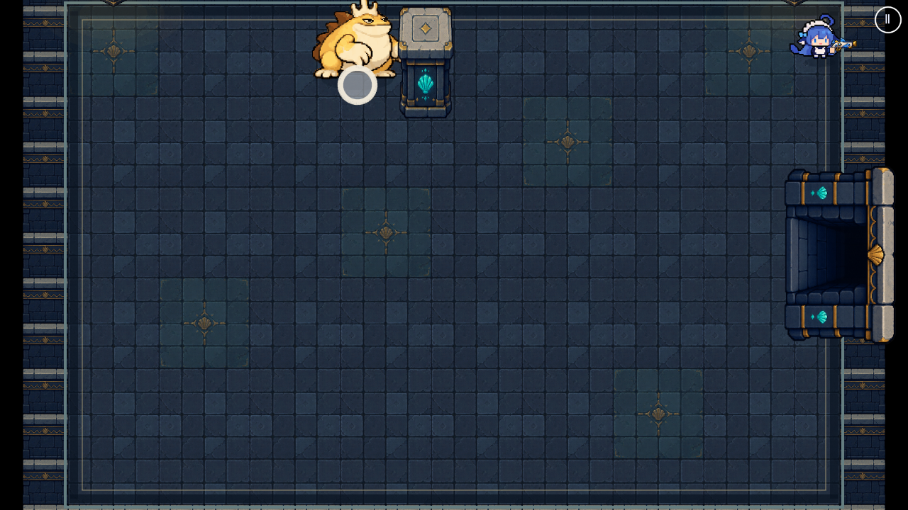
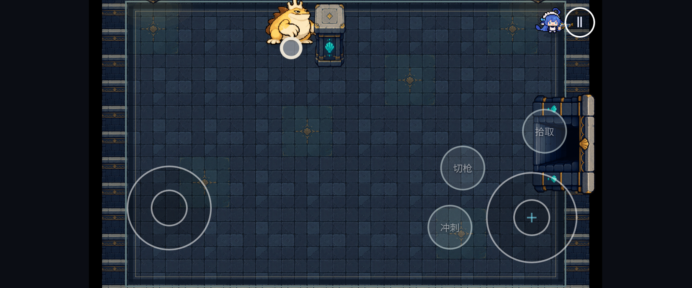

# ADR 0039 生产几何接线

## 范围

负责人在 #125/#126 合并后将生产接线与验证交给 GPT。基线 main
`82fb32b40060eb85667d879fb5e54deef068bc3a`；独立分支 `gpt/114-production-geometry`。

正式代码只有两行：DemoSession 与 StressRun 的 createCombatWorld options 都提供
`geometry: () => this.arena?.prepareGeometry() ?? null`。闭包在查询时取当前 arena，
覆盖新开、换房和完整读档；沿用 #125 的固定动态槽与 #126 的 AI 规则。
本 PR 未修改 AI/武器实现、数值、碰撞箱、存档字段或 WORLD_STEP 顺序，也未新增随机调用。
启用 provider 会让已合并的 ADR 0039 行为真正生效：贴墙撞柱会晕、召唤/落石按完整半径检查，
落石候选耗尽会跳过且不抽 stagger，因此不能声称运行结果或 RNG 与未接线 main 始终相同。
玩家武器继续走原有 LOS。

## 首次交付检查（复审前）

Node 22；完整 `npm run check` 通过：59 文件 / 482 单测，Prettier 3.9.10、
ESLint、TypeScript 与 Vite/PWA 构建全绿。入口包 1,669.57 kB / gzip 457.90 kB，
对照 main 1,669.47 / 457.85 kB。无新依赖、图集或缓存资源。

新增回归 8 项 × 桌面/手机横屏 Chromium = **16/16 通过**，无重试，
原始动作与检查次数见 [regressions.json](production-geometry/regressions.json)。每端石块雨
检查 12 个新落点、召唤 2 个子体；所有动作、落点和视线断言通过。

首次尝试整个 Chromium 套件共列出 238 项，在前 14 项（11 通过 / 3 条件跳过）之后、
进入已有 bestiaryLifecycle 夹具时长期无进展，手动终止；没有完整总报告，不能声称
238 项全绿。随后把新增夹具与相关既有场景分进程执行，以下分别记录结果。
图鉴生命周期在 main 与本候选的独立进程中均 1/1 通过，未确认整批执行停滞的根因。
未修改该测试或放宽断言。不将 #125/#126 的历史结果作为本次验收。

分进程运行 `demo.spec.ts save.spec.ts resumeProduction.spec.ts pwa.spec.ts stress.spec.ts`，
桌面 + 手机横屏共 **59 通过 / 1 条件跳过**（桌面不执行竖屏中断项），无失败或重试，记录见
[existing-regressions.json](production-geometry/existing-regressions.json)。覆盖真实走门、
右摇杆/Arcade 击败 Boss、暂停/后台与完整存档后续物理步一致、生产入口刷新续玩、
PWA 离线/关页重开/双标签页更新，以及两种压力场景及退出清理。
加上新增 16 项与隔离图鉴 1 项，本候选完成的这三批共有 76 项通过、1 项条件跳过。

## 真实物理回归

`tests/fixtures/productionGeometry.ts` 构造真正的 DemoSession：使用正式图集、
CombatBridge、RoomArena、HazardLayer、TrapLayer 与 Arcade World。测试只安排初始位置、
低血 Boss 和池中石块；AI 自行选择/推进招式，碰撞由真实 Arcade 执行。
没有给 fixture 注入 geometry provider，没有伪造 AI 阶段、动作事件或碰撞结果。

| 场景                    | 检查                                                                        |
| ----------------------- | --------------------------------------------------------------------------- |
| Boss 撞现有 Boss 房柱子 | 首次碰撞为 stun                                                             |
| Boss 撞外墙             | 首次碰撞为 crash，不能 stun                                                 |
| Boss 贴上墙冲向靠墙柱   | 首次碰撞为 stun；专门布置的 Box 同时生成图像、物理体和查询轮廓              |
| 低血 Boss 石块雨        | 自然进入 rain；新产生的每块石头完整半径可占据，检查数 > 4                   |
| 负卵蛙墙角召唤          | 数量等于数据定义，每个子体完整身体合法，生成当步检查                        |
| 菌冠蛙视线              | 隔柱 8 秒不开火，移到可见位置恢复；立石挡射击，清除后恢复                   |
| 蓄跳蛙隔柱跳跃          | 预计落点截到柱前，实际落点合法                                              |
| 完整会话重建            | 保存已落石，重启 Scene 并构造新 DemoSession，首个物理步之前查询即可看到石块 |

前 7 项每页独立初始化，防止前一场景状态污染后一项。玩家固定在测试目标处；
冲撞开始前固定 Boss 起点，冲撞开始后由 Arcade 自行推进。石块雨的低血量与
视线测试的立石为明确的 fixture 初始安排，不声称这些安排来自玩家操作。
最后一项通过 DemoSession 完整存档入口恢复，不直接把存档灌入运行中的世界。

负对照：将相同测试复制到独立 main `82fb32b` checkout，仅运行 `near-wall|brood`，
两项按预期失败：前者返回 crash，后者发现 child outside。证明测试能发现缺失生产接线，
不是只验证独立查询类。

固定测试镜头下的贴墙撞柱现场（旧地图素材，非新地图美术验收）：





## 固定负载性能方法

运行 `GEOMETRY_BASELINE=/path/to/main-checkout node scripts/benchmark-production-geometry.mjs`；
可选 `GEOMETRY_BROWSER` / `GEOMETRY_BROWSER_ARGS` 指定已有 Chromium 及启动参数。
脚本校验基线 SHA，并确认候选 StressRun 含 provider。

两份 checkout 各自构建生产包，不修改压测源代码，按 baseline → candidate → baseline →
candidate 顺序执行。相同 seed=42、1920×1080 DPR1、标准 capacity-30x400 配置，
每轮预热后重置计时，至少采样 240 个真实渲染帧；导出的每轮报告必须满足 30 怪、
400 弹恒定。测量期间不并行运行其他浏览器测试。

该配置只含苇腿蛙、巨爪蛙、陶甲蛙、鼓腮蛙、菌冠蛙、角冲蛙和奶怪这 7 类怪物，
保留标准压力场景的无伤害/弹丸不消耗规则。**不包含蓄跳蛙、负卵蛙或腹囊蛙**，
因此未覆盖它们的跳跃截断、召唤落位和死亡分裂查询负载。
StressRun 本身没有 HazardLayer，故报告覆盖新增几何/AI/导航与标准渲染的整体开销，
不代表密集石块雨特效负载。实际石块雨碰撞与落点另由上述真实 DemoSession 测试验证。
软件渲染的 FPS 不能外推为 Safari/iPhone 真机帧率，未做堆分配剖析或 30 分钟稳定性测试。

## 本轮帧率对照

原始 [performance.json](production-geometry/performance.json)，Chromium + SwiftShader：

| 轮次    | 平均 FPS | p95 帧间隔 ms | 平均 draw call | 显示对象 |
| ------- | -------: | ------------: | -------------: | -------: |
| main A1 |    18.86 |           101 |              9 |      823 |
| 接线 B1 |    19.61 |            98 |              9 |      823 |
| main A2 |    19.77 |           102 |              9 |      823 |
| 接线 B2 |    19.12 |           105 |              9 |      823 |

四轮始终满足 30 怪 / 400 弹，draw call 与显示对象数相同且不增长。
两对的 FPS/p95 差值方向不同，短样本中没有一致的性能退化信号；不据此宣称性能提升，
也不能证明所有设备无开销。上述低 FPS 来自此软件渲染环境，本次未提供真机达标结论。

## Claude 复审补充

Claude review [5677147146](https://github.com/marchosias142857/ai-vs-naiwa/pull/127#pullrequestreview-5677147146)
确认 head `7b35765d32cce4d840816a1914fcf3669d5f54af` 的生产接线与新增 Arcade 用例正确，无阻塞代码问题。
本轮按建议补充剩余 E2E、main 整批执行对照和报告 head 标识；不改生产逻辑。

原有 regressions / existing-regressions / performance 三份 JSON 的 `head` 指向可复现运行代码的 `7b35765`。原执行发生在提交前工作树，
当时 checkout HEAD 为 `82fb32b`；`headProvenance` 明确说明该区别，原时间戳和测试结果保留。
本次补测直接在已提交的 `7b35765` 上运行，运行时与测试源码保持干净；不能把旧结果说成又跑了一遍。

补测方法：候选每次以一个剩余 spec 文件名筛选并启动独立 Playwright 进程，桌面 + 手机横屏 Chromium，
`workers=1`、`retries=0`；main 在独立 checkout 重新构建原始生产包，不复制候选夹具，
一次整批运行仓库原有的三个 project（含 WebKit）。首轮两组正确性测试并行，隔离复跑和第二轮 main 整批运行则独占执行；未将批次耗时用作性能对照。
沿用测试断言和单项超时，只替换本地缓存的 Chromium 路径/SwiftShader 参数、端口及报告目录；
额外记录逐项进度，另设连续 180 秒无测试进展的看门狗；整批预算首轮 20 分钟，main 独占复跑 40 分钟。
未启用远端 CI。

标准 Playwright 环境下，分文件命令为：

```bash
npx playwright test tests/e2e/entities.spec.ts --project=desktop --project=mobile-landscape --workers=1 --retries=0
```

将文件名依次替换为报告中的各文件；原始 main 整批命令为 `npx playwright test --workers=1 --retries=0`。
仓库配置会先构建生产包；本地补测采用预先构建的包启动 preview，运行过程中未修改源码。

### 候选剩余文件补测

[remaining-regressions.json](production-geometry/remaining-regressions.json) 记录 22 个文件名筛选进程，
覆盖 **162 个不同用例：首轮 143 通过、17 条件跳过、2 失败**。每次以一个 spec 文件名筛选；
Playwright 子串匹配使 lifecycle/art 两批还包含图鉴生命周期/怪物美术，报告保留这 6 次额外执行，
`totals` 按真实文件、用例、project 去重，`rawTotals` 则保留实际执行数量。

Claude 指定的九个文件结果（均为桌面 + 手机横屏）：

| spec         | 通过 | 条件跳过 | 失败 |
| ------------ | ---: | -------: | ---: |
| `entities`   |   46 |        0 |    0 |
| `roomCamera` |    8 |        2 |    0 |
| `combat`     |    5 |        1 |    0 |
| `lifecycle`  |    6 |        0 |    0 |
| `smoke`      |    4 |        0 |    0 |
| `mobileFire` |    5 |        5 |    0 |
| `aim`        |    2 |        2 |    0 |
| `input`      |    5 |        1 |    0 |
| `talents`    |    9 |        1 |    0 |

另补齐 aimWheel、art、audio、bestiary、bestiaryLifecycle、debug、face、fxRender、
hdPresentation、hub、monsterArt、skillAnimation、uiLayout。

首轮两项失败均属于 bestiary 首个用例，但触发时限的位置不同：**桌面**在末段第 126 行
等待 `#hub-altar` 可见时失败（该元素仍为 hidden）；**手机横屏**在中段第 97 行，
切换视口尺寸后等待 `#bestiary-panel` 宽度等于 `innerWidth` 时失败，临近测试总时限仍相差 347。
两项均发生于候选与 main 同时运行浏览器负载期间，保留首轮失败。停止其他浏览器批次后，
仅隔离重跑这一个用例的两个 project：**2/2 通过**，桌面 14.251 秒、手机横屏 16.348 秒；
源码、断言和单项超时均未修改，自动重试仍为 0。main 首轮并行时同用例两端通过
（21.841 / 29.968 秒），main 独占时为约 13.0 / 14.6 秒；候选隔离耗时与 main 独占接近。
这一旁证与浏览器负载引起的时间波动相符，但不能确认根因；也不能把首次失败改写为首次全绿。

本轮 162 项与先前新增 16 项、既有 demo/save/resumeProduction/pwa/stress 60 项合并，并以仓库
Playwright 清单核对，**238 个 Chromium 项目组合全部有记录；采用上述隔离复跑结果后为 220 通过、
18 条件跳过**。旧的单跑图鉴和子串匹配重复项不累计。这里是跨批次覆盖，不是一次整套运行全绿；
候选没有新增 WebKit/Safari/iPhone 验收。

### 原始 main 整批对照

第一轮与候选并行，因验证进程设置的 20 分钟整批预算中断：**151 通过、17 条件跳过、
1 项被中断、59 项未执行**，见 [main-first-attempt.json](production-geometry/main-first-attempt.json)。
Playwright 原始 stats 将后两类也计入 skipped，报告中的规范化 `totals` 单独列出，不能将其视为条件跳过。
此轮没有断言失败，180 秒无进展看门狗未触发；两端 bestiaryLifecycle 均通过。

第二轮仅运行原始 main，整批预算 40 分钟，单项超时与断言不变；实际约 19.5 分钟结束，
见 [main-full-regressions.json](production-geometry/main-full-regressions.json)。全部 228 项得到终态：
**Chromium 204 通过、18 条件跳过；WebKit 6 项在浏览器启动阶段失败**，均因主机缺少 GTK4、
GStreamer 等系统库，未进入游戏断言。没有整批预算中断或无进展看门狗触发，不称三个 project 全绿。

两轮 main 的 bestiaryLifecycle 在桌面和横屏都通过；本候选的分文件执行也通过。
此前图鉴生命周期处的长期停滞仍未复现，不能认定为 main 的已有缺陷，因此没有基于未确认归因另开 Issue。
首次交付的完整 `npm run check`（59 文件 / 482 单测）是同一运行时代码的历史结果；本次增量只改文档和报告，
不把它写成新执行。最终新增文件另做格式与 diff 检查。

### 性能边界与后续

Claude 另外做了纯 sim 对照（非 GPT 本地复测）：同一压测房、30 怪、3600 步 × 3 轮，
仅计 `world.step`，旧规则每步 0.030–0.065 ms，接线后 0.11–0.14 ms，provider 平均
每步调用 8.5 次，sync 约占 0.03 ms。来源为上述 review，未取得原始计时文件；该结果
与本地 SwiftShader FPS 分开记录，不外推手机耗时。约 19 FPS 的整体渲染报告对这一级
sim 开销不够敏感，不能据此说几何开销可忽略。以后可让压力面板单独导出每步耗时；
本 PR 不增加计时埋点，也不缓存同一步的 sync，以保留同一步内桶/石块变化的可见性。

腹囊蛙墙角死亡分裂的真实 Arcade 用例仍作为非阻塞后续项，当前由单测覆盖。

## 状态与后续

Claude 增量复审 [5677526680](https://github.com/marchosias142857/ai-vs-naiwa/pull/127#pullrequestreview-5677526680)
确认 `b0cd0d4` 的文档/JSON 增量和覆盖数字正确，**无阻塞问题、可以合并**，并指出上文已更正的
桌面与横屏失败点描述。本次只更正文档，不修改测试结果、运行时代码或测试脚本，未新跑测试。
远端 CI 维持此前确认的手动禁用状态；不合并，不改 main 或 Claude 分支。由负责人合并。#114 仍需目录/freezeV1/版本化存档、出生锚点、不规则轮廓物理和正式地图美术；
#115–#119 未启动。main 的 WebKit 尝试受上述系统库缺失阻断；没有 Safari/iPhone 真机新结果。
