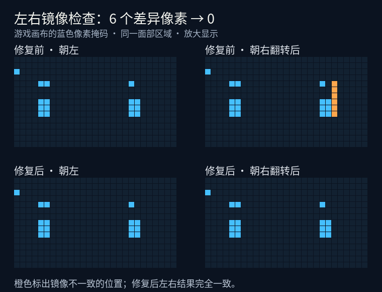
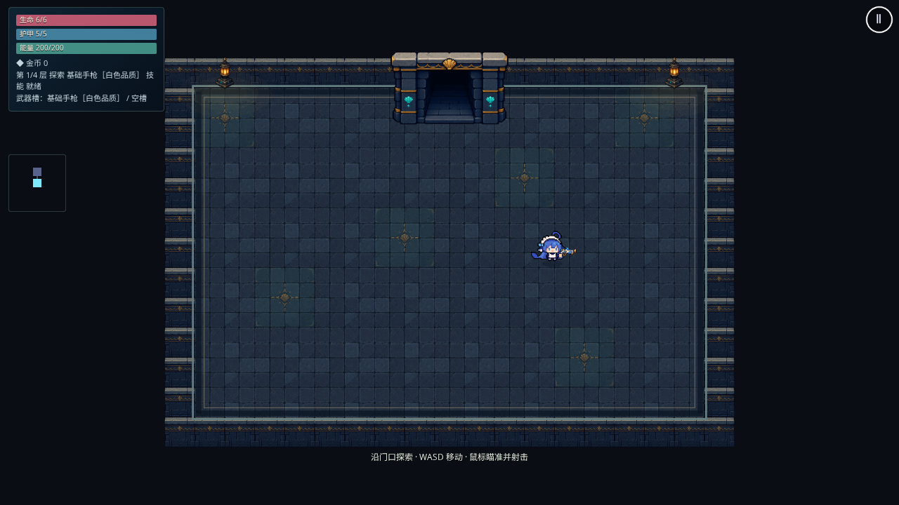

# 大肥鱼眼睛稳定性修复

基于已合并 #88 的 main `8088309`，分支 `gpt/stable-character-face`。

## 行为

- 6 帧待机、8 帧行走复用第一帧的脸部，双眼像素形状固定；待机摆尾与跑步腿部动作保留。
- 以固定脸部的同一源边对齐画布像素（未翻转左上角、翻转后右上角），避免不同裁切宽度或翻转改变眼睛的采样。
- 脸部以外仍显示对应动作帧，分片排除原脸，避免半透明状态重复绘制眼睛。
- 受击和死亡继续使用原图与原动作；角色大小、物理判定、装备、存档与主城空手规则不变。
- 原 PNG 字节保持不变，无新增运行资源。配置与理由见 [ADR 0027](../adr/0027-stable-character-face.md)。

## 验证方法

`face.spec.ts` 保留 WebGL 帧缓冲用于读取，运行真实动画与移动。逐帧提取游戏画布中的眼睛像素，要求左右朝向分别在全部待机/行走帧中一致，并检查同一帧在移动过程中也保持一致。检测同时要求眼睛有实际像素，不能用隐藏或空白贴图通过。

镜像补丁另要求朝右结果逐行反转后与朝左结果完全一致。基于 main `d4f014e` 先运行新增断言，旧实现失败：蓝色掩码有 6 个像素差异，朝右为 22 个、朝左为 16 个，其中一只眼睛多出一列；修复对齐方向后再次验证。

浏览器测试覆盖桌面与 Pixel 7 横屏 Chromium；iPhone 真机与 WebKit 仍待设备验收。远端自动 CI 保持禁用。

固定脸部初版验证：`npm run check` 全绿（42 个文件 / 304 单测、格式、ESLint、类型、生产构建）；浏览器回归 43 项通过、1 项平台条件跳过，无失败或重试。覆盖逐帧眼睛像素、四向握持、受击/死亡、主城/存档、Boss、离线与压测；四组压测显示对象数均保持 793，不随动画增长。PWA 仍预缓存 15 项，约 10.57 MiB。

镜像补丁验证：`npm run check` 全绿（304 单测）；桌面与 Pixel 7 横屏的脸部、角色美术、分辨率和主城回归 19 项通过、1 项平台跳过，无失败或重试。两个平台上朝左与朝右均为 16 个蓝色检测像素，镜像差异为 0。

下图按实际测试像素掩码绘制，橙色标出修复前多出的 6 个像素；它是检测结果的放大图，不是角色贴图。

更新后的游戏截图 Git blob SHA 为 `fafa6720b8cf3ab34fb5fe5e97d19edab1573146`（465,512 字节）；像素对比图为 `7c00c1aee40ba01dc6579c12dc5bf257fddb5635`（40,621 字节）。图片经文件通道上传并核对远端一致。

## 手动验收

合并发布后用 `?seed=42&god=1` 刷新到最新版本，先在主城观察待机摆尾，再左右行走并反复停步；进入地牢检查同样的动作、武器与受击/死亡。观察眼睛宽高是否固定、脸部是否与头发衔接、翻面时是否出现第二张脸。

