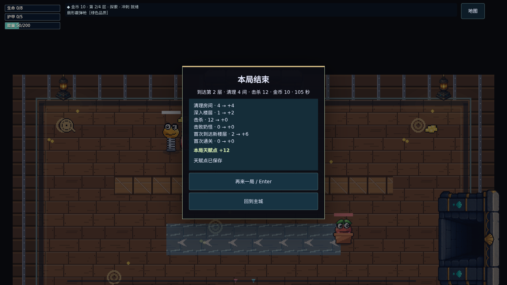

# #98 档案与结算接线

日期：2026-10-25。基于 #102 `aefda9a97b5cd471ce7a638a58de73dc7591fcb2`、#103 `7e88b1780a7a4cd2ce3a2630fe8a8f3ad13325ae`。本 PR 交付档案与结算运行时；祭台图片与天赋界面在后续叠加 PR 中。没有修改 Claude 分支，没有合并或开启远端 CI。

## 上游首轮精确 head 评审

| PR   | npm run check                                                | 独立检查                         | 相关 Chromium e2e                                         |
| ---- | ------------------------------------------------------------ | -------------------------------- | --------------------------------------------------------- |
| #102 | Prettier 在 `src/sim/meta/talents.ts` 失败                   | ESLint、类型、383 单测、构建通过 | smoke / hub / demo：25 通过、1 条件跳过                   |
| #103 | 同一 Prettier 问题；另有 checkpoint.test.ts 三个 unused-vars | 类型、388 单测、构建通过         | demo / save / resumeProduction / pwa：51 通过、1 条件跳过 |

问题已写入各 PR review。独立 GPT 分支带有对应格式与测试清理，便于本地完整检查；Claude 应在自己的分支收尾并提供新 head。

## 交叉评审后的增量复测（2026-10-25）

- #102 `24c0860969348082fae30979a386def1f5e2be2c`：完整 `npm run check` 通过，51 文件 / 383 单测。
- #103 `988dc5145981e505006158c48c76b2183c6e7be5`：完整 `npm run check` 通过，52 文件 / 388 单测。
- 两边 Prettier、ESLint、类型、Vite/PWA 构建均通过。已检查增量只包含等价循环改写与测试辅助函数清理，本轮没有重复两边的浏览器 e2e；首轮结果保留在上表。
- #104 采用这两个上游文件的完整版本：`src/sim/meta/talents.ts` 与 `tests/unit/sim/checkpoint.test.ts`。#103 尚未合并，当前未 rebase 或改 base；合并后仍须保留这两个文件的上游版本。
- 新开 `?weapon=` 冒险使用 debug- ID，移除查询参数后继续该冒险仍不发奖。击杀奖励中英文注明上限，数值从 `TALENT_RULES.killCap` 注入。
- #104 完整 `npm run check` 再次通过，53 文件 / 397 单测。增量 e2e：调试武器新局 → 保存 → 无参数续玩 → 终局不结算，以及正常奖励写盘失败 → 回主城一次重试和击杀上限文字，桌面 / Pixel 7 各一遍，4/4 通过（2 workers、0 retries）。

## 行为与边界

- 档案原文 I/O 仍在 services；game 调用纯 sim/meta 契约，未让 services 反向依赖 sim。
- 档案修复与重建先原文备份；备份失败或读取被禁用时拒绝覆盖。旧 v1 键只读保留。
- 购买、退款写盘成功才更新等级；以最新持久档案计算，不缓存过期余额。
- 终局 summarizeRun → settleRun → 同步写档案 → 清冒险。已结算遗留冒险在启动时丢弃。
- 写盘失败不展示成功，不重复执行结算回调；回主城或直接重开只重试一次。第二次失败放弃奖励。按设计稿清除终局冒险，页面关闭会丢失待重试的内存奖励。
- 新开冒险传入档案天赋；完整续玩不再加一次，入口兜底使用冻结开局天赋。出口四选一按钮已接通，fixture 用 offerCount 检查。
- 调试新局 `?god=1` / `?floor=` / `?weapon=` 不结算；普通固定种子可结算。恢复的冒险保留原 runId。

## 本地验证

`npm run check`：Prettier、ESLint、类型、53 文件 / 397 项单测、Vite 构建全通过。锁文件与依赖未改变；本地 Node 24.22.1 / npm 11.9.0，仓库 .nvmrc 仍为 Node 22。

单测增加备份失败保护、读取被禁用、连续购买、退款失败、一次重试、重复结算与写入顺序。本分支相关 e2e 10 项全部通过：死亡结算与重开、真实 Arcade 击败 Boss 后回主城、写入失败保留旧档、奖励一次重试、满级天赋四选一和完整通关，各在桌面与 Pixel 7 横屏运行一次。

浏览器：Chromium 153 软件渲染，桌面 + Pixel 7 横屏，2 workers、0 retries。未运行 WebKit，不代表 Safari 或 iPhone 真机性能已验收。

## 手动核对

1. 正常开始冒险，死亡或通关后核对六项奖励、合计和已保存状态。
2. 回主城后打开标题菜单，确认不能继续已经结束的冒险；普通暂停退出仍能继续。
3. 在开发工具中模拟档案 setItem 失败，核对未保存提示；恢复写入后回主城，奖励只补发一次。
4. 用已结算 runId 的旧入口模拟关页窗口，启动时应清除该冒险。

