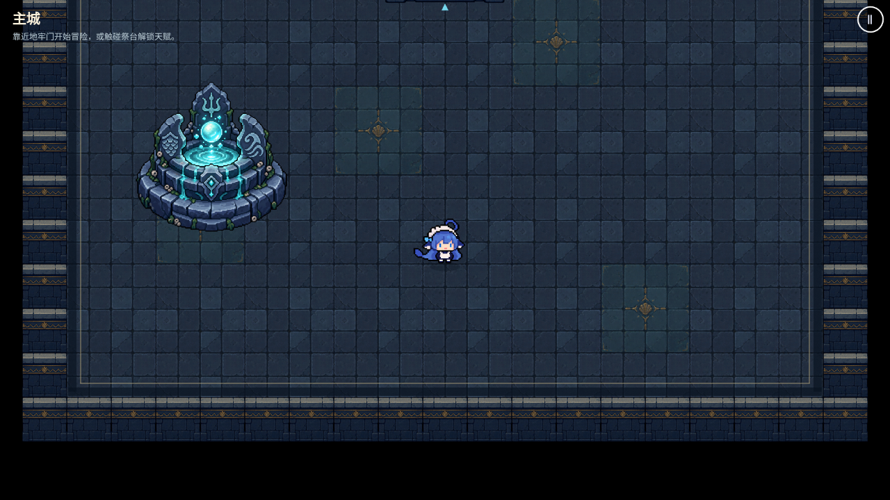
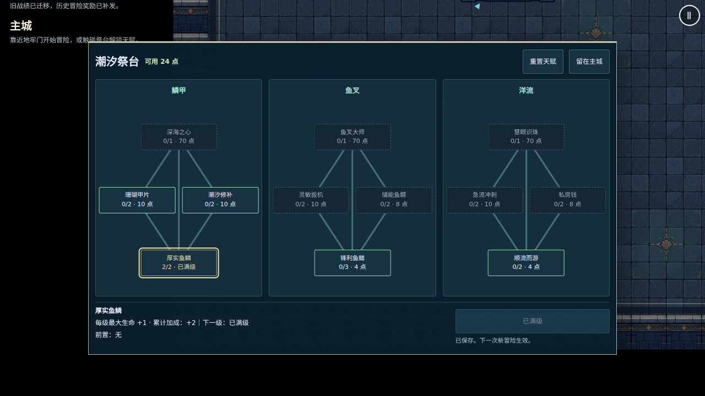
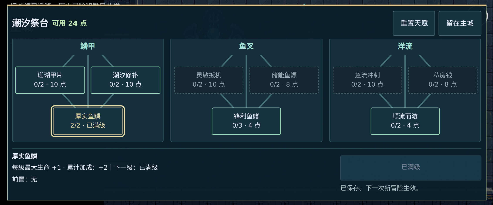

# #98 祭台与天赋界面验收记录

2026-10-25。基于 #102 / #103 契约与 #104 档案结算接线，当前仅推进 #98。#99–#101 未启动，所有 PR 由负责人合并。

## 交付

- 主城增加独立透明 PNG 潮汐祭台，靠近后点击按钮或使用交互键打开天赋树；地牢门、新冒险覆盖确认和旧冒险续玩保持原流程。
- 鳞甲、鱼叉、洋流三条分支、12 个数据驱动节点，显示等级、价格、前置和当前累计加成；解锁、满级、点数不足、前置锁定有不同状态。初版数值沿用 Claude 设计稿。
- 免费重置有二次确认。失败不改变已持久化等级；加点和重置只影响下一局，旧冒险继续使用冻结开局配置。
- 手机横屏树区可滚动，标题和操作区保留；支持真实左摇杆移动、点按、键盘 Tab/Esc 和手柄边沿导航。面板打开时独立暂停移动，关闭/场景退出清理监听。
- 独立静态贴图和固定 DOM 节点，不增加战斗逐帧特效分配。只有选择与购买时刷新天赋详情。
- AGENTS、ROADMAP、ARCHITECTURE 与 ADR 0035 已同步当前任务和主城功能；没有改变远端工作流。

## 本地验证

- 完整 `npm run check` 通过：Prettier、ESLint、类型、53 文件 / 397 单测、Vite 构建。
- 完整 Chromium 桌面 + Pixel 7 横屏套件首轮：180 通过、16 条件跳过、2 失败。两项失败均为同一个旧测试仍在结算“回主城”后查找标题页继续按钮；已改为先核对 Hub，再经暂停菜单查标题页，原 Boss 命中、胜利、清档断言保留。
- #104 单独重跑关键 e2e 10/10 通过。祭台末轮覆盖购买/退款/存储失败、满级天赋新局与两种续玩、损坏备份和结算去重、纯触屏操作、英文与手柄、真实死亡/Boss 结算及 PWA 断网重开，最终为 15 通过、1 条件跳过、0 失败（桌面跳过纯触屏用例）。
- 另有满级天赋四选一 → 换层 → 整局通关 fixture，桌面和手机均通过；`demoScenario` 不再写死 3 个候选。
- 初次新增英文手柄测试在切换语言重启 Menu 后又点开设置层，遮住开局按钮；现等待英文新菜单出现再进入主城，未改变产品行为。
- 所有浏览器批次使用 2 workers、0 retries，依次运行。Chromium 153 / SwiftShader 软件渲染；未运行 WebKit，不声称 Safari / iPhone 真机 FPS 达标。安装的 Noto CJK 字体仅用于本地截图，不进入游戏包或新增项目依赖。

缩图后的生产构建预缓存 20 项，11305.84 KiB（原为 12222.21 KiB）；PNG 单文件 276,649 字节，小于 Workbox 2 MiB 上限。PWA 离线测试显式请求祭台 PNG，验证 528×528 尺寸和小于 300 KiB 的文件预算；完整回归还覆盖更新提示、断网重开、双指开火、对象池、场景重开和存档。

## 文件通道验证

祭台通过已登录 GitHub 网页文件选择器上传实际文件，未使用编码上传；远端 Git blob SHA 与本地相同：

| 文件                                     |  字节数 | Git blob SHA                               |
| ---------------------------------------- | ------: | ------------------------------------------ |
| `public/assets/demo/talent-altar-v1.png` | 276,649 | `2006d1bcb6699c32213efab9c47441ce86500f9a` |

生成提示与来源见 [祭台资源记录](../../art-src/demo/talent-altar-prompt.md)。

## 交叉评审后的资源优化（2026-10-25）

- 负责人确认接受 imagegen 素材来源及缩图。原画保持构图，最近邻缩到 528×528；alpha 240–254 归一为 255，较低的透明边缘保留。原始文件在 Git 历史中，不重复进入离线包。
- 文件从 1,215,083 字节降到 276,649 字节（减少约 77.2%）；RGBA 解码数据从 6,290,064 字节降到 1,115,136 字节（减少约 82.3%，不含驱动和其他纹理开销），不能换算为真机 FPS 改善。
- 原尺寸主城/天赋树截图在下方作为界面布局记录。世界显示尺寸仍为 62×62，材质、碰撞和交互范围不变。
- AGENTS 的阶段句改为长期有效的逐项验收、合并与明确分配规则；当前 #98 / #99–#101 的实际排期仍由 ROADMAP 记录。手柄左右切换分支没有扩展到本轮。
- 同步 #104 的调试武器局奖励限制与击杀上限文字，以及两个文件的上游修法。完整 `npm run check` 通过（53 文件 / 397 单测）。
- 本轮相关 Chromium e2e：17 通过、1 条件跳过、0 失败，桌面和 Pixel 7 横屏，2 workers、0 retries。包含完整 `talents.spec.ts`、完整 `pwa.spec.ts`（离线缩图尺寸/预算、断网重开、连续更新）及两项结算增量测试；桌面跳过纯触屏用例。没有再次运行整个浏览器套件，也没有运行 WebKit。

## 手动验证

1. `?seed=42` 进入主城，走向左侧祭台，打开天赋树；未到祭台时不应出现交互按钮。
2. 完成一局获得点数，确认奖励明细与余额；解锁、连点购买、前置未满足、满级、余额不足及重置确认。
3. 购买后开新冒险，验证相应属性；暂停旧冒险后在主城加点，继续旧冒险应保持原开局属性。
4. 手机横屏滚动树区、点按购买与取消，关闭后重新推动摇杆才能移动；键盘与手柄分别检查确认不穿透。
5. 安装/缓存后断网重开主城，祭台图片和天赋界面仍可用。

