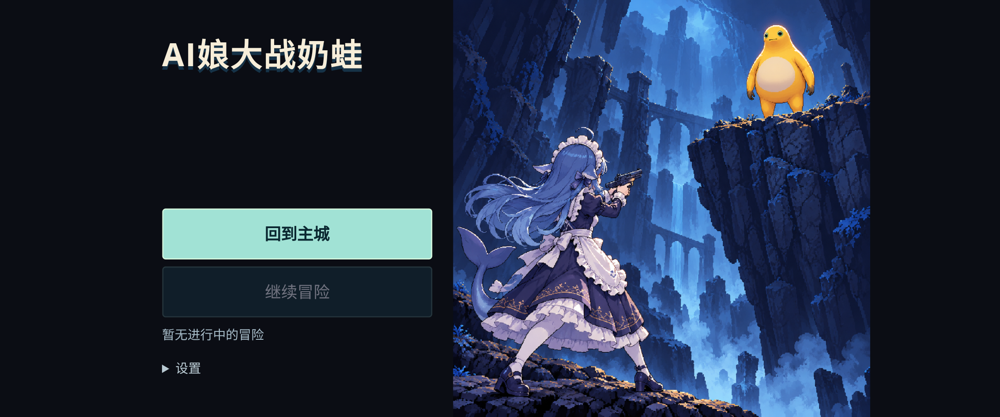
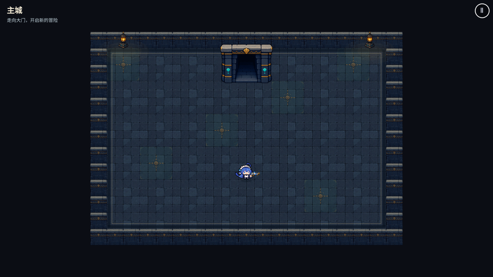
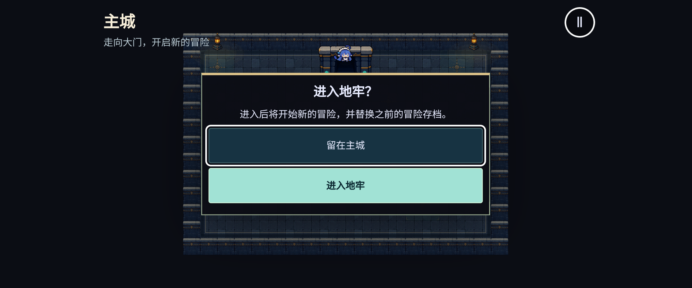

# 主城、开屏与武器品质验收

基于 main `6dab22d`（已包含手机负数触点开火修复），分支 `gpt/lobby-title-rarity`。合并前正式网页仍运行 main。

## 行为

- 开屏左上“AI娘大战奶蛙”，左下“回到主城 / 继续冒险”；没有有效存档时继续按钮禁用。设置保留在展开项内。
- 回到主城始终进入独立大厅，不恢复或覆盖旧冒险。大厅没有敌人、掉落与其他可交互设施；走近唯一的门后，用 E、手柄 A 或手机按钮打开确认。
- 取消、暂停退出、切后台均保留旧档。只有选择“进入地牢”才创建新冒险并按既有规则替换存档。
- 继续冒险沿用存档 v2：同构建完整恢复，旧构建按原规则恢复本层入口并显示提示。
- 十二把武器的内置 `rarity` 均有实际分级，HUD、装备与掉落提示显示品质。字段沿用 schema 中的白、绿、蓝、紫、橙、红，不新增重复字段；当前没有红色武器。品质不额外改变战斗数值与掉率。

## 插画与上传

`title-confrontation-v1.webp` 1254×1254，1,713,198 字节（1.63 MiB），与负责人附件 PNG 的解码像素逐字节相同；删除旧 `title.png`，Workbox 增加 WebP。

图片通过 GitHub 网页文件选择器按路径上传，提交 `28e08d5438a179e1752f8676317d8dfddd7870e4`；未把图片编码传给 Create Blob。远端与本地 Git blob SHA 均为 `45becc9f8b67ec92d20c63e19615af0ceeaba754`。后续上传遵循 [资源上传说明](../ASSET_UPLOADS.md) 和 AGENTS 硬规则。

## 验证范围

- `npm run check`：格式、ESLint、类型、42 文件 / 303 单测、生产构建通过。
- PWA 预缓存 15 项，总计约 10.56 MiB；单张新插画低于 2 MiB。
- 浏览器使用独立安装的 Chromium 153，生产构建覆盖桌面与 Pixel 7 横屏。测试浏览器与配置位于工作区，未给项目添加依赖。
- 全量浏览器回归共 166 项：151 项首次通过、1 项重试通过、14 项按平台条件跳过，最终失败为 0。覆盖大厅进出/取消/存档保护、手柄确认、手机双指与负数触点开火、新图断网刷新及离线重开。
- 桌面战斗流程首次出现脚本 MIME 类型错误，重试通过；全量运行期间另一轮构建有重叠，推测与构建产物临时替换有关。停止并行构建后，该用例又单独运行一次（禁用重试）并通过，未将此项记为首次稳定通过。
- 旧美术测试改为比较实际载入图像的 SHA-256，兼容 Phaser XHR 创建 `blob:` URL；受击测试使用符合楼层/升级数量约束的入口存档。
- 自动远端 CI 保持禁用，不重启或重跑。iPhone/WebKit 与手机真机手感、发热和长时间性能仍需实际设备验收。

## 手动试玩

合并并完成 Pages 发布后，打开 `?seed=42&god=1`，通过更新提示刷新缓存。

1. 检查首页标题、两个按钮和右侧完整插画。没有旧档时继续冒险应为灰色。
2. 点回到主城，用 WASD 或左摇杆走到上方门口，交互后先取消，再确认进入。
3. 地牢中移动、开火，暂停返回菜单。点继续冒险检查保存位置；再回主城，取消门口确认并返回菜单，旧档仍可续玩。
4. 在门口确认进入新地牢，检查旧冒险被新局替换。
5. `?weapon=sniper_pierce` 进门后检查紫色品质；`?weapon=heavy_cannon` 检查橙色品质。手机右轮盘持续开火与双指移动应保持正常。
6. 首次联网等离线缓存完成后断网，刷新首页并经大厅进入地牢，确认新插画、门、角色和武器正常显示。
