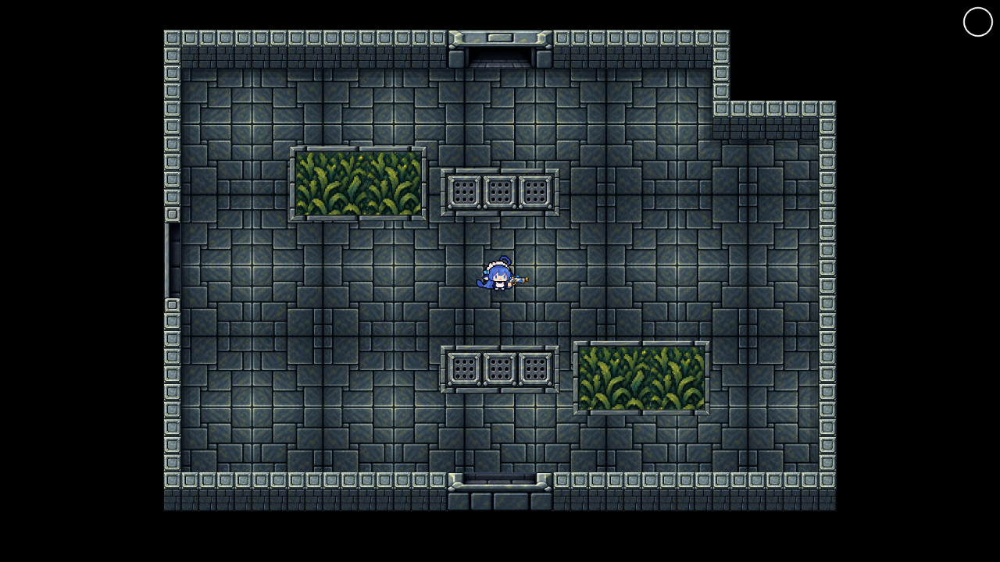
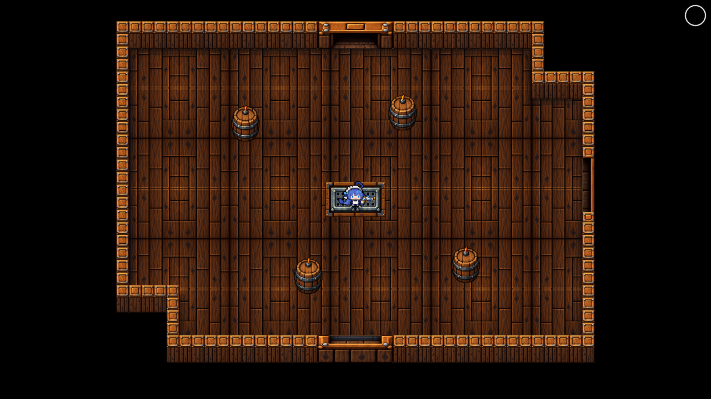
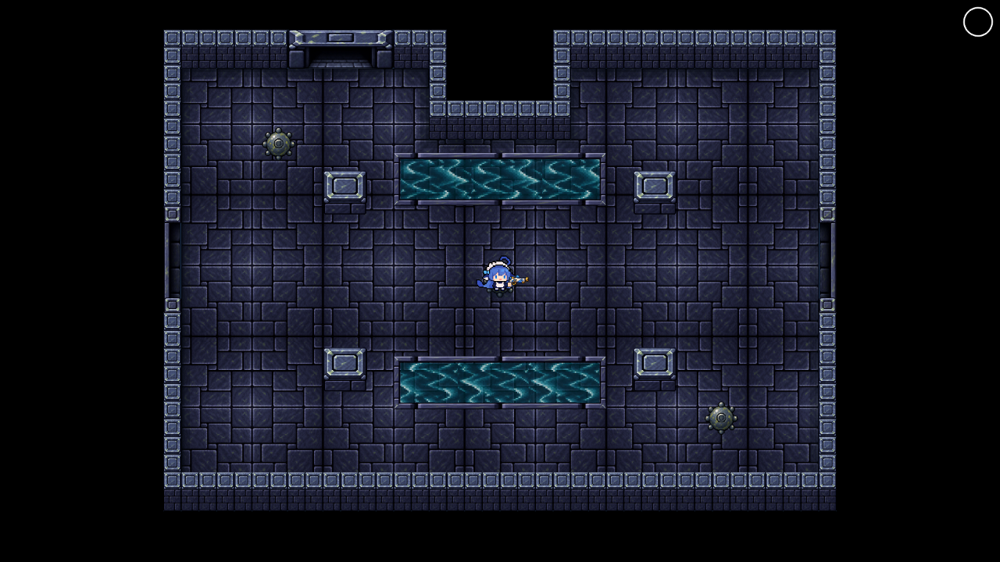
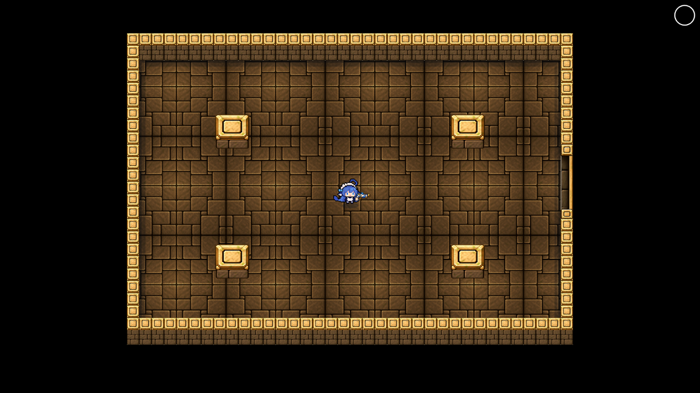

# v3 游戏实景索引

使用当前 Phaser 生产素材与 DemoSession/RoomArena 截图，未补画或改图。整房和门/障碍近景由测试夹具调整拍摄位置及倍率，正式游戏镜头不变；“正常游戏”和“横屏密集”采用对应项目视口。边框图是专门的接缝夹具。机器结果和限制见 [验证说明](../unified-map-art.md)，文件摘要见 [screenshots.json](screenshots.json)。

## 四主题整房

| 石殿                     | 沉船                    |
| ------------------------ | ----------------------- |
|  |  |

| 深渊                    | 奶池                   |
| ----------------------- | ---------------------- |
|  |  |

## 四向门与其他检查

门的横向宽度、纵向高度均为六个完整墙体模块；下表链接为原始截图。

| 主题 | 门连接                                                                                                                           | 其他画面                                                                                                                                                    |
| ---- | -------------------------------------------------------------------------------------------------------------------------------- | ----------------------------------------------------------------------------------------------------------------------------------------------------------- |
| 石殿 | [上](temple-north.png) · [下](temple-south.png) · [左](temple-west.png) · [右](temple-east.png) · [锁门](temple-side-locked.png) | [正常游戏](temple-production.png) · [转角](temple-corner.png) · [障碍](temple-obstacle.png) · [横屏密集](temple-dense-mobile.png) · [边框](temple-rims.png) |
| 沉船 | [上](wreck-north.png) · [下](wreck-south.png) · [左](wreck-west.png) · [右](wreck-east.png) · [锁门](wreck-side-locked.png)      | [正常游戏](wreck-production.png) · [转角](wreck-corner.png) · [障碍](wreck-obstacle.png) · [横屏密集](wreck-dense-mobile.png) · [边框](wreck-rims.png)      |
| 深渊 | [上](abyss-north.png) · [下](abyss-south.png) · [左](abyss-west.png) · [右](abyss-east.png) · [锁门](abyss-side-locked.png)      | [正常游戏](abyss-production.png) · [转角](abyss-corner.png) · [障碍](abyss-obstacle.png) · [横屏密集](abyss-dense-mobile.png) · [边框](abyss-rims.png)      |
| 奶池 | [上](milk-north.png) · [下](milk-south.png) · [左](milk-west.png) · [右](milk-east.png) · [锁门](milk-side-locked.png)           | [正常游戏](milk-production.png) · [转角](milk-corner.png) · [障碍](milk-obstacle.png) · [横屏密集](milk-dense-mobile.png) · [边框](milk-rims.png)           |

## 机关与交互物

| 主题 | 闲置                          | 预警                          | 激活                        | 破坏状态                        |
| ---- | ----------------------------- | ----------------------------- | --------------------------- | ------------------------------- |
| 石殿 | [查看](temple-traps-idle.png) | [查看](temple-traps-warn.png) | [查看](temple-traps-on.png) | [查看](temple-traps-broken.png) |
| 沉船 | [查看](wreck-traps-idle.png)  | [查看](wreck-traps-warn.png)  | [查看](wreck-traps-on.png)  | [查看](wreck-traps-broken.png)  |
| 深渊 | [查看](abyss-traps-idle.png)  | [查看](abyss-traps-warn.png)  | [查看](abyss-traps-on.png)  | [查看](abyss-traps-broken.png)  |

机关按本房实际存在的类型展示。状态由夹具设置后经过真实 TrapLayer 绘制，不能解读为水流/海草也有四种新玩法状态。奶池 Boss 房没有这些普通机关，独立边框素材仍包含奶池主题。

[主城祭台](hub.png) · [宝箱与三类补给](chest.png) · [出口与三类补给](exit.png)

以上仅为实景证据；新画面仍待负责人认可，按要求暂停 Claude 复审。
