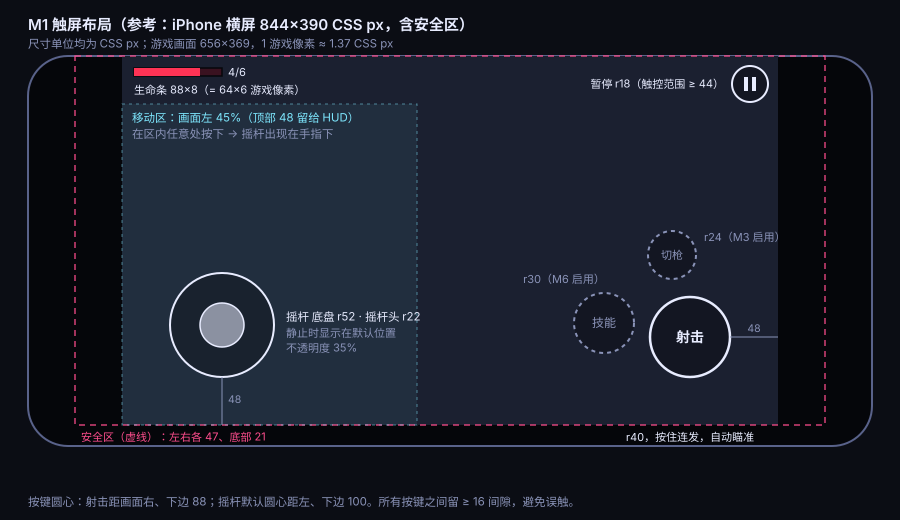

# M1 画面方案：镜头、触屏布局、HUD、打击感

- 状态：提议（Claude 起草，已按 GPT 工程评审修订，待负责人确认）
- 关联：Issue #11；实现见 #12（触屏控件）、#15（镜头与流程）、#16（打击感与 HUD）
- 参照：元气骑士的骑士 + 初始手枪

目标只有一个：**移动跟手、开枪有回馈、挨打看得清**。M1 全部用占位图，所以这里定的是节奏、位置和强度，不定美术风格；换成正式美术后，这些参数照样适用。

## 1. 画面与镜头

- 内部分辨率 480×270，整数像素渲染（`pixelArt`、`roundPixels` 已开启），镜头位置每帧取整，避免像素抖动。
- **房间比画面小**（M1 的灰盒房间 304×208）：镜头固定在房间中心，不跟随。
- **房间比画面大**（M2 起）：镜头跟随玩家。
  - 平滑：每帧按 `1 - exp(-12 × dt)` 的比例靠近目标点，约 0.25 秒追上，与帧率无关。
  - 死区：画面中心 24×16 游戏像素内移动时，镜头不动，减少小幅走位带来的晃动。
  - 前瞻：镜头目标点向瞄准方向偏移 24 像素（没有瞄准方向时，向移动方向偏移 12 像素），让玩家看到更多前方。
  - 边界：镜头不越出房间边缘外 32 像素。
- 房间以外的区域填背景色 `#0b0d14`。

## 2. 绘制层级

| 层级（depth） | 内容                           | 说明                                         |
| ------------- | ------------------------------ | -------------------------------------------- |
| 0             | 地面瓦片                       |                                              |
| 10            | 地面贴花：刷怪预警圈、尸体残迹 |                                              |
| 20            | 影子                           | M5 正式美术时加入                            |
| 25            | 室内障碍、完整/受击桶          | #135：始终低于人物和怪物，桶内部仍按 y 排序  |
| 30            | 角色与怪物                     | 按脚底 y 坐标排序：depth = 30 + y / 10000    |
| 40            | 玩家子弹                       |                                              |
| 41            | 敌方子弹                       | 永远盖在玩家子弹上面，保证最危险的东西最显眼 |
| 50            | 特效：火花、枪口火光、碎片     |                                              |
| 60            | 墙体顶面                       | M2 起，用来遮住走到北墙后面的角色            |
| 90            | 全屏反馈：受伤红边、死亡压暗   | 固定在屏幕上，不随镜头移动                   |
| 100           | HUD                            | 固定在屏幕上                                 |
| 110           | 触屏控件                       | 固定在屏幕上                                 |

历史表中的墙顶 60 不代表当前模块墙的实际层级：模块外墙仍烘焙在地面画布中。#134 的阴影遮挡规则单独待做，本次 #135 不更改它。

这些层级定义在 `src/config.ts` 的 `DEPTH` 常量里（随 ADR 0002 加入），代码里不直接写数字。

## 3. 触屏布局

**尺寸用 CSS px 定义**（即手指实际触到的大小），运行时按画面缩放比例换算成游戏像素，所以在不同尺寸的手机上，按键的物理大小基本一致。位置相对游戏画面的边缘计算，游戏画面本身已经避开安全区。

| 控件   | 位置（圆心）                   | 尺寸             | 行为                                                                   |
| ------ | ------------------------------ | ---------------- | ---------------------------------------------------------------------- |
| 移动区 | 画面左侧 45%，顶部 48 留给 HUD | —                | 在区内任意处按下，摇杆出现在手指下                                     |
| 摇杆   | 默认距左、下边 100             | 底盘 r52、头 r22 | 死区为半径的 12%；手指拖出底盘时，底盘跟着手指移动；松手后回到默认位置 |
| 射击键 | 距右、下边 88                  | r40              | 按住连发，瞄准交给自动瞄准；没有目标时朝最后的移动方向开火             |
| 技能键 | 射击键左侧偏上                 | r30              | M1 不显示，位置预留（M6 启用）                                         |
| 切枪键 | 射击键上方偏左                 | r24              | M1 不显示，位置预留（M3 启用）                                         |
| 暂停键 | 距右、上边 28                  | r18，触控 ≥ 44   | 点按进入暂停，再点或点「继续」恢复，见 3.2                             |

- 外观：白色 2 px 描边，填充黑色、不透明度 30%。摇杆静止时整体不透明度 35%，按下后 80%。
- 按下反馈：填充改为 `#7ee8ff`、不透明度 35%，按键缩放到 0.94，持续 60 ms。
- 按键之间至少留 16 px 间隙；每个按键的触控范围不小于 44×44 px。
- PWA 的「有新版本」提示目前在右上角，会盖住暂停键。请把它下移到暂停键下方（顶部 + 56 px），由 #12 顺手改 `index.html`；以实际画布顶部和暂停键的触控范围复核，不要只按视口高度推算。

### 3.1 换算与实现细则

- **缩放比例**：`scale = 画布的 CSS 宽度 ÷ 480`，取自画布实际的 `getBoundingClientRect()`。CSS 尺寸 ÷ scale 得到游戏像素；指针坐标先减去画布的 left / top，再除以 scale。**不要再乘 devicePixelRatio，也不要再减一次安全区**（`#game` 容器已经避开安全区）。在 resize、方向变化、可视区域变化时重新计算。
- **换算示例**（以示意图的 656×369 画面为例，scale = 656 ÷ 480 ≈ 1.367；运行时一律用实际 scale）：

| 项目                 | CSS px        | 游戏像素                |
| -------------------- | ------------- | ----------------------- |
| 射击键半径 / 圆心    | r40 / 距边 88 | r29.3 /（415.6, 205.6） |
| 摇杆底盘、摇杆头半径 | r52、r22      | r38.0、r16.1            |
| 摇杆默认圆心         | 距边 100      | （73.2, 196.8）         |
| 技能键、切枪键半径   | r30、r24      | r22.0、r17.6            |
| 暂停键半径 / 圆心    | r18 / 距边 28 | r13.2 /（459.5, 20.5）  |
| 最小触控范围         | 44            | 32.2                    |
| 顶部 HUD 留白        | 48            | 35.1                    |

- **摇杆活动范围**：摇杆底盘的圆心限制在「移动区内缩一个底盘半径」的矩形里，底盘始终完整地留在移动区内，不会被手指带进安全区或 HUD；在移动区外按下的手指不会生成摇杆。
- **多指**：摇杆、射击、暂停各自记住按下它的那根手指的 pointer ID，只响应这根手指，不读取 `activePointer`。现有 `activePointers: 3` 足够。在手指抬起、抬起位置在画布外（`pointerupoutside`）、触摸被系统取消、切后台、方向变化时，都要释放这根手指：摇杆归位、射击松开，恢复后不能残留移动或开火。如果改用原生 Pointer Events，还要处理 `pointercancel` 与 `lostpointercapture`（方向改变会取消指针流）。画布保持 `touch-action: none`。
- **UI 场景**：控件与 HUD 放在独立的 UI 场景，排在战斗场景之上（场景顺序决定跨场景的叠放，depth 只在场景内部生效）。被控件处理过的触摸不再传给战斗场景。UI 场景的相机固定，不受震屏和镜头移动影响。
- iOS Safari 与 Android Chrome 都要真机测试多指；桌面浏览器的触摸模拟不能代替真机。

### 3.2 暂停

采用「**只暂停战斗场景**」：

- 点暂停键、按 Esc 或手柄 Start：只暂停战斗场景（物理、计时器、tween 都停）。UI 场景照常运行，显示 60% 不透明度的深色遮罩和「继续」按钮（r40，居中）。
- 恢复：点「继续」、再点暂停键、按 Esc 或手柄 Start。
- 进入暂停时清空 InputFrame，并释放所有被持有的手指；恢复后要重新按下才会移动或开火。
- 恢复战斗场景时，同步该场景 TweenManager 的时基（与 `bindLifecycle.ts` 相同的做法），避免 tween 补跑约 33 ms。
- 自动暂停（触屏竖屏、切后台）仍由生命周期模块停掉整个循环，它不会改动手动暂停的状态：在暂停界面切到后台再回来，仍然停在暂停界面。
- 暂停菜单**不使用** `LifecycleService.setManualPaused`：它会停掉整个循环和全部输入，UI 场景也会跟着停住，「继续」按钮就无法响应。

## 4. 桌面与手柄

- 鼠标：在画布上隐藏系统光标，改画一个 7×7 游戏像素的十字准星（白色，1 像素黑边），固定在最上层。
- 鼠标瞄准时角色朝向跟随准星；键盘移动 + 鼠标瞄准是桌面的默认方式。
- 手柄：右摇杆推出死区才算手动瞄准，否则使用自动瞄准。不显示准星。
- 桌面窗口变成竖长时不暂停，上下留黑边（#19）。

## 5. HUD（M1 只有生命值）

- 位置：画面左上角，距边缘 8 游戏像素。
- 生命条：64×6 游戏像素，1 像素深色描边；填充 `#ff3355`，底色 `#3a1220`；右侧显示「当前 / 上限」，8 px 字。
- 掉血动画：先立即缩到新长度，同时在被扣掉的那一段显示白色残段，300 ms 后用 150 ms 缩回（玩家能看清自己刚掉了多少）。
- 生命 ≤ 2 时，生命条以 0.8 秒为周期在 100% 与 60% 不透明度之间闪动。
- M3 起在生命条下方依次加入护甲条（灰色）与能量条（蓝色），间距 3 像素，现在不占位。

## 6. 打击感与反馈

所有时长以毫秒计，强度以游戏像素计。**特效只订阅事件（ADR 0002），不读取、不修改战斗状态。**

| 时机         | 事件                                                       | 效果                                                                                                                                                                                       |
| ------------ | ---------------------------------------------------------- | ------------------------------------------------------------------------------------------------------------------------------------------------------------------------------------------ |
| 玩家开火     | `weapon:fired`                                             | 枪口火光：4×4 白黄方块，50 ms；角色贴图向开火反方向后坐 1 像素，60 ms 回位                                                                                                                 |
| 子弹飞行     | —                                                          | 玩家子弹用自带拖尾的贴图：本体 4×4，后方 6 像素渐隐拖尾（不透明度 0.6 → 0），按飞行方向旋转；不额外创建残影对象。敌方子弹不加拖尾，圆形更容易判断位置                                      |
| 子弹打中怪物 | `bullet:hit`                                               | 火花 4 颗：寿命 120–180 ms，速度 40–80 像素/秒，朝子弹来向的反方向 70° 扇形散开。命中无敌目标时同样播放                                                                                    |
| 子弹打中墙   | `bullet:hit`                                               | 火花 3 颗，灰白色，其余同上                                                                                                                                                                |
| 怪物受伤     | `entity:damaged`                                           | 整体闪白 60 ms；击退距离由武器 `knockback` 决定（sim 处理位移）                                                                                                                            |
| 暴击         | `bullet:hit`（`critical`）、`entity:damaged`（`critical`） | 火花由 `bullet:hit` 产生：数量与尺寸 ×2、改为黄色，**代替**普通火花；震屏 2 像素、80 ms 由 `entity:damaged` 触发                                                                           |
| 怪物死亡     | `entity:died`                                              | 压扁到 1.3×0.6 持续 80 ms，然后碎成 6 颗绿色碎片；地上留一块残迹，1.5 秒内淡出；震屏 1.5 像素、80 ms                                                                                       |
| 怪物出场     | `entity:spawned` → `entity:activated`                      | `spawned` 时出现地面红圈：半径为怪物半径 + 4，在 payload 的 `telegraph` 秒内从 2 倍大小缩到 1 倍，同时以 200 ms 周期闪动。`activated` 时移除红圈，怪物在 80 ms 内从 0 放大到 1（回弹缓动） |
| 玩家受伤     | `entity:damaged`                                           | 闪白 50 ms；震屏 3 像素、150 ms；屏幕四周红边，不透明度 0.35，250 ms 淡出                                                                                                                  |
| 玩家无敌帧   | —                                                          | 在无敌时长内，每 60 ms 在 100% 与 30% 不透明度之间切换                                                                                                                                     |
| 玩家死亡     | `entity:died`                                              | 角色闪白后倒下（旋转 90°，200 ms）；画面在 600 ms 内压暗到 60%；`BALANCE.deathRestartDelay` 后出现「失败了」和「点击 / 按任意键重来」                                                      |

- **不做顿帧**（命中瞬间整体停顿），也不显示伤害数字：元气骑士的初始手感里都没有。参数位置预留，试玩后觉得不够爽再开。
- 震屏只作用于战斗场景的相机，自己实现，不用 Phaser 自带的 shake（原因见第 8 节「视觉随机」）。x、y 方向各自按像素定义幅度，随时长线性衰减，偏移取整到像素；多次震动不叠加，取当前最强的一次。

## 7. 颜色

| 用途             | 颜色      |
| ---------------- | --------- |
| 背景             | `#0b0d14` |
| 玩家子弹         | `#fff3a0` |
| 敌方子弹         | `#ff4d8d` |
| 命中闪白         | `#ffffff` |
| 刷怪预警         | `#ff4d6d` |
| 生命条           | `#ff3355` |
| 受伤红边         | `#ff3355` |
| 控件按下、强调色 | `#7ee8ff` |

敌方子弹统一用偏红、紫的颜色，任何地板上都要一眼可见（`docs/ART_GUIDE.md`）。

## 8. 给实现方的约束（GPT 做工程与性能检查的依据）

### 8.1 特效预算（共 100，与 `POOL_SIZES.fx` 一致）

| 类别             | 数量 | 达到上限时                                |
| ---------------- | ---- | ----------------------------------------- |
| 出场预警圈       | 32   | 不丢弃：它是玩法信息；M1 同屏最多 30 只怪 |
| 命中火花（普通） | 24   | 丢弃本次发射                              |
| 命中火花（暴击） | 8    | 丢弃本次发射                              |
| 打墙火花         | 8    | 丢弃本次发射                              |
| 死亡碎片         | 16   | 丢弃本次发射                              |
| 枪口火光         | 4    | 复用最旧的一个（环形队列）                |
| 地面残迹         | 8    | 复用最旧的一个（环形队列）                |
| 合计             | 100  |                                           |

- 子弹拖尾画在子弹贴图里，不占预算；全屏红边与死亡压暗各 1 个固定对象，属于全屏反馈层，不计入。
- 每类有独立额度，一类用满不会挤占另一类：火花再多，也不会让预警圈或死亡碎片消失。额度按「预警圈 > 死亡碎片 > 命中火花 > 打墙火花」的重要程度分配。「丢弃本次发射」就是发射器到达上限后什么都不做，所以不需要回收最旧粒子（Phaser 4.1 没有可以直接用的 `killOldest`）。
- 粒子：每类一个发射器，场景初始化时预先建好粒子。**Phaser 4.1 的写法**：`reserve(n)`，`maxAliveParticles: n`，`maxParticles` 保持 0。如果写成 `maxParticles: n`，它会把已死亡与存活的粒子一起算进硬上限，预留之后就再也发射不出来（GPT 实测）。
- 发射时不新建发射器、tween、配置对象或回调闭包；颜色、纹理、混合模式尽量共用，减少发射器数量。100 的上限不等于 draw call ≤ 30，帧率结论以 #18 的真机压测为准。

### 8.2 视觉随机

- 视觉随机使用独立的 `fxRng = runRng.fork('fx')`。`fork` 不推进战斗用的随机流，所以特效多播或少播都不会改变战斗结果，同一种子仍然可以复现。
- 粒子的速度、角度、寿命通过 `onEmit` 回调从 `fxRng` 取值；回调在初始化时建好并复用。**不使用** Phaser 粒子配置里的随机区间或随机数组，它们内部调用 `Math.random`。
- 震屏自己实现（见第 6 节），每帧从 `fxRng` 取 x、y 偏移。Phaser 自带的 shake 内部也调用 `Math.random`。
- 不替换全局 `Math.random`。这样不需要为视觉效果开规则例外。

### 8.3 其他

- 控件与 HUD 放在独立的 UI 场景，见 3.1。
- 所有参数集中放在 `src/game/fx/params.ts`，按本文的小节分组并注明单位，方便负责人试玩后直接调。
- 预留两个开关：「屏幕震动」「受伤闪烁」，默认开启，M4 接入设置界面。

## 9. 请负责人确认

1. 整体方案是否可以按此实现？
2. **震屏强度**：默认取上表数值（偏克制，接近元气骑士）。如果你想要更「爽」的感觉，我建议把玩家受伤改为 4 像素、怪物死亡改为 2 像素。
3. **伤害数字**：默认不显示。如果你希望显示，我会补一版样式（白色像素字，向上飘 12 像素，400 ms 淡出，暴击为黄色并放大）。
4. **子弹拖尾**（修订新增）：原方案每颗子弹 2 个残影，400 发子弹就要 800 个对象，超出预算。改为子弹贴图自带 6 像素渐隐拖尾，看起来接近，性能开销几乎为零。敌方子弹不加拖尾。
5. **暂停方式**（修订新增）：点暂停后，画面压暗并显示「继续」按钮，战斗完全停住。
